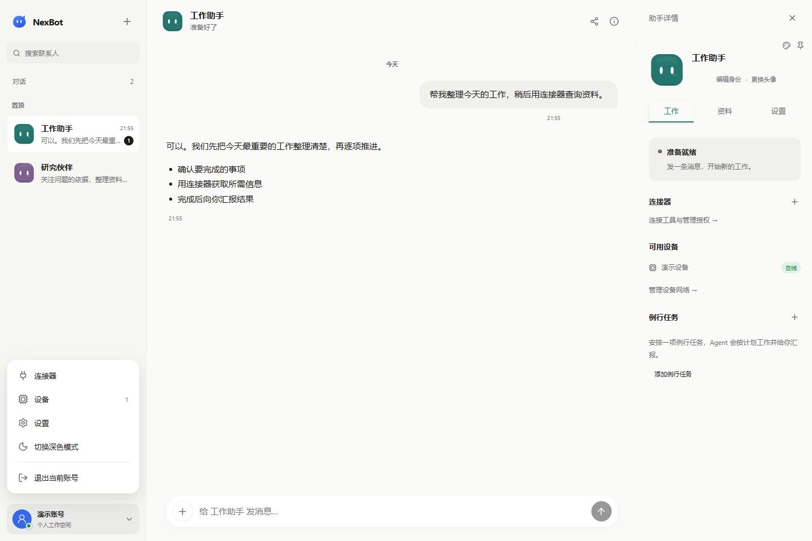

# NexBot

把 AI 助手放进你的日常工作。为不同事情创建专属助手，在电脑和手机上继续对话，让助手处理文件、调用工具，并按计划完成例行任务。

[打开网页版](https://bot.nexorai.com.cn) · [注册账号](https://user.nexorai.com.cn/register/nexbot) · [查看版本发布](https://github.com/DarrenHoo-10/nex_bot/releases)

## 可以用 NexBot 做什么

- **创建专属助手**：给助手起名字、设置身份和职责，分别处理写作、研究、工作整理等事情。
- **继续之前的工作**：每个助手保留自己的对话记录，用同一账号在不同设备上接着聊。
- **上传文件**：通过输入框的「＋ → 文件」添加材料，让助手阅读、总结或协助处理。
- **操作电脑**：Windows 和 Mac 客户端登录后自动连接本机，助手可在任务中读取文件、运行命令和保存结果；Windows 还支持操作窗口。
- **接手电脑上的编程 Agent**：在网页和 Windows 客户端左上角切换到 NexAgent（Android、Mac 和 iPhone 在「Agent 会话」入口），按电脑和 Agent 查看 Claude Code、Codex 会话，实时操作终端、继续已停止的会话、处理审批，也可以交给助手接着做。电脑端需要 Windows 或 Mac 客户端保持登录。
- **连接工具**：在设置中添加 MCP 连接器，为助手配置可用工具。
- **交给后台**：长任务在后台执行，主对话可以继续聊天；完成、需要你回答或无法继续时回到对话汇报。
- **安排例行任务**：设置重复执行的工作，在对话里查看结果。
- **管理待办**：按日、周、月安排事项，自己推进或交给助手执行，完成后确认验收。
- **选择模型**：连接自己的模型服务，获取可用模型列表，调整上下文窗口和最大输出。

## 选择使用方式

| 方式 | 适合什么场景 | 当前状态 |
| --- | --- | --- |
| Windows EXE | 日常对话、完整设置，以及让助手操作这台电脑 | x64 桌面客户端，安装版 |
| Mac 应用 | 原生 macOS 客户端：对话、完整设置，以及让助手读取文件、运行命令 | Apple Silicon，macOS 14 及以上，DMG 测试版 |
| iPhone 应用 | 原生 iOS 客户端：对话、附件、审批与设置 | iOS 17 及以上，未签名 IPA，需用 AltStore 重签（每 7 天续签） |
| Android APK | 随时查看消息、发送任务、上传文件和处理审批 | Android 8.0 及以上，测试版 |
| 网页版 | 不安装应用，直接开始对话和管理助手 | 浏览器访问即可 |

Android 与 Windows 共用账号设置、模型、记忆服务、连接器、设备和助手管理界面。Mac 应用暂不支持操作窗口。iPhone 和 Android 客户端不会控制手机；通过手机或网页向助手安排电脑任务时，目标电脑需要保持 NexBot 登录、在线且未暂停控制。

## 下载与安装

飞书可以接入多个应用，每个机器人对应一个助手；连接器里点开应用，可以为每个群设置触发方式（必须 @、话题内免 @、默认应答、全部回复）、会话方式（群聊共享话题独立、整群一个会话、每次 @ 开新话题）和只对该群生效的系统上下文。飞书里的话题对应 NexBot 话题，网页上接收飞书的助手会像金融助手一样显示话题卡片。网页和 Windows 的左上角可切换 NexBot / NexAgent，NexAgent 按电脑 → 项目 → 会话整理 Claude Code、Codex、ZCode 和 Antigravity CLI 会话。NexAgent 的项目可拖动排序（新项目排在最前），时钟按钮按时间列出全部会话，放大镜可按标题和会话内容搜索；输入框可选模型和推理强度，支持粘贴图片；发往 Claude 桌面端或终端会话（含跳过权限模式）的消息由该电脑上的客户端送达。模型菜单列出所选运行工具在这台电脑上可用的模型；新建会话直接在右侧的输入框里写第一条消息，上方可浏览或新建目录、选运行工具和工作树，提交后会话立即出现；侧栏置顶「进行中」，输入框在圆环左侧显示当前模型，圆环按会话实际使用的模型以 K / M 显示上下文用量，历史记录可一直往前翻，新建会话勾选 Worktree 即在新的工作树里运行。NexAgent 可在「设置 → 模型 → 翻译服务」选择已连接的模型，异步翻译已完成的英文回复。Jev 判定超时或不可用时，继续按本地规则筛选。助手设置中的长 Token 用量显示为 4.2M 一类的简写。NexAgent 回复可复制或从该处创建私人聊天分支，选区菜单支持复制，后台任务显示简称。发送的消息立即显示，发出 30 秒内且未被回应的消息可编辑后重发；模型调用失败时居中提示原因。Claude、Codex 需要确认或提问时，各端在消息流下方显示悬浮毛玻璃动作岛，支持一键允许、本会话总是允许、拒绝以及单选/多选与「其他」自定义输入，工具调用以无框时间轴展示；新建会话默认完全访问，也可切换为「每次询问」。Windows 客户端关闭窗口默认最小化到系统托盘，可在托盘菜单恢复窗口、暂停/恢复本机控制或彻底退出。当前发布的客户端为 Windows 0.9.62、Android 0.2.60 和 Mac / iOS 0.2.54。每个工作区都有一个金融助手，在 NexBot 或已连接的 `nex_stock` 中新建对话，会在同一个助手下生成独立话题。

在 NexAgent 的「运行工具」选择 Antigravity CLI，即可在已登录 AGY 的 Windows 或 Mac 电脑上新建会话。需要 Antigravity CLI 1.5.15 或更新版本。可续接已退出的本机 CLI 会话、按内容搜索 AGY 会话，也可在有终端组件的电脑上打开这段会话。

NexAgent 新建会话时，输入框上方依次是项目、运行工具和会话选项；会话选项里可开 Worktree、改分支名，并按所选运行工具选择权限模式：Claude Code 有计划模式、每次询问、自动接受编辑、自动审批、完全访问，Codex 有只读、默认、完全访问，Antigravity 有每次询问、自动接受编辑、完全访问。已有会话可在输入框的 + 号里切换权限模式，终端里运行的 CLI 在下次启动时生效。过程流式输出与工具步骤默认在助手标识下方折叠为「用时 X分钟 >」，点击可展开查看。

| 平台 | 下载 | 安装方式 |
| --- | --- | --- |
| Windows x64 · 0.9.62 | [下载 EXE](https://github.com/DarrenHoo-10/nex_bot/releases/download/nexbot-v0.9.62-preview.1/NexBot-0.9.62-x64-Client-Setup.exe) | 运行安装向导，可选目录 |
| Android 8.0+ · 0.2.60 | [下载 APK](https://github.com/DarrenHoo-10/nex_bot/releases/download/nexbot-v0.9.62-preview.1/nexbot-0.2.60-debug.apk) | 在手机上打开并安装，测试版 |
| Mac（Apple 芯片）· 0.2.54 | [下载 DMG](https://github.com/DarrenHoo-10/nex_bot/releases/download/nexbot-v0.9.62-preview.1/NexBot-0.2.54-mac-arm64.dmg) | 打开 DMG，把 NexBot 拖进「应用程序」，首次打开见下方 |
| iPhone（iOS 17+）· 0.2.54 | [下载 IPA](https://github.com/DarrenHoo-10/nex_bot/releases/download/nexbot-v0.9.62-preview.1/NexBot-0.2.54-ios-unsigned.ipa) | 未签名，用 AltStore 或 Sideloadly 签名后安装，见下方 |
| 校验文件 | [SHA256SUMS.txt](https://github.com/DarrenHoo-10/nex_bot/releases/download/nexbot-v0.9.62-preview.1/SHA256SUMS.txt) | 核对下载文件完整性 |

[0.9.62 发布说明](https://github.com/DarrenHoo-10/nex_bot/releases/tag/nexbot-v0.9.62-preview.1)：全面放开助手默认完全权限（`full`）与话题/设备/跨助手约束，新增内置 `web.fetch` 网页与接口读取能力，修复后台任务对话重复气泡、转交包装文案泄露与直发消息重复引用问题并将操作数改为可展开列表，并打通 NexAgent ZCode 会话及修复 Windows 更新器静默退出。Windows 包尚无发布者数字签名。Mac 应用使用临时签名，尚未公证。Android 包使用调试签名，适合体验测试。GitHub 的「Source code」压缩包是源码，不能直接安装。

Android 已包含完整设置和助手管理。自行构建请参阅 [Android 安装包说明](android/README.md)。

### Windows 安装

1. 下载 `NexBot-<版本>-x64-Client-Setup.exe`。从便携版迁移时，先关闭正在运行的 NexBot。
2. 运行安装向导。首次安装可选择新目录或空目录，覆盖安装沿用已登记的目录。安装版沿用当前 Windows 用户的 NexBot 配置。
3. 使用 NexorAI 账号的邮箱和密码登录。客户端默认连接 NexBot 正式服务。
4. 进入助手对话，或点击左上角「＋」创建助手。

安装向导会创建开始菜单和桌面快捷方式。

安装版会检查新版并提示更新，也可以手动运行新版 Setup。更新沿用原安装目录和当前用户的配置。

### Android：安装 APK

1. 获取可安装的 APK。当前测试包名称为 `nexbot-<版本>-debug.apk`。
2. 将 APK 下载或传到手机，在浏览器下载列表或文件管理器里点开。
3. 如果系统要求，允许当前浏览器或文件管理器「安装未知应用」，然后返回完成安装。
4. 打开 NexBot，使用与电脑端相同的账号登录。
5. 选择助手即可继续对话；消息通知可按需开启。

**更新方式：** 安装由同一发布者、使用相同签名提供的新版 APK，覆盖现有版本。若系统提示签名不一致，请向发布者索取匹配的安装包。文件名带 `unsigned` 的 APK 尚未签名，不能直接安装。

Android 当前为测试版，尚未上架应用商店。

### Mac：安装 DMG

1. 下载 `NexBot-<版本>-mac-arm64.dmg`（Apple 芯片，macOS 14 及以上），双击打开。
2. 把 NexBot 拖到「应用程序」文件夹。
3. 首次打开：应用尚未经过苹果公证，直接双击会被系统拦下。在「应用程序」中右键 NexBot，选择「打开」，再点「打开」；或在终端执行 `xattr -dr com.apple.quarantine /Applications/NexBot.app` 后正常打开。之后可以像普通应用一样启动。
4. 使用 NexorAI 账号登录，默认连接 NexBot 正式服务。登录后这台 Mac 会自动成为可供助手读取文件、运行命令的设备，可在设置里暂停。

**更新方式：** 退出 NexBot，用新版 DMG 里的应用替换「应用程序」中的旧版，再打开。使用同一账号登录后继续查看原有助手和消息。下载后可用 `shasum -a 256` 对照校验文件核对完整性。

### iPhone：用 AltStore 安装

IPA 没有苹果签名，不能直接安装，需要用你自己的 Apple ID 签名。免费 Apple ID 即可，但签名 **7 天后过期**，需要续签（见下方）。

1. 在电脑（Mac 或 Windows）上安装 [AltServer](https://altstore.io)，用数据线把 iPhone 连上电脑，按 AltStore 官网步骤把 AltStore 装到 iPhone，使用你的 Apple ID 登录。
2. iPhone 上打开「设置 → 隐私与安全性 → 开发者模式」并重启（iOS 16 及以上需要）。
3. 在 iPhone 上下载 `NexBot-<版本>-ios-unsigned.ipa`，用 AltStore 打开：「My Apps」右上角「＋」选择该文件，等待签名安装。
4. 首次打开如提示未受信任的开发者，到「设置 → 通用 → VPN 与设备管理」信任你的 Apple ID。
5. 使用 NexorAI 账号登录，默认连接 NexBot 正式服务。

**续签：** 让电脑开着 AltServer 并与手机在同一 Wi-Fi，AltStore 会每 7 天自动后台续签，不需要重新下载 IPA，数据和登录状态保留。也可以打开 AltStore 在「My Apps」里手动点「Refresh」。超过 7 天没续签，应用会打不开，在 AltStore 里续签或重新安装即可。Sideloadly 也可以安装并自动刷新。

**更新方式：** 下载新版 IPA，用 AltStore 或 Sideloadly 覆盖安装。

免费 Apple ID 同时最多签 3 个应用，每周最多新建 10 个应用 ID。目前没有 TestFlight 或应用商店版本；也可以按 [Apple 客户端说明](apps/apple/README.md) 从源码构建。

## 第一次使用

### 1. 登录或注册

已有 NexorAI 账号，可直接使用邮箱和密码登录。没有账号，点击登录页下方的「去注册」，按页面填写信息和邀请码。邀请码由服务运营方提供。

### 2. 连接你的模型

在 Windows、Android 或网页版点击账号，进入「设置 → 模型」：

1. 选择 API 协议，填写服务商提供的 API 基础地址和 API Key。
2. 点击「获取模型列表」，选择模型；也可以手动填写模型 ID。
3. 保存配置，返回对话开始使用。

在会话输入框点击「＋ → 模型」，可搜索并切换当前助手使用的模型，不影响其他助手。

「联网识别」从公共模型目录查找上下文和输出参数。服务商自定义的模型名称可能无法匹配，此时可以手动填写。未识别到参数时，默认上下文为 **256,000 Token**，最大输出为 **32,000 Token**；手动设置优先。

### 3. 创建助手并发送任务

点击左上角「＋」创建助手，例如「写作助手」或「工作助理」。在助手设置的「关于」里点击身份信息，可以直接编辑职责。

你可以从这些任务开始：

- 「读一下这份文档，整理出待办事项。」
- 「把刚才的内容保存成 Markdown 文件到桌面。」
- 「每天早上帮我整理今天要处理的工作。」

文件通过聊天输入框的「＋ → 文件」上传，每条消息最多 5 个文件，每个文件不超过 5 MiB。当前支持读取文本、PDF 和 PNG／JPEG／WebP 图片；其他格式可以上传和下载，暂不直接解析。

## 电脑控制与权限

Windows 和 Mac 客户端登录后自动启用本机控制，不需要手动配对。在「设置 → 设备」查看设备的在线状态，通过「暂停控制／恢复控制」管理本机。退出应用或账号后，本机停止接受操作。

输入框下方可以切换权限，设置按助手分别保存：

| 模式 | 行为 |
| --- | --- |
| 标准权限 | 普通文件创建、保存和只读查询直接执行；删除、覆盖重要文件、发消息、付款等危险操作需要批准 |
| 完全权限 | 已授权能力范围内的操作无需逐次审批 |

两种模式都可以停止当前任务，也都受设备暂停、退出登录和工具授权范围约束。

## 常见问题

**模型列表能获取，为什么参数识别不到？**

模型列表来自你配置的服务商；参数识别来自公共目录。服务商使用别名、添加后缀或目录尚未收录时，可能无法匹配，不影响手动配置后使用。

**助手提示电脑离线怎么办？**

打开目标电脑上的 NexBot 并登录，在「设置 → 设备」确认在线且未暂停控制。只打开网页或 Android 客户端，不会让一台未连接的电脑上线。

**关闭电脑端后，手机还能聊天吗？**

可以。助手和消息由服务端管理；需要操作那台电脑的任务，要等电脑端重新上线。

**一定要配置记忆服务吗？**

不需要。未配置也可以聊天和查看记录。如需长期记忆，可在「设置 → 记忆服务」连接 Hindsight。

## 开发与自行部署

普通使用者安装客户端即可。需要自行构建或部署时，请参考：

- [服务端部署说明](deploy/core/README.md)
- [Android 构建说明](android/README.md)
- [Mac／iPhone 原生客户端构建](apps/apple/README.md)与[验证记录](docs/verification/native-clients.md)
- [Windows／Mac 客户端构建与验证](docs/verification/client-device-executor.md)
- [界面截图与跨端参考](doc/ui/README.md)
- [发布验证规范](docs/verification/README.md)

## 开源与致谢

NexBot 基于 [OpenMausBot](https://github.com/milind-soni/OpenMausBot) 演进，保留上游提交历史、[Apache-2.0 授权](LICENSE)、[第三方声明](NOTICE)与[原版 README](docs/upstream/OpenMausBot-README.md)。
