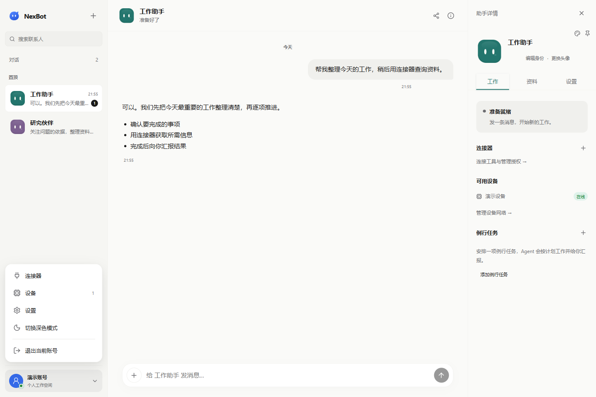

# NexBot

把 AI 助手放进你的日常工作。为不同事情创建专属助手，在电脑和手机上继续对话，让助手处理文件、调用工具，并按计划完成例行任务。

[打开网页版](https://bot.nexorai.com.cn) · [注册账号](https://user.nexorai.com.cn/register/nexbot) · [查看版本发布](https://github.com/DarrenHoo-10/nex_bot/releases)

## 可以用 NexBot 做什么

- **创建专属助手**：给助手起名字、设置身份和职责，分别处理写作、研究、工作整理等事情。
- **继续之前的工作**：每个助手保留自己的对话记录，用同一账号在不同设备上接着聊。
- **上传文件**：通过输入框的「＋ → 文件」添加材料，让助手阅读、总结或协助处理。
- **操作电脑**：Windows 和 Mac 客户端登录后自动连接本机，助手可在任务中读取文件、运行命令和保存结果；Windows 还支持操作窗口。
- **连接工具**：在设置中添加 MCP 连接器，为助手配置可用工具。
- **安排例行任务**：设置重复执行的工作，在对话里查看结果。
- **选择模型**：连接自己的模型服务，获取可用模型列表，调整上下文窗口和最大输出。

## 选择使用方式

| 方式 | 适合什么场景 | 当前状态 |
| --- | --- | --- |
| Windows EXE | 日常对话、完整设置，以及让助手操作这台电脑 | x64 桌面客户端，便携版 |
| Mac 应用 | 原生 macOS 客户端：对话、完整设置，以及让助手读取文件、运行命令 | Apple Silicon，需从源码构建 |
| iPhone 应用 | 原生 iOS 客户端：对话、附件、审批与设置 | iOS 17 及以上，需从源码构建 |
| Android APK | 随时查看消息、发送任务、上传文件和处理审批 | Android 8.0 及以上，测试版 |
| 网页版 | 不安装应用，直接开始对话和管理助手 | 浏览器访问即可 |

Android 0.2.3 与 Windows 共用账号设置、模型、记忆服务、连接器、设备和助手管理界面。Mac 应用暂不支持操作窗口。iPhone 和 Android 客户端不会控制手机；通过手机或网页向助手安排电脑任务时，目标电脑需要保持 NexBot 登录、在线且未暂停控制。

## 下载与安装

当前下载为 **2026-10-18 预览版**：

| 平台 | 下载 | 安装方式 |
| --- | --- | --- |
| Windows x64 | [下载 EXE](https://github.com/DarrenHoo-10/nex_bot/releases/download/nexbot-v0.9.3-preview.1/NexBot-0.9.3-x64-Client-Portable.exe) | 双击运行，免安装 |
| Android 8.0+ | [下载 APK](https://github.com/DarrenHoo-10/nex_bot/releases/download/nexbot-v0.9.3-preview.1/nexbot-0.2.3-debug.apk) | 在手机上打开并安装，测试版 |
| 校验文件 | Windows：[SHA256SUMS.txt](https://github.com/DarrenHoo-10/nex_bot/releases/download/nexbot-v0.9.3-preview.1/SHA256SUMS.txt)；Android：[SHA256SUMS.txt](https://github.com/DarrenHoo-10/nex_bot/releases/download/nexbot-v0.9.3-preview.1/SHA256SUMS.txt) | 核对下载文件完整性 |

[Android 发布说明](https://github.com/DarrenHoo-10/nex_bot/releases/tag/nexbot-v0.9.3-preview.1)（统一记忆设置、总用量与精简输入框）、[Windows 发布说明](https://github.com/DarrenHoo-10/nex_bot/releases/tag/nexbot-v0.9.3-preview.1)。Windows 包尚无发布者数字签名；Android 包使用调试签名，适合体验测试。GitHub 的「Source code」压缩包是源码，不能直接安装。

Android 0.2.3 已包含完整设置和助手管理。自行构建请参阅 [Android 安装包说明](android/README.md)。

### Windows：运行 EXE

1. 获取 `NexBot-<版本>-x64-Client-Portable.exe`。
2. 把文件放在方便保留的位置，双击打开。当前是便携版，无需运行安装向导，也不需要安装 Node.js。
3. 使用 NexorAI 账号的邮箱和密码登录。客户端默认连接 NexBot 正式服务。
4. 进入助手对话，或点击左上角「＋」创建助手。

需要桌面入口时，可以为 EXE 创建快捷方式。

**更新方式：** 退出 NexBot，使用发布者提供的新版 EXE 替换旧版，再打开。使用同一账号登录后继续查看原有助手和消息。

### Android：安装 APK

1. 获取可安装的 APK。当前测试包名称为 `nexbot-<版本>-debug.apk`。
2. 将 APK 下载或传到手机，在浏览器下载列表或文件管理器里点开。
3. 如果系统要求，允许当前浏览器或文件管理器「安装未知应用」，然后返回完成安装。
4. 打开 NexBot，使用与电脑端相同的账号登录。
5. 选择助手即可继续对话；消息通知可按需开启。

**更新方式：** 安装由同一发布者、使用相同签名提供的新版 APK，覆盖现有版本。若系统提示签名不一致，请向发布者索取匹配的安装包。文件名带 `unsigned` 的 APK 尚未签名，不能直接安装。

Android 当前为测试版，尚未上架应用商店。

### Mac 与 iPhone：从源码构建

原生客户端暂未提供安装包。在 Mac 上安装 Xcode 16.4 及以上和 XcodeGen 后，按 [Apple 客户端说明](apps/apple/README.md) 构建：Mac 应用需先打包本机执行端，iPhone 应用可在模拟器或已签名的设备上运行。两个应用都使用 NexorAI 账号登录，默认连接 NexBot 正式服务。

## 第一次使用

### 1. 登录或注册

已有 NexorAI 账号，可直接使用邮箱和密码登录。没有账号，点击登录页下方的「去注册」，按页面填写信息和邀请码。邀请码由服务运营方提供。

### 2. 连接你的模型

在 Windows、Android 或网页版点击账号，进入「设置 → 模型」：

1. 选择 API 协议，填写服务商提供的 API 基础地址和 API Key。
2. 点击「获取模型列表」，选择模型；也可以手动填写模型 ID。
3. 保存配置，返回对话开始使用。

在会话输入框点击「＋ → 模型」，可搜索并切换当前助手使用的模型，不影响其他助手。

「联网识别」从公共模型目录查找上下文和输出参数。服务商自定义的模型名称可能无法匹配，此时可以手动填写。未识别到参数时，默认上下文为 **256,000 Token**，最大输出为 **32,000 Token**；手动设置优先。

### 3. 创建助手并发送任务

点击左上角「＋」创建助手，例如「写作助手」或「工作助理」。在助手设置的「关于」里点击身份信息，可以直接编辑职责。

你可以从这些任务开始：

- 「读一下这份文档，整理出待办事项。」
- 「把刚才的内容保存成 Markdown 文件到桌面。」
- 「每天早上帮我整理今天要处理的工作。」

文件通过聊天输入框的「＋ → 文件」上传，每条消息最多 5 个文件，每个文件不超过 5 MiB。当前支持读取文本、PDF 和 PNG／JPEG／WebP 图片；其他格式可以上传和下载，暂不直接解析。

## 电脑控制与权限

Windows 和 Mac 客户端登录后自动启用本机控制，不需要手动配对。在「设置 → 设备」查看设备的在线状态，通过「暂停控制／恢复控制」管理本机。退出应用或账号后，本机停止接受操作。

输入框下方可以切换权限，设置按助手分别保存：

| 模式 | 行为 |
| --- | --- |
| 标准权限 | 普通文件创建、保存和只读查询直接执行；删除、覆盖重要文件、发消息、付款等危险操作需要批准 |
| 完全权限 | 已授权能力范围内的操作无需逐次审批 |

两种模式都可以停止当前任务，也都受设备暂停、退出登录和工具授权范围约束。

## 常见问题

**模型列表能获取，为什么参数识别不到？**

模型列表来自你配置的服务商；参数识别来自公共目录。服务商使用别名、添加后缀或目录尚未收录时，可能无法匹配，不影响手动配置后使用。

**助手提示电脑离线怎么办？**

打开目标电脑上的 NexBot 并登录，在「设置 → 设备」确认在线且未暂停控制。只打开网页或 Android 客户端，不会让一台未连接的电脑上线。

**关闭电脑端后，手机还能聊天吗？**

可以。助手和消息由服务端管理；需要操作那台电脑的任务，要等电脑端重新上线。

**一定要配置记忆服务吗？**

不需要。未配置也可以聊天和查看记录。如需长期记忆，可在「设置 → 记忆服务」连接 Hindsight。

## 开发与自行部署

普通使用者安装客户端即可。需要自行构建或部署时，请参考：

- [服务端部署说明](deploy/core/README.md)
- [Android 构建说明](android/README.md)
- [Mac／iPhone 原生客户端构建](apps/apple/README.md)与[验证记录](docs/verification/native-clients.md)
- [Windows／Mac 客户端构建与验证](docs/verification/client-device-executor.md)
- [界面截图与跨端参考](doc/ui/README.md)
- [发布验证规范](docs/verification/README.md)

## 开源与致谢

NexBot 基于 [OpenMausBot](https://github.com/milind-soni/OpenMausBot) 演进，保留上游提交历史、[Apache-2.0 授权](LICENSE)、[第三方声明](NOTICE)与[原版 README](docs/upstream/OpenMausBot-README.md)。
