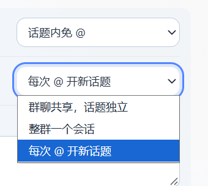

# 前端设计规范

NexBot 工作区的设置、表单和弹层沿用同一套界面语言。Web、Windows 和 Android 的共享界面以现有组件和主题变量为准。macOS 和 iOS 的原生控件按各自平台的样式和交互验收。

## 设置页的选择菜单

- 优先复用产品已有的触发器、菜单和选项样式。颜色、圆角、边框、阴影和文字层级由同一套主题定义。参考 [模型选择器](android-model-selector.png) 和 [菜单样式](../../src/personal/components/model-picker.css)。
- 关闭时让用户看见当前值。展开后用对勾和轻量底色标出已选项。悬停与键盘焦点独立于选中状态，焦点轮廓要清晰可见。
- 菜单对齐触发器并留出小间距。靠近视口底部时优先上翻，空间不足时限制菜单高度并让选项区域滚动。选项说明可以换行。
- 键盘可打开菜单、用方向键移动焦点、用 Enter 确认、用 Escape 取消并返回触发器。选择菜单里的值只更新当前表单，提交由表单里的主按钮完成。

## 负面案例：飞书群聊设置的原生下拉框

入口为「设置 → 连接器 → 飞书 → 应用 → 群聊 → 会话方式」。旧实现用原生 `<select>`，关闭时触发器套用了产品圆角，打开后选项由系统菜单绘制。截图里，直角菜单贴在圆角控件下方，高饱和蓝色选中行与粗蓝色焦点环争夺注意力，且用户在展开时只能看到模式名。

这类 Web 设置菜单应使用可套用主题的应用内选择器。让圆角面板与触发器对齐，给每种会话方式保留一行说明，并用对勾区分已选项。验收时实际展开菜单，检查浅色、深色、窄窗口和靠近视口底部的布局，再用键盘完整走一遍打开、选择与取消。
