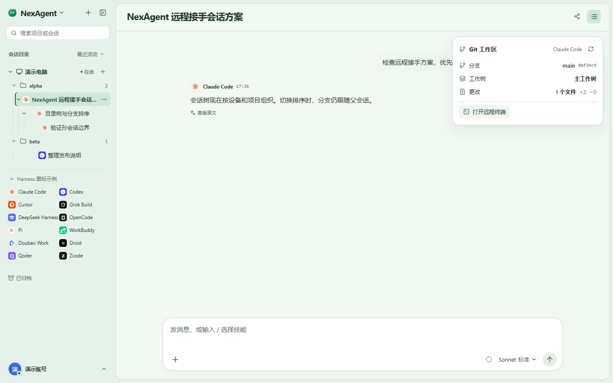
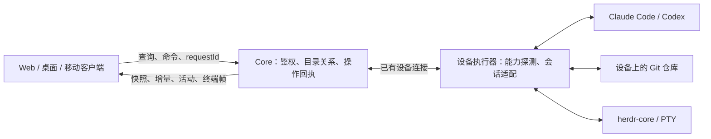

# NexAgent 中文会话工作台 · 交互定稿与技术方案

2026-11-15 定稿。交互基线是分支 `codex/nexagent-project-ui-review` 上的提交 `5a5d035e5d1658b66ed4f73f29b6a284a1b50965`。这份方案用于将已确认的项目内原型接入正式 Core、设备执行器和客户端。第 1 节是交互验收依据；第 2 节记录代码现状；第 3 至 6 节是正式实现设计。



### 重现定稿

在 Windows 的基线检出目录中，使用 Node 24 或以上、Git 和本机 Chrome 或 Edge。运行以下命令会构建 Core 和 Web，准备 herdr-core，并启动临时账号、设备、仓库及模拟 Claude CLI。终端链路使用真实 ConPTY。就绪后访问本机 `http://127.0.0.1:18809/review`，Ctrl+C 回收该次夹具。端口可替换。

```powershell
corepack pnpm install --frozen-lockfile
node scripts/smoke-cli-agents.mjs --workbench --serve=18809
```

启动入口与原有 Agent 协议分别见[隔离预览脚本](../../scripts/smoke-cli-agents.mjs)、[工作台夹具](../../scripts/testing/nexagent-workbench-fixture.mjs)和[原 Agent 模式设计](agent-mode.md)。

## 1. 交互定稿

| 区域 | 定稿行为 |
| --- | --- |
| 外观与布局 | 浅绿导航、淡绿对话底、实色白色输入区和卡片。画布 `#f2f8f2`、导航 `#e6f2e9`、强调色 `#176643`。桌面会话标题直接位于内容区顶部。右上保留「交给助手」及其右侧的 Git 工作区按钮。窄屏保留返回列表和打开导航的入口。 |
| 导航 | 设备 → 项目目录 → 主会话 → 子会话 → 孙会话。可展开的节点逐级缩进，有独立展开按钮。Harness 用会话前的品牌图标表示；工作树和 Git 分支在卡片里查看。默认按同层最近活动倒序，也可按 Harness 排，同一 Harness 内仍按最近活动。搜索可展开命中路径。左栏可拖宽，记住宽度。图标样例用于评审，运行能力取自设备上报。 |
| 会话操作 | 行尾省略号与右键打开同一菜单，提供查看会话 ID、创建分支、归档、删除。双击名称在原位编辑，Enter 保存，Esc 取消，中文输入法确认候选字不触发保存。归档会话可从归档列表恢复。列表和标题省略「已停止」标记。 |
| Fork | 点击一次即在当前父节点下显示「原会话名（fork）」，完成后原位打开。根、子会话可以 fork；孙会话可以独立对话，到此为层级上限。创建期间用户主动切换会话，完成回调尊重这次选择。 |
| 新建会话 | 先选设备和工作目录，再选可用 Harness。最近目录可点选。Git 项目可选现有工作树，或勾选新建独立工作树并填写新分支名。设备菜单使用项目内浅绿选中态。创建前可见当前分支、目录校验和设备不可用原因。[新建会话实图](../screenshots/nexagent-workbench-v1/new-session.png) |
| 对话与输入 | 主区始终是对话。底部常驻当前 Harness 的输入框，可续接的旧会话由首次发送触发续接。左侧「＋」提供文件和目标模式；输入 `/` 选择技能。右侧选择模型、推理强度、查看上下文；缺少用量时如实显示。运行中可排队、撤回排队消息或引导当前任务。Enter 发送，Shift+Enter 换行。 |
| 中文阅读与注释 | 英文助手正文优先展示中文，可切换原文。代码、命令及链接目标应保真。选中文字可「添加注释」或「发起侧边会话」。注释编辑器保留删除、取消、保存；删除后同步移除标记。 |
| 侧边会话 | 选中文字立即打开右侧页签并聚焦输入框，引用片段随草稿一起显示。首次发送才创建底层会话。多个草稿独立；侧聊不进入左树，也不占用会话操作菜单。 |
| Git 与活动 | 卡片默认收起，在标题分隔线下方、内容区右上角展开。显示分支、工作树名称、更改文件和增删行数；卡片省略本机绝对路径。待办、子代理、后台任务随活动出现和结束；空分组整组隐藏。 |
| 远程终端 | 从 Git 卡片打开，与侧聊共用右侧页签栏。连接后可直接输入，终端铺满页签内容区，按面板尺寸调整 PTY 行列。省去模式切换栏。断线、重连和控制权错误在终端内呈现。[右侧页签实图](../screenshots/nexagent-workbench-v1/terminal-tabs.png) |

## 2. 当前实现与正式接入范围

**首要目标是接续用户已经打开的 App / CLI 原生会话。** 用户在电脑上的 Codex、Claude Code 或 ZCode 已经聊到一半，应能从 NexAgent 找到同一个会话、查看上下文、继续发送，并在原客户端与 NexAgent 看到同一条后续回复。连接前后以原生 thread/session ID 核对身份。另开一个带历史摘要的新进程只能作为用户主动选择的分支。

| 已有会话来源 | 当前可行路径 | 正式版的验收边界 |
| --- | --- | --- |
| Codex App / CLI | 项目已有历史发现和 App 数据库读取；目标 thread 被可连接的共享 app-server 加载时，设备可向同一 thread 发起回合或引导当前回合。 | 分别从 App 和独立启动的 CLI 建会话，按实际安装版本验证共享通道、原窗口回显和断线恢复。只查到历史时只声明可读。 [OpenAI App Server](https://developers.openai.com/codex/app-server/) |
| Claude Code CLI / Claude 桌面端的 Code 会话 | 项目已有会话发现和本地 inbox 适配。目标活会话须公布兼容的消息入口；设备返回已确认或未确认投递。普通 Claude 聊天和 Code 会话分别识别。 | 用同一原生 session ID 核验消息及回复。收件确认不足时显示待确认，避免自动重发。官方 Remote Control 可用于对照产品行为，NexAgent 的本地 inbox 路径需要逐版本验证。 [Claude Code Remote Control](https://code.claude.com/docs/en/remote-control) |
| ZCode App / CLI | 当前只有图标。官方实现以现有 Host / CLI 为会话运行端，V4 协议提供 conversation 快照、增量和命令通道。 | 增加设备端 ZCode 适配器，先证明在用户授权后能附着到已运行的 Host、定位原 session 并收发。再分别验证独立 CLI、引导、中断、审批和分支；按实际能力启用。 [ZCode 协议](https://github.com/zai-org/ZCode/blob/main/docs/zcode-protocol.md) · [官方远控说明](https://zcode.z.ai/cn/docs/remote-control) |

设备应按**具体会话**上报发现、读历史、发送、引导、审批、中断、分支和终端输入能力。原生消息通道和 PTY 键盘通道分别判断。设备代理拥有某个 PTY 时才开放远程终端；外部 App 收到消息不会自动获得 PTY。历史会话只有在设备确认可安全续接、且原进程没有并发占用时才启动续接。

接入门槛按产品和入口分别记录：用户先在原 App 或 CLI 发 A，NexAgent 打开同一会话后发 B，原客户端显示 B 并产生回复 C，两端都能读到 C；重连后 ID、消息顺序和上下文一致，且 B 只投递一次。本轮复查的外部路由、inbox、daemon 和 App 数据库相关隔离测试共 74 项通过，真实产品版本的双端验收另行记录。

| 能力 | 冻结版本实际使用 | 正式接入工作 |
| --- | --- | --- |
| 设备、会话、消息、审批、终端 | Core 的 `/api/cli-agents`、列表和消息推送、设备执行器、herdr-core、xterm。Core 已限制为所有者访问。 | 延续鉴权、观察/控制权限校验、消息分页、流控及重连。浏览器打开终端时请求控制。 |
| 会话关系、改名、归档、删除 | `WorkbenchReview` 读取隔离服务的内存记录。Fork 在同目录启动模拟 CLI，并复制可见历史。新版夹具保存名称到服务进程，较早预览在浏览器保存。 | 建立持久关系和操作记录。接通各 Harness 的真实上下文分叉与归档/删除能力，验证重启后可恢复。仅复制聊天历史不足以证明模型上下文已继承。 |
| Git、独立工作树 | 夹具对临时仓库实际执行 Git，创建工作树使用请求 ID 去重。 | 将 Git 查询与创建迁到拥有仓库的设备，处理超时、分支冲突和建树成功但启动失败。 |
| 输入与侧聊 | 原型有本地草稿、目标、选区、附件上传和独立侧聊。模型与技能来自夹具；排队由内存定时器驱动，「引导」走普通发送。 | 接入 Harness 能力发现、原生引导、持久队列、附件交付回执。设置成功以设备确认的有效值为准。 |
| 翻译、注释和活动 | 已配译文覆盖示例；其他英文尝试浏览器本地 Translator。注释暂存在 sessionStorage。活动从已加载的结构化消息记录归并。 | 译文按正文版本缓存；将正式保存的注释与可丢弃的输入草稿分开；活动跨分页、设备重连和客户端重开可重建。 |

生产 Web 不应依赖 `/__review/*`、模拟账号或演示设备。替换边界位于 [WorkbenchReview](../../src/personal/cli-agents/WorkbenchReview.tsx)、[会话工作台](../../src/personal/cli-agents/CliAgentsWorkspace.tsx)、[输入框](../../src/personal/cli-agents/Composer.tsx)与[现有 Core 路由](../../server/personal-os/cli-agents/routes.ts)。

## 3. 架构、数据归属与接口



**数据模型。** 复用 `cli_agent_sessions`、`cli_agent_items`、`cli_agent_ops` 和请求表。现有会话以设备、engine、native ID 组成的 key 识别。展示名称与 Harness 自动生成的标题独立保存，防止下一次设备扫描覆盖用户改名。以下是新增字段或关联表的逻辑契约，具体迁移号在合并时分配。[共享协议](../../shared/cli-agents.ts) · [现有表结构](../../server/personal-os/cli-agents/schema.ts)

| 记录 | 必需信息与约束 |
| --- | --- |
| 工作台会话 | 稳定逻辑 ID、当前会话 key、设备、项目、父 ID、类型（主会话／fork／侧聊）、自定义标题、归档/删除状态、版本。续接生成新 key 时重新绑定逻辑 ID。旧数据默认根会话，回填可空新字段，不凭同名目录猜父关系。 |
| 项目与工作树 | 项目归属由设备解析仓库根与关联工作树，非 Git 目录按设备内规范路径分组；保留工作树显示名、分支或分离 HEAD、采集时间。相同目录名可出现在不同设备。 |
| 操作与投递 | 操作含 requestId、调用者、目标、参数摘要、执行状态及返回 ID。同请求同参数返回原结果，参数冲突拒绝。排队消息另含 sessionId、序号、交付状态和设备回执。 |
| 注释、引用与活动 | 注释关联会话、消息 ID、正文版本、原文/译文版本、选区范围和摘录。侧聊引用可独立于注释存在。活动以会话、类别、Harness 任务 ID 去重，记录最近事件版本与结束原因。 |

**接口建议。** 保留已有 `GET /api/cli-agents`、`GET /items`、`POST /start`、`/continue`、`/send`、`/interrupt`、`/answer` 和 WebSocket `/stream`。下表的相对路径以 `/api/cli-agents` 为前缀，是拟新增或扩展的契约。

| 操作 | 建议契约 | 成功与失败语义 |
| --- | --- | --- |
| 创建分支 | `POST /sessions/branch`，提交 parentId、requestId | 返回 operationId、childId 和父 ID。设备实际继承上下文后才发布 ready。现有 `POST /fork` 已用于「交给助手」并生成助手话题，保持其原语义。 |
| 改名、归档、删除 | `PATCH /sessions/:id` 更新显示名；独立 archive、restore、delete 命令，携带版本与 requestId | Core 持久化显示名。涉及 Harness 存档的操作等待设备回执；失败保留原行和可重试状态。父项删除时单独处理子项，禁止静默级联删除原生会话。 |
| 启动与 Git | 扩展 `/start` 接收 projectId、worktree 选择、可选新分支和 requestId；`GET /sessions/:id/git` 查询快照 | 返回设备已确认的工作树和有效分支。分别表达“干净”“采集失败”“从未上报”。缓存按设备和工作树隔离。 |
| 侧聊、发送与附件 | 首发带 sourceSessionId、sourceMessageId、引用、clientMessageId；`/send` 扩展 delivery；附件先上传并取得受会话约束的引用 | 同一草稿重试只创建一个侧聊，只投递一次首条消息。区分已排队、已送达和 Harness 已接收引导；不支持引导时禁用对应选项。 |
| 注释与活动 | 按会话读写注释，更新携带版本；活动快照与后续增量带游标；设备上报能力及模型、技能和上下文用量 | 跨端发生修改冲突时保留未提交文字并重读。游标有缺口则重取快照；旧客户端忽略新增可选字段。 |

## 4. 容易出错的交互时序

**分支首帧。** 点击时读取当前显示名，生成「原名（fork）」并在该父节点下预留树行。Core 先校验设备、归属、Harness 能力和深度，登记操作后交给设备。无论列表推送还是创建回执先到，首次可公开的子会话数据必须包含确定的父 ID。前端在会话 key 与父关系都确认后原位替换；仅当用户仍在源会话时打开子会话。失败移除占位、保留源会话；迟到的旧快照不可覆盖已确认关系。第二个客户端也须通过同一快照/增量契约得到正确层级。预览已处理发起端的两种返回顺序。[会话树](../../src/personal/cli-agents/SessionList.tsx)

**侧聊首发。** 选区 → 本地页签 → 立即聚焦 → 编辑草稿 → 首次发送时分配会话并提交带引用消息。草稿 ID 到正式会话 ID 的映射要保存到回执；创建成功、发送失败时复用该 ID。切换标签要保留草稿，关闭终端标签仅释放终端连接。[右侧会话状态](../../src/personal/cli-agents/use-side-chats.ts) · [终端视图](../../src/personal/cli-agents/TerminalView.tsx)

**恢复、排队与引导。** 停止但可续接的会话在首次发送时串行续接并定向到新 key。每个逻辑会话最多一个队列消费者，从最早可投递消息开始；设备离线保留队列，撤回只影响尚未交付的条目。发送回执失联时先对账，避免重复执行。引导针对正在运行的轮次并关联 turnId；轮次已结束应返回可处理的状态。目标在后续消息中持续有效，用户可随时退出。

**工作树与运行活动。** 在设备上校验仓库与分支，用参数数组调用 Git。为创建请求记录 worktree 实际路径；重试复用已建工作树，保留已有文件和未提交更改。前台待办和同步子任务随轮次结束清除；脱离轮次继续运行的子代理或进程按各自 ID 等待结束事件。重连后先用权威快照校准；分页加载历史不能复活已完成任务。[活动归并实现](../../src/personal/cli-agents/session-activity.ts)

**翻译与选区。** 保留原始消息，译文为派生数据。按消息 ID、内容哈希、目标语言和翻译器版本缓存；流式正文稳定后再翻译。浏览器无能力或翻译失败时仍可读原文。有语言包下载要求时由用户触发。选区存储 UTF-16 起止位置和摘录；重新渲染时核对版本及摘录，不匹配就保留摘录、放弃错误高亮。引用译文时带上原消息定位。[消息渲染](../../src/personal/cli-agents/TranscriptView.tsx) · [注释组件](../../src/personal/cli-agents/AnnotatedMessage.tsx)

## 5. 权限、兼容性与实施顺序

沿用 Core 所有者鉴权以及设备本机暂停/退出边界。服务端校验每次请求的设备、项目和会话关系；收到会话 key 或本地路径不能代替授权。终端写入只发往已授予控制权的流，断连丢弃旧 sid，按新面板尺寸重连。附件隔离存放，限制大小与生命周期；日志关联 operationId、事件类型和错误码，避免记录消息正文、选区、文件内容和绝对路径。

1. **协议与存储。** 增加兼容字段、关系存储、操作幂等和能力上报；补齐迁移、快照与增量排序测试。关闭新能力时，旧会话仍可按原方式读写。
2. **目录与会话生命周期。** 接入真实 fork、侧聊、改名、归档、删除和 worktree，先跑单设备，再验证第二客户端与断线重连。每个 Harness 单独验证支持项，图标数量不代表接入数量。
3. **输入与阅读。** 接入队列、引导、配置确认、附件、翻译与注释；再接活动恢复和 Git 缓存。设备未返回模型、活动或 token 用量时，UI 只呈现有来源的信息。
4. **多端与放量。** Web、Windows 和 Android 共享 Web 界面，分别验证桌面键盘、WebView 窄屏与终端中继。macOS/iOS 的 SwiftUI 根据同一契约实现等效交互，在 Mac 上验收选区、侧页签和草稿恢复。按 Core/设备能力逐项启用；回滚关闭新能力，保留元数据和可重放操作记录。

## 6. 验收与当前证据

| 验收场景 | 通过条件 |
| --- | --- |
| Fork 与并发 | 人为让设备推送先到、HTTP 回执先到、旧快照晚到；逐次检查 DOM，创建中与完成后均在指定父行下。失败无残留；导航到其他会话后不抢焦点；重复请求唯一子项；孙会话的服务端拒绝再次 fork。 |
| 菜单、搜索、改名 | 排序只改变同层顺序；折叠状态、选中项与父关系稳定。双击回车后列表、标题、搜索同步更新；重开可读新名。右键和省略号的操作一致。 |
| 侧聊、终端和输入 | 选区立即可输入；首次发送失败可重试并保留附件和引用。侧聊与终端并列，切换时草稿保留。终端打开后直接键入产生远端回显，缩放重设行列，关闭页签释放控制。 |
| Git、活动、阅读 | 核对主工作树、独立工作树、分离 HEAD、非 Git 目录及离线状态。逐一触发三类活动再结束，空分组消失；真实任务 ID 对应正确。中文/原文可往返切换；代码与选区锚点可核对；删除注释清理标记。 |
| 正式版专项 | 使用真实 Claude Code、Codex 各自验证继承上下文、设置生效、归档/删除和引导能力；验证设备暂停、重启、跨端同步、重复回执和双端争取终端控制权。分别记录支持、受限和缺失的能力。 |

**本次冻结复核。** 在 Windows 从基线源码重新构建，启动新的隔离 Core、设备和临时 Git 仓库。工作台与设备消息映射共 12 个测试文件、183 个用例通过。浏览器验证了终端自动获取输入焦点及远端回显、侧聊草稿跨标签保留、工作区卡片与设备选择器。另对分支创建注入延迟与失败，验证了推送先到、回执先到、途中导航和创建失败四条路径。上面的截图来自本次运行。真实 Harness 原生 fork、持久投递、Apple 客户端和生产部署均留给正式实现验收。

关闭本次夹具时，清理脚本按共用的 herdr-core 可执行文件路径也匹配到了其他预览进程，退出码为 1。随后按本次会话标识和临时目录复查，匹配的 herdr-core 进程为 0，临时目录已移除；原有预览仍可访问。

```powershell
corepack pnpm exec vitest run src/personal/cli-agents server/personal-os/cli-agents-node/items.test.ts
```
