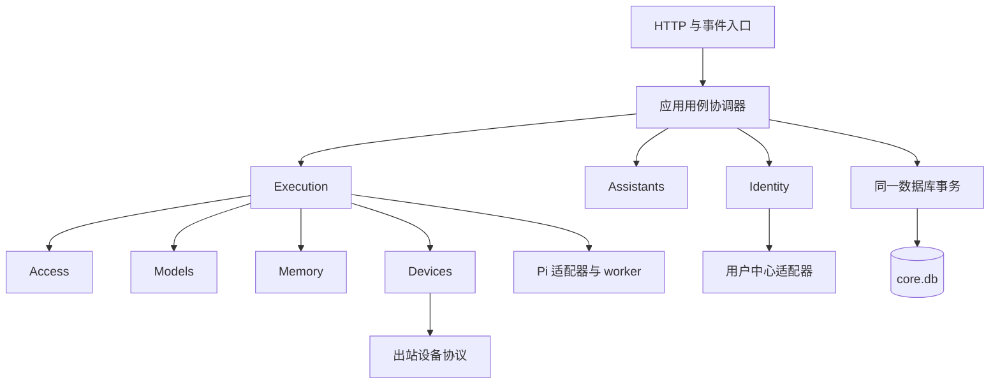
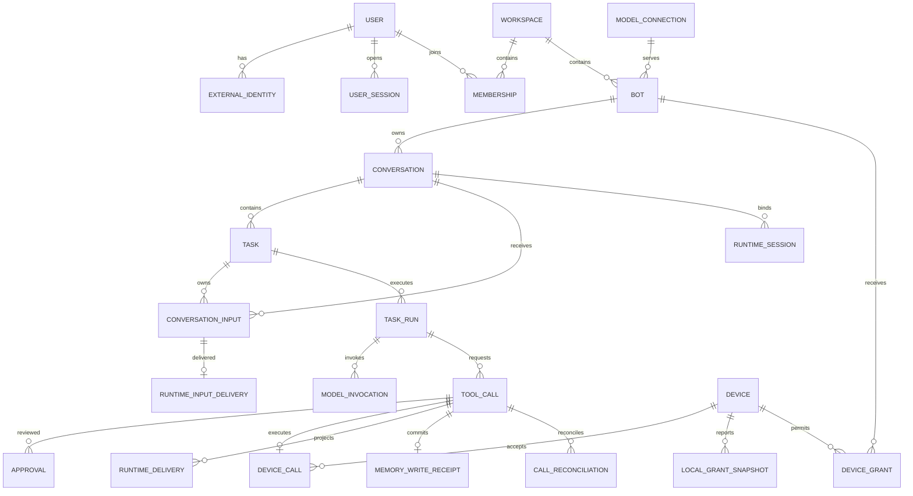

# 个人 AI OS 模块化单体领域与数据设计

创建：2026-10-07。更新：2026-10-08。状态：实施设计，尚未接入应用。

2026-10-11 最新任务控制决定：[任务不限累计用量与用户停止](2026-10-11-manual-task-control.md) 优先于本文所有 Task 预算、累计调用上限、任务截止时间和 AdjustTaskBudget 规则。当前应用使用 Schema v9 增量迁移停用旧字段，保留实际用量账本与用户取消；本文其他领域边界仍适用。

2026-10-11 产品修正：[Personal Agent 产品与领域修正](2026-10-11-personal-agent-product-correction.md) 优先于本文中以 Conversation 作为用户入口、一个 Bot 对应多个可见对话的设计。用户面对持久 Agent 联系人与 AgentInbox，Conversation 改为后台任务执行上下文。新增表通过版本 2 增量迁移接入，原任务和权限约束继续有效。

2026-10-11 后续记忆与协作决策以 [主设备记忆与协作方案](2026-10-11-personal-agent-memory-hindsight.md) 为准：Core 仍为模块化单体，真正的 Hindsight 与其 PostgreSQL 在同一主设备运行；BotCard 是实时公开职责目录；内部 A2A 自动执行；接收方按自己的策略与用户资源授权执行，危险操作的 Approval 归属于实际执行 Bot。本文旧版“私有记忆写入逐次审批”和“全部调用提升审批”的默认策略不适用于该升级，现有 DDL 仍需增量迁移验证。

Agent / Bot 统一表示用户显式创建的持久助手实体。初始化工作空间不创建任何 Bot，没有固定职业枚举、按名字选择的子类或默认种子实例；身份、能力、策略和记忆是实例数据。

本设计细化[总体技术方案](2026-10-07-personal-ai-os-identity-and-devices.md)，采用模块化单体：一个 Core 部署单元、一个核心 SQLite 数据库、进程内模块调用。Pi worker 是隔离运行时故障的子进程，Device Node 是设备执行端，均不把 Core 的业务模块拆成微服务。

本设计确定领域术语、聚合、事务边界、表结构和恢复规则。配套的 [Core DDL](2026-10-07-personal-ai-os-core-schema.sql) 与 [Node DDL](2026-10-07-personal-ai-os-node-schema.sql) 是待 P0 验证后冻结的建库契约草案，不是对现有数据目录直接执行的升级脚本。领域命名、数据归属和存储边界以本设计为准；登录与设备的线协议继续遵循总体方案。数据库校验通过不能替代 SDK 恢复验证。

## 一 首版约束

- 一台 Core 只服务一个个人工作空间；首版只有一个 owner。保留成员关系以表达资源归属，但不交付团队邀请、资源转让或多租户托管。
- 全新工作空间没有 Agent；只能通过用户的 CreateAgent 命令创建。启动、恢复、升级和归档最后一个 Bot 不补建默认助手，已有数据不自动删除。
- Bot、对话、设备、模型连接和记忆元数据均属于工作空间，并记录所有者。首版所有者必须是该工作空间的 owner；禁止跨工作空间引用。
- 固定 Pi SDK。领域对象不继承 Pi 类型、HTTP DTO 或前端展示类型；协议转换在模块边界完成。
- 每段对话同时最多有一个未结束任务、一个未释放执行轮次、一个活动 Pi 会话。等待审批和结果核对也占用任务位置；其他对话可以并行。
- 同一个设备同时最多有一个已派发且未核对完成的调用，其他调用可以排队。设备离线与设备撤销是不同概念，离线不删除归属和历史。
- 不引入微服务、消息中间件、事件溯源或通用工作流引擎。数据库工作队列与少量持久事件用于恢复，不能成为第二套业务事实来源。

## 二 统一语言

| 术语 | 精确定义 | 生命周期与关系 |
| --- | --- | --- |
| User | Core 内部的用户身份 | 一个用户可以关联多个外部身份；登录会话不是用户 |
| Workspace | 资源归属边界 | 首版一个个人空间、一个不可转让的 owner |
| Bot | 有角色、模型引用和记忆范围的持久助手 | 一个 Bot 有多段对话；切换设备不创建 Bot |
| Conversation | 用户持续交流的上下文容器 | 对应旧 `threadId`；可归档，不因一次任务完成而结束 |
| ConversationInput | 已被 Core 接受的用户消息 | 带客户端消息 ID 和对话内序号；先持久化，再确认与投递 |
| Task | 一次用户目标及其授权上下文 | 属于一段对话；保存发起会话、预算、结果和终态 |
| TaskRun | Core 获得执行权后的一段运行记录 | Task 的多个 Run 串行；重启、恢复产生新 Run，不修改旧记录冒充连续运行 |
| RuntimeSession | Conversation 与 Pi 持久上下文的绑定 | 属于技术适配；更换、分支与重建创建新绑定，旧绑定关闭 |
| ModelInvocation | 一次实际发给模型服务的请求 | 重试产生新记录，计入同一 Task 的预算 |
| ToolCall | 一次参数确定的业务工具操作 | 工具请求重放仍映射到同一 ID；不同参数必须创建新调用并重新授权 |
| DeviceCall | ToolCall 在指定设备上的执行记录 | 与设备类 ToolCall 一对一，共用 ID；投递重试不产生第二次业务调用 |
| Approval | 用户对特定工具参数与策略版本作出的单次决定 | 不等于长期 Grant；批准后仍需重新检查权限 |
| DeviceGrant | Core 将 Node 本地权限的子集授予某个 Bot | 可撤销、有期限，不能扩大本地授权 |
| LocalGrant | Node 上由用户选择的资源和操作上限 | Node 是事实来源；Core 只保存带版本的快照 |
| MemoryDocument | 有来源、作用域和版本的长期记忆文档 | 正文在文件中；可供指定 Bot 或工作空间读取 |
| Artifact | 有界、可追溯的任务产物 | 内容寻址文件和数据库元数据共同构成产物 |

旧代码的 [TaskRecord](../../server/store.ts) / [WireTask](../../shared/wire.ts) 表示对话。迁移后领域内一律称 `Conversation`，兼容 HTTP 接口可暂留旧字段名，但不能将旧记录直接导入新 `tasks` 表。UI 中的 `busy`、`unread`、标题和展示状态不充当执行状态。

## 三 模块与数据所有权

| 模块 | 聚合根 | 独占写入的数据 | 对外能力 |
| --- | --- | --- | --- |
| identity | User、Workspace、UserSession、LoginTransaction | users、external_identities、workspaces、memberships、user_sessions、login_transactions | 验证主体、关联身份、准入、撤销会话 |
| assistants | Bot、Conversation | bots、conversations | 建立助手与对话、修改配置、归档 |
| execution | Task、ToolCall | tasks、task_runs、model_invocations、tool_calls、conversation_inputs、runtime_input_deliveries、runtime_sessions、runtime_deliveries、call_reconciliations、artifacts | 接受输入、暂停恢复、记录工具结果、核对执行 |
| access | BotPolicy、DeviceGrant、Approval | bot_policies、device_grants、approvals | 计算有效权限、批准参数、撤销授权 |
| devices | Device、Enrollment、DeviceCall | devices、device_credentials、device_enrollments、device_local_grants、device_calls | 配对、能力登记、领取与续租、回传结果 |
| models | ModelConnection | model_connections | 创建连接、解析受限凭据、停用连接 |
| memory | MemoryDocument | memory_documents、memory_write_receipts | 按作用域读写、版本控制、写入去重、检索授权 |
| platform | 不承载业务聚合 | schema_migrations、command_receipts、outbox_events、audit_records | Unit of Work、时钟、ID、密钥库、持久事件投递 |

`TaskRun`、`ModelInvocation` 是 Task 的子记录；`ExternalIdentity` 是 User 的子记录；Membership 是 Workspace 的关系记录；凭据和本地授权快照属于 Device。它们可以各有表，不因此成为独立聚合。ToolCall、DeviceCall 和 Approval 有独立的并发更新及生命周期，作为独立聚合，以 ID 关联。

模块只能经另一个模块导出的应用服务与查询接口访问它的数据，不能导入其 Repository、直接 UPDATE 其表或修改返回的实体。授权和执行的强一致流程由明确的用例协调器共享同一个 Unit of Work；不禁止单体中必要的跨聚合事务，也不让网络调用进入数据库事务。

读侧允许专门的查询适配器跨表 JOIN，但只返回 DTO，并强制加入工作空间与可见性过滤。读侧不得拥有业务写入入口。跨模块外键是本项目为一个数据库选择的完整性约束，不代表模块可以相互操作内部模型。



## 四 聚合规则与值对象

### 身份与归属

User 的外部身份键为 `(protocol, issuer, subject)`，按原值精确比较，邮箱只用于展示和联系。外部身份一旦撤销，保留 tombstone，不允许绑定到另一 User。重新启用只能由原 User 完成受审计恢复。

Workspace 的 `owner_user_id` 首版不可变；初始化必须在一个事务内创建 Workspace 和 owner 的有效 Membership。API 返回的 `role` 由“是否 owner”推导，成员关系表不再另存一个可能矛盾的 owner 标记。停用 owner 会阻止该空间的新任务，不通过修改资源所有权绕过。

UserSession 是独立撤销单位。Task 保存原始发起 `session_id`；任何新操作都检查会话、User 与 Membership 仍有效。恢复已失效会话的任务需要本人重新登录，再通过 `ReauthorizeTask` 显式替换授权会话并记录审计；没有自动继承新登录的行为。

### 助手与模型

Bot 的名字、可选身份说明、模型连接引用与归档状态由 Bot 管理；工具策略由 Access 的 BotPolicy 管理，不能将提示词当策略。所有实例使用统一运行流程，不按名字、身份文本或固定职业枚举选取专用实现。稳定 BotId 绑定收件箱和私有记忆，更名不换 ID、bank 或权限。Conversation 的 owner、Bot、Workspace 创建后不可改变，改标题不改身份。

CreateAgent 在用户显式操作后同事务创建 Bot、公开资料、收件箱、统一基础策略与私有 bank 待建立映射。Hindsight 资源由 outbox 异步建立，未完成状态明确可见。没有 Agent 的工作空间是合法状态，不因启动或客户端连接被自动填充。

ModelConnection 保存经过规范化的 provider、端点及加密凭据引用。修改端点必须显式重新绑定凭据并递增版本；TaskRun 冻结使用的连接及版本，版本不一致时暂停后续模型调用，让用户确认恢复。停用连接不删除历史用量与引用。

### 任务与调用

Task 固定目标、发起人、Conversation 和预算。后续用户消息要么作为该 Task 的 steering，要么在结束后创建新 Task；不得靠并行新 Task 绕过等待审批或 `needs_reconciliation`。

### 用户输入与执行命令

用户点击发送统一调用 `SendInput`，Core 根据事务中的任务状态决定归属。HTTP 目标为 `POST /api/v1/conversations/{id}/inputs`，请求包含 `client_message_id`、`expected_task_id`（空闲时为 null）、`content`；返回 `input_id、input_seq、task_id、input_kind、delivery_state`。客户端只能展示服务端返回的状态，不能用 `busy` 推导业务动作。

| 接收时状态 | 命令语义 | 是否启动或唤醒模型 |
| --- | --- | --- |
| 没有未结束 Task | 创建 Task 与 start 输入，推进对话序号 | 授权及调度条件通过后启动 |
| queued 或 running | 归入当前 Task，记录 steer 输入 | queued 时按序构造初始输入；running 时交给受控 steering 入口 |
| awaiting_approval、paused、needs_reconciliation | 归入当前 Task，记录 supplement 输入并提示暂存 | 不启动、不续跑、不充当批准 |
| cancelling | 返回 409 TASK_CANCELLING，不确认接收 | 否；客户端保留草稿 |
| expected_task_id 与当前状态不一致 | 返回 409 TASK_STATE_CHANGED，并提供可见状态 | 不把本来要补充旧任务的消息悄悄变成新任务 |

同一事务先按 `(conversation_id, owner_user_id, client_message_id)` 查询重试；命中且请求摘要一致即返回原回执，即使 Task 已结束也不新建。未命中才检查 expected_task_id、分配 `conversations.next_input_seq`、创建或绑定 Task、保存输入并递增 Task version。相同消息 ID 携带不同正文或目标返回冲突。消息与附件描述限额在入口校验，附件只引用已授权 Artifact。

只有事务提交后才能向前端确认消息已接受。消息 ACK 只代表已保存，不表示模型已经读取。`conversation_inputs` 保存原始接收事实；`runtime_input_deliveries` 保存 pending、applied、consumed、blocked 或 discarded。applied 表示 SDK 会话里已有该 input ID 对应条目，consumed 表示确认包含它的模型轮次已稳定结束；两个状态不得合并。

投递按 input_seq 保序；每条输入只绑定一个 RuntimeSession，首版不自动转投另一个会话。SDK 写入成功但数据库未确认时，恢复过程按稳定 input ID 查找会话再确认，不再次发送。SDK 若不能持久关联 input ID 或确认消费范围，P0 不通过；不能把重复发送当作恢复策略。Task 成功完成前必须检查没有未消费的 accepted 输入，并用 Task version 与新的输入接收互斥。

用户取消、明确放弃未消费输入或任务失败时，输入标记 discarded 并保留原因，界面展示“未送达模型”；不能静默清掉消息。输入已 applied 但尚未 consumed 时如需放弃任务，应关闭该 RuntimeSession，未来 Task 使用新绑定，防止已放弃的队列在后续执行中重新生效。

`ApproveTool`、`CancelTask`、`ResumeTask`、`ReauthorizeTask` 与 `AdjustTaskBudget` 是独立的已鉴权命令。文本“同意”“继续”“取消”只是输入，不直接批准工具或取消 Task；界面提示相应按钮。批准后恢复只针对该审批所绑定的 Task，不能创建新 Task。

为避免旧动作在补充要求尚未处理时执行，awaiting_approval 期间接收新的非重复输入，会在接收事务中取消尚未消费的旧审批及尚未派发的待批 ToolCall，记录原因 input_changed 和取消结果，将 Task 转 paused。界面显示“已保存补充要求，请继续任务后重新生成操作”，需要显式 Resume，不能自动运行。若批准先提交并已经派发，补充消息按 running 的 steering 处理，不能承诺撤回已执行动作；用户需用独立取消命令。事务顺序决定这两种结果，前端按服务端状态展示。

这里取消的只是尚未执行的旧工具提案，不是取消 Task。若批准事务已创建待派发记录但尚未交给 Node，输入接收事务重检后必须取消该批准所对应的 queued 记录并转 paused；这条规则优先于一般 queued/running 的输入投递。已进入 delivered 则只能请求取消并等待确认，不能直接标记未执行。正常执行中的消息不会取消无关工具；针对已派发动作停止执行仍需独立 CancelTask 命令。

Core 构造的 BotPrincipal 以 `task_run.id` 作为 `authorizationId`，有效期不超过 Task 截止时间和授权会话期限。它只标识授权上下文，不是可交给外部使用的 bearer。新工具请求必须来自当前未释放 Run、当前代次及 IPC 绑定的 worker；旧 Run 的迟到回调只进入既有调用的结果核对路径。

ToolCall 在创建时冻结规范化参数、参数哈希、工具版本和来源模型条目。值对象 `ArgumentDigest` 对规范化后的工具名、版本、目标和参数计算摘要；不使用任意对象序列化顺序。来自模型的 owner、授权 ID 和调用租约一律不作为可信上下文。

DeviceCall 不再重复保存一份可修改的用户参数与业务状态。它保存设备、Grant、本地策略版本、执行状态、租约与结果证据；参数来自不可变 ToolCall。结果只有经 Devices 验证，才能由 Execution 接受为业务结果。

归档 Conversation 只改变可见性，不隐式停止 Task；界面提供独立取消操作。归档或删除 Bot 时禁止启动新 Task，已有 Task 先取消或明确暂停并核对，再完成删除命令。硬删除不能绕过历史引用。恢复 Task 默认沿用目标和预算；延长截止时间或增加预算必须通过本人授权的 `AdjustTaskBudget` 命令并记录差异。

### 权限与审批

`EffectivePermission = UserSession ∩ BotPolicy ∩ DeviceGrant ∩ LocalGrant ∩ OS`。前四项在派发及续租时重检，Node 继续执行本地上限和操作系统限制。

Approval 绑定 `tool_call_id + argument_hash + bot_policy_version + device_grant_id + grant_version + local_policy_version`。非设备工具不填写设备 Grant 字段。一次决定只能消费一次；更改参数创建新调用，策略版本变化使原决定失效。自动批准也记录授权依据，但不伪造“用户点击过批准”。

LocalGrant 的 `(device_id, local_grant_id)` 标识及版本由 Node 提供。Core 仅允许版本单调递增；Node 减权立即生效，Core 在发现快照变化后将相关旧 Grant 标记失效，需重新确认，不自动继承增权。

### 新 Agent 的统一基础策略

原始空 BotPolicy 仍表示无工具权限。用户显式创建任意 Agent 时，创建用例写入统一的版本化基础策略，与名字及身份描述无关；不能在运行时发现空策略后自动增权。基础策略明确允许自身与共享记忆检索、自身私有记忆写入、公开目录及内部 A2A，设备和外部工具另行配置。按实际副作用区分 auto、approval_required 和 denied，内部 A2A 不受旧全局 ask 模式提升为逐次审批。

| 工具 | 基础策略与授权 | 恢复能力 |
| --- | --- | --- |
| memory.read / memory.search | 自身私有与同工作空间共享范围；auto，不直接检索同伴 bank | read_only，已存结果直接返回，未存结果可重新读取并记录版本 |
| memory.write | 自身私有范围 auto；发布到共享范围须有明确用户指示；危险清理走执行方审批 | transactional，call_id 对应一次持久写入回执 |
| 公开目录 / agent.delegate | 当前工作空间内部 auto；按稳定 BotId 路由，不根据固定名字分支 | 目录只读；A2A 以 call_id 和子 Task 回执去重，未知结果先核对 |
| file.list / file.read / document.extract_text | P3 注册；选择 Node 和目录并授予 Grant 后才可用，范围内 auto | read_only；仍经 Node 日志按 call_id 去重 |
| terminal.run_program | P4 显式开启、指定程序和参数范围，required | 首版按 non_replayable 处理，结果未知必须核对 |
| terminal.execute / 未验收 connector | 默认不注册或策略拒绝 | 没有声明及验证恢复能力时禁止自动重试 |

工具注册契约包含 `effect: read_only | write` 与 `recovery: read_only | transactional | idempotency_key | query_result | non_replayable`。恢复类型由受信适配器声明并测试，模型不能自报。预算、归属与授权仍独立检查；工具属于 auto 不等于无权限约束。

### 领域值对象

| 值对象 | 校验与使用 |
| --- | --- |
| UserId、WorkspaceId、BotId 等 | 品牌类型区分，不把任意 string 当已验证 ID |
| ExternalIdentityKey | 协议枚举、精确 issuer/subject，不按邮箱合并 |
| ResourceScope | `{root_id, relative_path, operations}`；路径平台校验最终在 Node 执行 |
| Budget | 正整数轮次、工具次数、token 门槛、绝对截止时间 |
| ArgumentDigest / ContentDigest | 小写 SHA-256 十六进制；输入规范化规则有版本 |
| Lease | 调用 ID、序号、期限与持有者；不是业务许可的替代品 |
| CredentialRef | 仅能被受限凭据解析器解析，不可序列化进模型上下文 |

摘要 v1 的输入为 Core 生成的确定 UTF-8 JSON 信封，字段固定为 `v、tool_name、tool_version、target_kind、target_id、arguments`；arguments 先经工具 schema 验证并规范化。Core 的 tool_calls 和 Node 的 node_calls 都持久保存不可变的 canonical_envelope 原文、argument_hash 和 digest_version。发送、去重、恢复均使用已保存原文，不从 arguments_json 重建。Node 对收到的原文计算摘要，再解析并校验执行字段；arguments_json 是可核对的解析投影，不能成为第二份可修改参数。入口拒绝无效 UTF-8、孤立代理字符、NaN、Infinity 与重复键，原文不得重排键、改变空白、换行或 Unicode 表示。

## 五 状态机

所有状态变更通过命令处理；数据库 CHECK 限定合法取值，转换前置条件由领域方法和带版本条件的 UPDATE 保证。不能提供任意 `PATCH status` 接口。

### Task 与 TaskRun

| Task 当前状态 | 允许的后续状态 | 必要条件 |
| --- | --- | --- |
| queued | running、cancelled | 启动前授权有效；取消时尚无外部动作 |
| running | awaiting_approval、paused、needs_reconciliation、cancelling、succeeded、failed | 完成必须不存在未解决调用，且会话结果已持久化 |
| awaiting_approval | running、queued、paused、cancelling、failed | 审批消费与授权重检通过后继续；Run 已释放则 queued 并创建新 Run |
| paused | queued、cancelling、cancelled | 恢复需明确请求、有效授权和预算；无未解决动作才能直接取消 |
| needs_reconciliation | paused、cancelling | 先收集或人工核实结果；不直接重跑 |
| cancelling | cancelled、needs_reconciliation | 确认未执行或已停止才能取消成功 |
| succeeded、failed、cancelled | 无 | 后续追问创建新 Task，历史不覆写 |

TaskRun 状态为 `active / waiting / ended / interrupted`。同一 Task 最多一个未释放 Run，数据库部分唯一索引约束同一 Conversation 的执行占用。等待审批时持久记录 wait_started_at 和 release_after_at，默认最多保留 worker 60 秒，也不能超过会话或 Task 的剩余期限。新消息不延长这 60 秒。宽限期内批准且所有前置条件满足可继续同一 Run；到期由适配器保存等待点、终止 worker 并确认退出，将 Run 标为 ended，Task 仍为 awaiting_approval。批准后创建新 Run，从持久审批与未完成工具记录恢复。该挂起恢复机制必须在 P0 通过，不能仅依赖内存中的 Promise。

Approval 有效期默认为创建后 24 小时，并取 Task 截止时间与授权会话期限的最小值。到期标记 expired、Task 转 paused，不自动拒绝成“用户点了拒绝”，也不执行工具。重新授权或增加预算后，旧 Approval 不复活，需要新决定。预算暂停或 Core 重启同样释放 Run；Task 的非终态唯一索引仍阻止另一 Task 插队。

停止旧 worker 并确认退出后才能给新 Run 开启相同 Pi 会话。仅凭数据库租约过期不足以证明旧 worker 已停止；无法确认时进入核对状态。Pi 会话还要获取文件排他锁。每次 Run 递增 Task 的执行代次，旧代次回调只能提交已存在调用的结果证据，不能创建新工具调用。

### ToolCall 与 DeviceCall

| 对象 | 状态及规则 |
| --- | --- |
| ToolCall | `proposed → awaiting_approval / ready / rejected`；`awaiting_approval → ready / rejected / cancelled`；`ready → executing / cancelled / rejected`；`executing → succeeded / failed / unknown / cancelled` |
| 未知 ToolCall | `unknown → succeeded / failed / cancelled` 只允许核对证据后发生；不得变回 ready |
| DeviceCall | `queued → delivered → running → succeeded / failed`；未确认结果转 unknown；确认尚未执行或进程已停止才可 cancelled |
| 未知 DeviceCall | 可接受同一 ID 的迟到结果，经核验转确定终态；不能重新开始执行 |
| Approval | `pending → approved / rejected / expired / cancelled`；`approved → consumed / expired / cancelled`；已消费决定不可重用 |
| Device | `enrolling → bound → revoked`；离线由最后心跳派生，不是可复活的绑定状态 |

合法的迟到结果可以解决 unknown，但不能自动恢复已撤销授权；Task 进入 paused，用户决定下一步。任务在 unknown 未解决前不能进入成功或失败终态。设备凭据已撤销的回传不再通过认证，需要所有者通过核对流程提交证据。

### Core 与 Node 状态映射

| 可观察事实 | Core DeviceCall | Node node_calls |
| --- | --- | --- |
| 尚未投递 | queued | 尚无记录 |
| Core 已提交派发、无法确定响应是否到达 | delivered | 可能无记录，也可能已 received 或 running |
| Node 验证并提交接收日志 | delivered，收到开始确认后可推进 running | received，尚未调用执行器 |
| Node 已持久记录即将启动并调用执行器 | running，若确认丢失也可能暂为 delivered | running |
| 结果持久化 | 收到并核验后 succeeded / failed / cancelled | succeeded / failed / cancelled |
| 执行或结果不能确认 | unknown | unknown，或终态待重新上传 |

Node 没有 delivered 状态。Node 重启把遗留 received/running 都转为 unknown，先核对，首版采取保守策略不自动重开进程；已有终态直接重传结果。Core 重启先核对 delivered/running；远端不可达或不能确认时转 unknown，不能直接放回 queued。Core delivered 表示一次投递尝试，不是执行成功证据。

### 未知结果的核对命令

界面显示工具名、不可变参数摘要、设备、最后租约与可用产物，提供“查询设备记录”和“提交核对证据”。`RefreshCallEvidence` 是只读查询；`ReconcileCall` 写入 call_reconciliations，包含 call_id、expected_call_version、decision_key、证据和判断。普通补充消息与模型自己宣称成功不能调用此管理命令。

| 核对结果 | 必要证据与处理 |
| --- | --- |
| confirmed_succeeded / confirmed_failed | 认证设备返回的同 ID 结果，或本地事务写入回执；也可由本人提交带具体观察与来源的人工证明，明确标记 owner_attestation |
| confirmed_not_executed | 确认没有启动，并已阻止迟到投递再执行；在线 Node 需持久化该 call_id 的取消记录。单纯“查不到日志”不够 |
| confirmed_stopped | 已停止的进程或操作证据；确认部分副作用仍可能存在，保留说明，不宣称已经回滚 |
| inconclusive | 保存证据，保持 unknown 及设备占用，不开放重试 |

核对记录、DeviceCall/ToolCall 的确定结果、runtime_delivery 与审计在同一个 Core 事务中提交，并检查版本；不同结果冲突不覆盖原结果。not_executed 和 stopped 对应 cancelled，回填给模型的是取消与已知副作用事实，不能伪装成功。自动认证证据与人工声明分开展示，人工声明不标为系统已验证；不接受无说明的一键“当作没执行”。

设备失联时若无法建立停止或未执行证据，继续 unknown；必要时先撤销绑定，并由用户在设备上处理后提交证据。重新运行必须在核对解决后由用户明确发起，产生新的 ToolCall ID 并重新授权；原调用永远不从 unknown 回到 ready。

### 输入与控制 API

这些 API 仅接受拥有该资源的用户会话并执行 CSRF 或原生凭据检查。版本和幂等键是并发控制字段，不能替代授权。Bot 和模型工具不能调用审批、重新授权及人工核对端点。

| 方法与路径 | 行为 |
| --- | --- |
| POST /api/v1/conversations/{id}/inputs | 新输入持久化后返回 202；同 client_message_id 同摘要返回原回执，不按当前 Task 重新归类 |
| GET /api/v1/conversations/{id}/inputs?after_seq=… | 按用户输入序号恢复消息列表与最新送达状态；序号不冒充全部服务端事件的游标 |
| GET /api/v1/tasks/{id} | 查询当前 Task version、输入等待情况、审批与调用摘要；前端重连以此重新同步 |
| POST /api/v1/tasks/{id}/cancel | 以 expected_version 和幂等键请求取消；未确认远端停止时返回 cancelling 或 needs_reconciliation |
| POST /api/v1/tasks/{id}/resume | 显式恢复暂停任务；检查预算、会话与所有未知调用，不能跳过待批操作 |
| POST /api/v1/tasks/{id}/reauthorize | 本人重新认证后绑定新的授权会话；失效审批不复活 |
| POST /api/v1/tasks/{id}/budget | 明确增加预算或延长期限，记录新旧值；不自动恢复任务 |
| POST /api/v1/approvals/{id}/decision | 接收 approve 或 reject、expected_version、显示过的参数摘要及幂等键；重新检查绑定版本 |
| POST /api/v1/calls/{id}/evidence-refresh | 查询绑定设备或事务回执；不执行原工具，无新证据时保持 unknown |
| POST /api/v1/calls/{id}/reconciliations | 以 expected_call_version、decision_key 和证据提交人工核对；source 由后端固定为 owner_attestation，不能由客户端伪装设备证据 |

所有控制命令先查幂等记录，再检查当前状态。TASK_STATE_CHANGED、TASK_CANCELLING、INPUT_ID_CONFLICT、MEMORY_VERSION_CONFLICT、CALL_RECONCILIATION_REQUIRED 使用 409；响应包含调用者有权查看的恢复提示。消息原回执不表示最新执行状态，客户端应通过查询或事件刷新，不因历史 ACK 再发送一次。

## 六 关键事务与并发

首版 Core 使用单进程数据库写入器，所有业务关系和执行事实在 `core.db`；模型上下文恢复快照、正文和产物按下文单独保存。每个连接开启 `foreign_keys`，写事务使用 `BEGIN IMMEDIATE`，配置有限 busy timeout；设备执行日志使用 `synchronous=FULL`，Core 授权和执行数据也使用 FULL。模型、用户中心、文件写入及 Node 网络调用均在数据库事务外执行。

聚合使用 `version` 乐观锁：`UPDATE ... WHERE id=? AND version=?`，影响 0 行返回冲突，不覆盖其他修改。重试只重试无外部副作用的数据库命令；不能在自动重试事务中执行 shell、模型请求或发送消息。

| 用例 | 同一数据库事务中提交 | 事务外动作与恢复 |
| --- | --- | --- |
| CompleteLogin | 消费登录事务、映射 User、准入、创建 Core session、审计 | 上游凭据先验证；失败不签发本地会话 |
| SendInput / StartTask | 消息 ID 去重、校验预期 Task、分配输入序号、创建或绑定 Task、输入与回执、递增 Task version | 调度器领取后建立 Run；确认已接受不等于已消费 |
| AuthorizeDeviceCall | 重检各项权限、消费 Approval、ToolCall ready、创建 DeviceCall queued、审计 | Node poll 领取；DeviceCall 表本身就是持久派发队列 |
| DeliverDeviceCall | 再次重检授权、占用设备、状态 delivered、写租约 | 响应丢失仍投递同一 call ID，Node 根据日志返回状态 |
| AcceptDeviceResult | 校验设备及参数绑定、写 DeviceCall 结果、更新 ToolCall、创建 runtime_delivery、审计 | Pi 适配器回填；重复结果哈希相同返回已接受，不同哈希报冲突 |
| CommitMemoryWrite | CAS 更新正文版本引用、写 memory_write_receipt、工具结果、runtime_delivery 与审计 | 正文先落盘；响应丢失查询回执，不再次修改文档 |
| ReconcileCall | 固定证据、核对调用版本、写确定状态或保持 unknown、对应回填与审计 | 远端查询与证据文件上传在事务外 |
| RevokeDevice / Grant | 写 revoked 或新策略版本、取消确定未派发调用、标记其他任务需停止、审计与事件 | 在线通知加速，续租查询保证即使事件丢失也不再授权 |
| FinishTask | 重检无未解决调用、无未确认回填及未消费输入、CAS 结束 Run 与 Task、保存结果引用 | 新输入递增 Task version，与完成动作串行决定结果 |

上述跨模块事务由用例协调器调用各模块公开的事务参与接口完成，Repository 仍属于原模块。动态权限检查与派发状态写入必须在同一事务内，避免“检查通过后撤销、仍创建新执行”的窗口；已发出的动作依靠租约与取消收敛。

每个 API 命令以 `(workspace_id, actor_user_id, command_type, idempotency_key)` 去重，记录请求摘要；同 key 不同摘要拒绝。回执不保存登录令牌、密码或 Key；身份兑换和凭据轮换采用总体方案的专用协议，不借此缓存秘密响应。

## 七 持久化布局与事实来源

```text
data/
  core.db                 领域元数据 权限 任务 调用 审计
  runtime/pi/<id>/        适配器持久化的 Pi SessionManager 上下文快照
  memories/<id>/<hash>    不可变记忆版本正文
  artifacts/<id>/<hash>  不可变文件产物 每个产物独立授权
  secrets/               受操作系统或部署密钥保护的凭据库
```

| 数据 | 唯一事实来源 | 可以重建的部分 |
| --- | --- | --- |
| User、Bot、Conversation、Task 和权限 | core.db | UI 列表、搜索投影 |
| 已接受用户输入与送达状态 | conversation_inputs 与 runtime_input_deliveries | 输入卡片、待处理消息列表 |
| 模型上下文 | 适配器保存的 Pi SessionManager 恢复快照 | 聊天展示中来自 Pi 的消息投影 |
| 执行结果 | Core ToolCall 加设备执行证据；Node 保留本地日志 | UI 工具卡片 |
| 记忆内容 | 数据库当前版本引用的不可变正文 | 全文与向量索引 |
| 文件产物 | 内容摘要对应的不可变文件 | 预览与提取缓存 |

现有 `bots.json` 的业务元数据迁入 SQLite，旧 `messages.db` 保留为历史只读来源，再按需建立新投影。不能继续让 JSON 与 SQLite 各自写一份 Bot 状态。Pi 的消息展示只是投影，Core 的 Task 与授权不会因回滚聊天分支而回滚。

Core 输入记录保存用户投递事实，Pi 会话保存实际送入模型的上下文，两者用 input ID 关联；界面据此合并为一条消息，不能出现双份消息，也不能编辑投递记录来暗中改写 Pi 历史。

正文写入采用“临时文件写入并持久化 → 同盘原子 rename 至内容地址 → 数据库事务更新引用”。提交失败留下可回收孤儿文件，不能留下指向未完成正文的有效记录。MemoryDocument 更新使用版本 CAS，历史正文按保留策略清理；覆盖同名文件不是并发控制。

凭据库也按新引用写入，再事务切换引用；失败的孤儿引用进入清理流程。删除凭据前先撤销数据库连接，活动 worker 不得继续取得新凭据。密钥轮换期间保留读取旧密文所需 key ID，不能只备份数据库而丢失解密能力。

### 非设备工具的幂等与恢复

memory.write 的审批参数包含目标文档 ID、expected_version 和新内容摘要。新建文档 ID 由 Core 预分配，expected_version 为 0；更新必须匹配当前版本。先写不可变内容文件，再在同库事务内重检权限与版本、更新文档、插入以 tool_call_id 为主键的 memory_write_receipt，并提交工具结果和回填记录。重复 call ID 返回原结果；不同调用竞争同一版本时只有一个成功，另一个返回版本冲突并重新读取和审批。

进程在文件写完但事务前崩溃，只留下孤儿内容；事务已提交但响应丢失，按回执核实成功。不能仅靠“再写一遍内容一样”宣称幂等。receipt 保存已提交版本、内容引用与结果摘要；它记录写入事实，文档当前指针仍由 memory_documents 决定。

未来 connector 的写操作只有在适配器实现并验证供应商幂等键或结果查询后才可自动恢复。原有 MCP 接口未声明这些能力时按 non_replayable 处理，结果未知进入同一个核对流程；不能因为它不是设备命令就自动重试。

## 八 表结构与约束

完整列类型、必填、默认值、外键、CHECK 与索引见配套 SQL。所有 ID 为非空不透明 TEXT；时间用 UTC epoch 毫秒 INTEGER；外部 API 仍使用 RFC 3339。JSON 只承载有版本的策略、挑战或工具参数，不替代关系键、状态和到期字段。数据库用 `json_valid` 保证语法，模块入口用 schema 校验形状及限额。

Core 表按模块分组建在同一数据库，无跨数据库外键。默认外键删除策略为 RESTRICT；业务对象通过状态或时间软删除。历史任务、调用与审计不因删除 Bot 级联消失。DDL 中有意识保留的冗余 workspace、owner、bot、conversation 字段通过复合外键锁定一致性。

### JSON 字段的领域契约

权限相关 JSON 必须包含 `schema_version: 1`，未知字段和版本拒绝，不能把 `{}` 当作允许全部的默认策略。DDL 校验脚本用 `{}` 仅检验数据库语法，不代表这些数据能通过领域入口。

| 字段 | v1 形状与限制 |
| --- | --- |
| bot_policies.policy_json | `schema_version`、`allowed_tools: [{name, version, approval:"auto"|"required"}]`；缺省为空列表即无工具权限。approval_mode 单独存列，全局 ask 提高要求，不能降低工具 required |
| device_local_grants.scope_json / device_grants.scope_json | `schema_version`、`rules: [{capability, resource, limits}]`；resource 为 `{kind:"directory", root_id, path_prefix}` 或明确的 `{kind:"device_user"}`；limits 可含 max_bytes、timeout_ms，均为有界正整数 |
| devices.capabilities_json | `[{name, version}]`，不携带隐式授权；未知能力无法执行。新增能力仍需新的 LocalGrant 与 DeviceGrant |
| tool_calls.arguments_json | 由已注册的工具名与版本确定 schema；不是任意命令解释器入口。终端可执行程序与参数分别验证 |
| tool_calls.authorization_snapshot_json | `schema_version`、session_id、run_id、bot_policy_version、可选 grant_id/version/local_policy_version、decision；只供审计，执行时重检事实表 |
| result_json / artifacts.provenance_json | 结构化状态、错误码、输出或产物 ID、来源页码及摘要；超限输出存产物。禁止用返回正文中的指令修改授权 |
| memory_documents.source_json | 来源类型、来源 ID、时间与可选摘要；不自动访问来源 URL。正文不作为权限配置 |
| login_transactions.challenge_json | 总体身份协议的受控挑战与 step ID，不保存答案；provider 事务引用或 verifier 使用 secret_ref |
| conversation_inputs.content_json | `schema_version:1`、text 与可选 artifact_ids；不接受客户端指定 owner、授权或 system 消息角色 |
| call_reconciliations.evidence_json | 证据来源、采集时间、设备或进程记录、观察说明及可选产物 ID；未知字段不触发代码或外部读取 |
| outbox_events.payload_json / audit_records.details_json | 由事件名或 action 决定 schema；包含 ID、版本、摘要和非敏感变更，不包含 Key、密码、完整提示词或文档 |

目录 scope 的子集判断按路径段和平台规则进行，不能用字符串前缀判断。`device_user` 仅用于用户明确批准的整机权限操作；目录规则永远不能推导出任意 shell 权限。Model、MCP、记忆工具同样需要 BotPolicy，设备工具另加设备 Grant 交集。

| 表组 | 关键约束 |
| --- | --- |
| users / external_identities | 外部身份三元组永久唯一；撤销不释放唯一键 |
| workspaces / memberships | 一个 Core 一个 Workspace；owner 唯一；成员二元组唯一；owner 有效成员由初始化用例保证 |
| user_sessions / login_transactions | token hash 唯一；登录事务一次性消费、来源绑定、过期拒绝；敏感内容只存凭据引用 |
| bots / conversations / bot_policies | 工作空间与 owner 成对引用；Conversation 的 Bot 与 owner 必须一致 |
| model_connections | owner 与 workspace 一致；端点和凭据引用受版本保护 |
| tasks / task_runs | 同 Conversation 一个未结束 Task、一个未释放 Run；Run 序号在 Task 内唯一 |
| runtime_sessions / runtime_deliveries | 每 Conversation 一个 active session；每 session/tool call 一次回填；运行时条目键去重 |
| conversation_inputs / runtime_input_deliveries | 客户端消息 ID 和对话内序号分别唯一；输入先落盘再确认；applied 与 consumed 独立，不自动跨 RuntimeSession 转投 |
| model_invocations | 每 Run 的请求键唯一；实际重试另建记录；用量按记录汇总，未知用量不能按零处理 |
| tool_calls / device_calls | 运行时工具来源键唯一；DeviceCall 的 PK 同时是 ToolCall FK；设备、Bot、Grant 归属必须一致 |
| devices / device_credentials / device_enrollments | 配对一次性消费；凭据摘要唯一；撤销族不复活；未确认绑定超时回收 |
| device_local_grants / device_grants | 本地快照按设备与 local ID 唯一；Core Grant 引用确定的 Bot 与设备；版本匹配由 Access 校验 |
| approvals | 一个 ToolCall 最多一个仍有效的待决或已批准决定；摘要及版本与请求绑定 |
| memory_documents / artifacts | owner 与 workspace 一致；私有 Bot 记忆必须绑定 Bot，共享记忆不绑定 Bot；内容位置不能来自任意用户路径 |
| memory_write_receipts / call_reconciliations | 记忆写入按 call ID 唯一，核对按 call ID 与 decision_key 去重；写入与证据记录不可改写 |
| command_receipts / outbox_events / audit_records | 命令键唯一；事件 ID 去重；审计追加，不保存秘密或完整请求正文 |

### 关系总览



ER 图表示历史关联数量，不表示必须将所有子对象加载进聚合。active 数量上限由 SQL 部分唯一索引实现。

### 约束负责层

| 不变量 | 数据库保证 | 领域或适配器保证 |
| --- | --- | --- |
| 不跨工作空间或 owner 引用 | 复合外键 | 请求 principal 的真实来源与成员状态 |
| 一段对话不能并发执行两个任务 | Task 与 Run 部分唯一索引 | worker 排他锁、执行代次与旧进程停止 |
| 参数不可在批准后偷换 | 调用来源唯一、审批关联调用 | 冻结参数、规范化哈希、版本绑定、只读 Repository 接口 |
| 撤销后不能新派发 | revoked 状态与派发同事务 | 派发和续租重检，Node 本地检查 |
| 同调用不重复产生业务结果 | 主键、来源键、回填唯一键 | Node 日志去重、结果摘要比较、unknown 核对 |
| 状态只能合法转换 | CHECK 状态集合、CAS version | 领域转换方法及调用者权限 |
| 删除用户不转移历史资源 | RESTRICT 与身份键永久唯一 | 撤销与清理流程、资料匿名化 |

不能声称 DDL 独自实现全部权限。数据库也不防持有进程文件权限的恶意管理员；首版是个人可信 Core。

ToolCall 的多态 `target_id` 是一个例外：设备目标由 DeviceCall 的复合外键锁定，记忆和 connector 目标须由对应模块的 `resolveOwnedTarget` 查询验证作用域，不能仅按裸 ID 读取。首版闭环实现设备与记忆工具；connector 类型为现有工具适配保留，未注册或未完成作用域校验的 connector 默认不可调用。第三方账号连接与新增 MCP 服务的管理接口另行设计，不把当前模型 Key 当作这些服务的凭据。

### 数据保留与删除

User、身份映射、Bot、Conversation、Task、调用和命令回执保留 ID 及关系，不释放唯一键。用户删除操作先撤销授权，再清除展示资料和可删除正文；匿名化后仍保留必要的引用与撤销标记。Artifact 或记忆删除先在数据库标记不可读，再清理无其他引用的内容文件。

已消费或过期的登录事务 24 小时后移除，其中 secret_ref 在消费或失效时立即释放。配对临时秘密在消费后释放；配对结果保留用于绑定核对。凭据轮换旧摘要至少保留至该凭据族绝对到期，以检测重用；族被撤销后保留撤销状态。Node 调用 ID、参数摘要和最终状态至少保留至绑定被移除且设备不再接受该 Core 调用，不能清掉日志后把重复 ID 作为新任务执行。

审计记录首版保留至工作空间整体销毁，内容只包含必要的操作元数据；普通应用命令不能 UPDATE 或 DELETE 审计。已投递 outbox 可在 7 天后清理，待处理与失败项不能按时间盲删。大结果可按用户配置清理正文，但保留摘要、最终状态和“正文已清理”标记，不因此重跑原操作。

## 九 事件与恢复

`DeviceRevoked`、`GrantRevoked`、`TaskPaused`、`ToolResultAccepted`、`MemoryUpdated` 等事件与业务写入一起保存到 outbox，提交后由本进程投递。事件包含 ID、实体 ID、版本和摘要，不携带密码、Key 或完整文档。首版每条事件由单一模块协调处理；处理结果与消费标记在一个事务内提交。

outbox 至少一次投递，消费者按事件 ID 幂等。它用于通知和可重建投影；授权撤销仍以数据库实时检查为准，不等异步事件生效。DeviceCall 已承担设备待发队列，不再创建第二个可独立重试的“执行设备动作事件”。

Pi 与 SQLite 无法共同提交事务。`runtime_deliveries` 在接受工具结果时写入 pending；适配器通过稳定外部工具调用标识查询 SessionManager，已存在相同结果则确认，不存在则按受支持接口补入，再标记 applied。崩溃后重复上述核对。若锁定 Pi 版本不支持定位和安全回填，P0 不通过，任务保持 needs_reconciliation，不能伪称实现了自动恢复。

2026-10-10 已通过进程级恢复实验：SDK entries 由适配器通过公开导入/导出接口保存，首条 custom message 不依赖 SDK 原生文件的延迟落盘。先持久化 assistant entry，再按原来源键建立或核对 ToolCall；Core 结果提交后补写 SDK 快照，快照成功后确认 runtime_delivery。若在任一步被结束进程，重启核对相同来源及相同结果，不生成新工具调用。已持久的 SDK 结果与 Core 回执冲突，或只有 SDK 结果而没有执行证据时，必须停下核对，不能用追加成功覆盖错误。

模型终轮另存与 request ID、input ID 集合关联的完成标记，然后提交 input consumed；重启可使用已保存的回复完成消费和 Task 版本 CAS，不再发送同一轮模型请求。审批宽限到期先标记正在释放，监督进程确认 worker 退出后才释放 Run；审批或租约到期本身不等于退出。短等待批准唤醒同代次 worker，长等待批准由新代次恢复原 ToolCall。新输入到达时，pending 或已批准但未执行的调用都作废；文本“同意”不构成批准。

当前 `server/runtime/pi/p0/recovery-store.ts` 是仅含一个可信会话的实验账本，不是这份完整 DDD Schema 的 Repository。P1 应将相同事务边界接入各模块的真实权限、版本和审计，不直接把实验表作为产品迁移。实验快照按整段 entries 原子存储，长会话的增量存储与性能需在产品适配时验证。

Node 启动时把遗留的 received/running 调用标记 unknown，除非通过持久进程标识、产物或退出记录确认结果。它不能仅因为 Core 再次 poll 就执行。`node_calls` 永久绑定本次设备绑定 ID、信封原文、参数摘要和调用 ID；更换 Core 或重新绑定使用新绑定 ID，不复用旧权限。

| 故障窗口 | 处理 |
| --- | --- |
| 批准已提交，尚未派发 | 从 DeviceCall queued 恢复，先重检授权 |
| 派发响应丢失 | 重投同一调用 ID；Node 返回已有状态或首次接收 |
| Node 执行完成，Core 未收到 | Node 重传持久结果；不重新执行 |
| Core 接受结果，Pi 未记录 | 从 runtime_deliveries 回填或核对 |
| Pi 已记录，确认标记未写 | 查会话中稳定条目后标记 applied |
| 授权在执行中被撤销 | 停止续租、请求取消；无终止证据则 unknown |
| 模型请求已发出但用量未知 | ModelInvocation unknown，暂停预算相关执行，禁止记零或无界重试 |
| 同时批准与取消 | CAS 和同库事务决定先后；派发前重检取消与授权 |
| 输入已接受但尚无 worker | 从持久输入队列投递；不要求用户再次发送 |
| SDK 已接收输入，送达标记未提交 | 根据 input ID 查会话后确认；不能按纯文本相同猜测 |
| 记忆正文落盘后崩溃 | 根据写入回执判断提交与否；无回执的孤儿文件不等于写入成功 |

模型轮次和工具次数是严格的本地发起上限；token 门槛基于已知用量和请求上限，不能承诺与服务商最终账单完全一致。压缩、重试和标题生成等附加模型请求也需记账；首版不在 SDK 内开启无法计入记录的隐式模型请求。

model_invocations 的 purpose 保留 answer、compact、title，增加 runtime_internal 与必填 purpose_detail。purpose_detail 必须属于锁定 SDK 版本的已验收请求来源清单，不能用任意字符串兜底放行。未识别来源在网络请求前拒绝并给出诊断。每次真实重试分配新 request_key，预留轮次后才发请求；P0 需对比假服务端收到的请求数与记录数，证明没有漏记。这个扩展分类不表示任意 SDK 内部行为已获准。

## 十 模块代码契约

```text
server/
  modules/
    identity/ assistants/ execution/ access/ devices/ models/ memory/
      domain/          实体 值对象 状态转换 领域错误
      application/     命令 查询 跨聚合用例
      infrastructure/  SQLite Repository 外部协议适配
      public.ts        其他模块唯一允许导入的接口
  workflows/           明确的跨模块事务协调器
  runtime/pi/          SDK 封装 worker IPC SessionManager 适配
  platform/            UnitOfWork 时钟 ID 凭据库 outbox
  transport/           HTTP WebSocket 或长轮询 DTO
```

```ts
type ScopedActor = Readonly<{
  userId: UserId;
  workspaceId: WorkspaceId;
  sessionId: UserSessionId;
}>;

interface TaskCommands {
  // 内部协调入口；用户消息只能经 SendInput 创建 Task 并原子保存输入。
  start(actor: ScopedActor, input: StartTask, key: IdempotencyKey): Promise<TaskId>;
  resume(actor: ScopedActor, taskId: TaskId, expectedVersion: number): Promise<void>;
  cancel(actor: ScopedActor, taskId: TaskId, expectedVersion: number): Promise<void>;
}

interface TransactionParticipant {
  // 各模块实现自己的具名方法；不暴露通用 SQL 或任意实体写入口。
  authorizeAndQueueDeviceCall(tx: UnitOfWork, input: TrustedDeviceCall): Promise<void>;
}
```

领域方法只依赖时钟接口、值对象和领域规则，不执行 IO。Repository 不提供通用 `update(any)`；对状态变更提供明确持久化方法和期望版本。Transport 的 Zod 校验只说明输入形状正确，不能产生 TrustedActor 或 TrustedDeviceCall。

模块依赖用静态 import 规则约束；同库事务用集成 fixture 验证。无需提前建立依赖注入框架、通用 Repository 基类或每个实体一个服务。

## 十一 迁移与实施门槛

### 开发期的新旧后端并存

启动参数固定为 `NEX_BACKEND=legacy|personal-os`，缺省 legacy；personal-os 开发期必须显式设置新的绝对 `NEX_DATA_DIR`。开关是部署配置，不出现在用户的 harness 选择中。一次 Core 启动只装配一种业务后端，禁止按路由同时写旧 Store 和新 Repository。

启动器解析真实路径并检查后端标记；personal-os 只接受新空目录或已有 personal-os 标记的目录，拒绝旧数据目录、与它有祖先或子目录关系的路径以及指向同一位置的目录别名。legacy 也不能通过该启动器打开已标记的 personal-os 目录。并行运行的 fixture 使用不同数据根、端口和 Core ID，Device Node 只绑定对应 fixture，不自动发现用户的活动应用。

现有 server/index.ts 与事件协议可以保留为入口和 DTO 适配层：legacy 模式装配旧服务，personal-os 模式装配新用例。兼容的 WireTask 仅由 Conversation 投影生成，不能再调用旧 Store 写入。旧聊天只从明确导出的只读快照导入查看；开发期不读取后再写回源库，不双写 Bot 元数据，不自动导入 CLI 凭据。

正式切换采用：停止旧后端 → 完整备份与校验 → 在新目录运行可恢复迁移 → 核对主体和数量 → 切换启动配置。新目录使用新的后端标记，旧目录保留作回退来源；不在日常运行中镜像写入两套存储。回退先停止新任务并撤销新签发凭据，恢复备份和旧启动配置；不能把新库直接交给旧程序。

### 实施依赖

1. **先做 P0**：在独立 SDK fixture 验证总体方案的门槛，包括消息去重、挂起恢复、工具回填和内部请求计数。只跑 DDL 校验不算 P0 通过；失败先修正适配方案和本设计，不搭整套模块掩盖阻塞。
2. **冻结术语与 Schema**：P0 通过后锁定 SDK 版本和接口映射，再实现 ID、状态机和 SQLite Repository。SQL 在全新临时库执行，不指向用户数据。
3. **迁移归属元数据**：生成稳定 user/workspace/owner 映射，将 bots.json 与旧 WireTask 分别迁为 Bot、Conversation；保留 legacy ID 映射。未知归属的记录隔离等待认领，不默认归 owner。
4. **建立任务事实来源**：新增 Input/Task/Run/Call，不将历史对话 busy 状态转换为正在执行的任务。旧聊天只读；新任务使用 Pi 绑定。
5. **接入授权与身份**：先验证本地 owner、会话撤销和审批，再接 Native/OIDC。初始化不以“第一个远程登录者”作为 owner；外部用户中心适配不阻塞 local 模式 Node 开发。
6. **接入 Node**：日常使用 Windows 上两个隔离进程及模拟断网、重启验证；Mac Core 到 Windows Node 的真机 PDF 流程仍是跨平台发布门槛。配对、授权、持久调用与 PDF 通过后，再开放受控终端。
7. **切换写入**：停旧进程，在隔离备份演练后迁移；一次切换至新数据库，不进行长期 JSON/SQL 双写。版本标记阻止新启动器误装配旧后端到新目录。

迁移脚本须记录 source version、目标版本和输入摘要；中断可恢复，但不能再次生成不同 owner 或重复 Bot。回退恢复完整备份，先撤销切换期间新签发的设备凭据。敏感正文和凭据只留在部署环境，公开 fixture 全部使用合成数据。

设计验收分三层：DDL fixture 检查外键、唯一约束与枚举；领域测试检查状态转换、版本冲突与业务不变量；应用集成 fixture 检查网络、进程和跨存储崩溃窗口。DDL 通过不代表运行时与远端执行已完成。服务与会话验证继续遵循[仓库验证规范](../verification/README.md)。

设计契约的验证入口为 [schema-check.mjs](2026-10-07-personal-ai-os-schema-check.mjs)：运行 `node docs/plans/2026-10-07-personal-ai-os-schema-check.mjs`，仅创建内存中的 Core 和 Node 数据库，检查合法关系及拒绝案例。WAL、磁盘持久化与崩溃恢复需在后续临时磁盘 fixture 中单独验证，不能从内存测试推断。

必须覆盖：重复身份、跨 owner 引用、并发任务、消息确认丢失与重试、终态附近的消息竞争、审批等待补充输入、60 秒释放和重启恢复、重复审批消费、授权与派发竞争、设备重复回传、unknown 的迟到结果及人工核对、记忆写入回执、Pi 输入与工具结果回填重复、旧 worker 回调、模型用量丢失、归档 Bot 的活动任务以及迁移恢复。Windows 日常 fixture 与 Mac→Windows 真机验收分开记录，不以同机测试代替跨平台交付。
