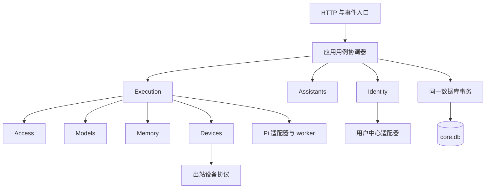
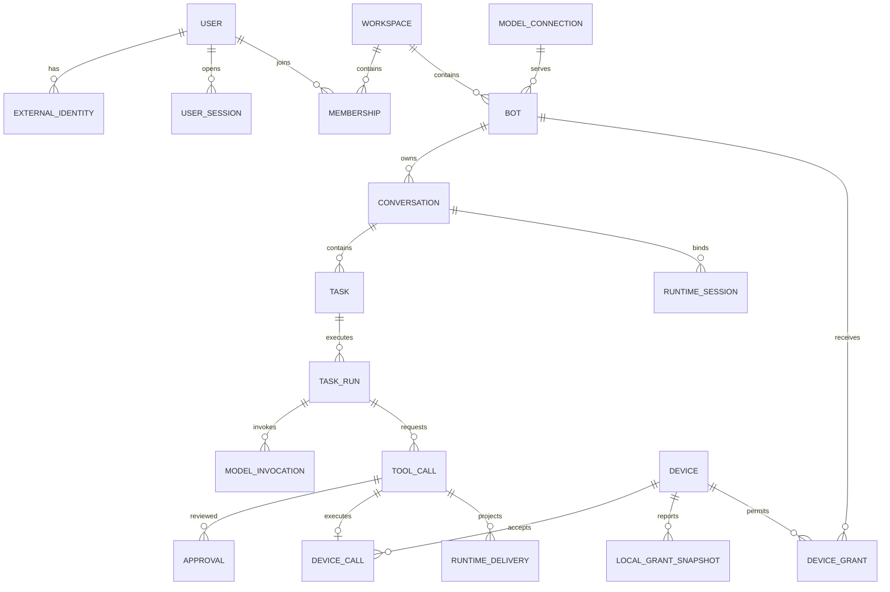

# 个人 AI OS 模块化单体领域与数据设计

创建：2026-10-07。更新：2026-10-08。状态：实施设计，尚未接入应用。

本设计细化[总体技术方案](2026-10-07-personal-ai-os-identity-and-devices.md)，采用模块化单体：一个 Core 部署单元、一个核心 SQLite 数据库、进程内模块调用。Pi worker 是隔离运行时故障的子进程，Device Node 是设备执行端，均不把 Core 的业务模块拆成微服务。

本设计确定领域术语、聚合、事务边界、表结构和恢复规则。配套的 [Core DDL](2026-10-07-personal-ai-os-core-schema.sql) 与 [Node DDL](2026-10-07-personal-ai-os-node-schema.sql) 是首版建库契约，不是对现有数据目录直接执行的升级脚本。领域命名、数据归属和存储边界以本设计为准；登录与设备的线协议继续遵循总体方案。

## 一 首版约束

- 一台 Core 只服务一个个人工作空间；首版只有一个 owner。保留成员关系以表达资源归属，但不交付团队邀请、资源转让或多租户托管。
- Bot、对话、设备、模型连接和记忆元数据均属于工作空间，并记录所有者。首版所有者必须是该工作空间的 owner；禁止跨工作空间引用。
- 固定 Pi SDK。领域对象不继承 Pi 类型、HTTP DTO 或前端展示类型；协议转换在模块边界完成。
- 每段对话同时最多有一个未结束任务、一个未释放执行轮次、一个活动 Pi 会话。等待审批和结果核对也占用任务位置；其他对话可以并行。
- 同一个设备同时最多有一个已派发且未核对完成的调用，其他调用可以排队。设备离线与设备撤销是不同概念，离线不删除归属和历史。
- 不引入微服务、消息中间件、事件溯源或通用工作流引擎。数据库工作队列与少量持久事件用于恢复，不能成为第二套业务事实来源。

## 二 统一语言

| 术语 | 精确定义 | 生命周期与关系 |
| --- | --- | --- |
| User | Core 内部的用户身份 | 一个用户可以关联多个外部身份；登录会话不是用户 |
| Workspace | 资源归属边界 | 首版一个个人空间、一个不可转让的 owner |
| Bot | 有角色、模型引用和记忆范围的持久助手 | 一个 Bot 有多段对话；切换设备不创建 Bot |
| Conversation | 用户持续交流的上下文容器 | 对应旧 `threadId`；可归档，不因一次任务完成而结束 |
| Task | 一次用户目标及其授权上下文 | 属于一段对话；保存发起会话、预算、结果和终态 |
| TaskRun | Core 获得执行权后的一段运行记录 | Task 的多个 Run 串行；重启、恢复产生新 Run，不修改旧记录冒充连续运行 |
| RuntimeSession | Conversation 与 Pi 持久上下文的绑定 | 属于技术适配；更换、分支与重建创建新绑定，旧绑定关闭 |
| ModelInvocation | 一次实际发给模型服务的请求 | 重试产生新记录，计入同一 Task 的预算 |
| ToolCall | 一次参数确定的业务工具操作 | 工具请求重放仍映射到同一 ID；不同参数必须创建新调用并重新授权 |
| DeviceCall | ToolCall 在指定设备上的执行记录 | 与设备类 ToolCall 一对一，共用 ID；投递重试不产生第二次业务调用 |
| Approval | 用户对特定工具参数与策略版本作出的单次决定 | 不等于长期 Grant；批准后仍需重新检查权限 |
| DeviceGrant | Core 将 Node 本地权限的子集授予某个 Bot | 可撤销、有期限，不能扩大本地授权 |
| LocalGrant | Node 上由用户选择的资源和操作上限 | Node 是事实来源；Core 只保存带版本的快照 |
| MemoryDocument | 有来源、作用域和版本的长期记忆文档 | 正文在文件中；可供指定 Bot 或工作空间读取 |
| Artifact | 有界、可追溯的任务产物 | 内容寻址文件和数据库元数据共同构成产物 |

旧代码的 [TaskRecord](../../server/store.ts) / [WireTask](../../shared/wire.ts) 表示对话。迁移后领域内一律称 `Conversation`，兼容 HTTP 接口可暂留旧字段名，但不能将旧记录直接导入新 `tasks` 表。UI 中的 `busy`、`unread`、标题和展示状态不充当执行状态。

## 三 模块与数据所有权

| 模块 | 聚合根 | 独占写入的数据 | 对外能力 |
| --- | --- | --- | --- |
| identity | User、Workspace、UserSession、LoginTransaction | users、external_identities、workspaces、memberships、user_sessions、login_transactions | 验证主体、关联身份、准入、撤销会话 |
| assistants | Bot、Conversation | bots、conversations | 建立助手与对话、修改配置、归档 |
| execution | Task、ToolCall | tasks、task_runs、model_invocations、tool_calls、runtime_sessions、runtime_deliveries、artifacts | 接受目标、暂停恢复、记录工具结果、核对执行 |
| access | BotPolicy、DeviceGrant、Approval | bot_policies、device_grants、approvals | 计算有效权限、批准参数、撤销授权 |
| devices | Device、Enrollment、DeviceCall | devices、device_credentials、device_enrollments、device_local_grants、device_calls | 配对、能力登记、领取与续租、回传结果 |
| models | ModelConnection | model_connections | 创建连接、解析受限凭据、停用连接 |
| memory | MemoryDocument | memory_documents | 按作用域读写、版本控制、检索授权 |
| platform | 不承载业务聚合 | schema_migrations、command_receipts、outbox_events、audit_records | Unit of Work、时钟、ID、密钥库、持久事件投递 |

`TaskRun`、`ModelInvocation` 是 Task 的子记录；`ExternalIdentity` 是 User 的子记录；Membership 是 Workspace 的关系记录；凭据和本地授权快照属于 Device。它们可以各有表，不因此成为独立聚合。ToolCall、DeviceCall 和 Approval 有独立的并发更新及生命周期，作为独立聚合，以 ID 关联。

模块只能经另一个模块导出的应用服务与查询接口访问它的数据，不能导入其 Repository、直接 UPDATE 其表或修改返回的实体。授权和执行的强一致流程由明确的用例协调器共享同一个 Unit of Work；不禁止单体中必要的跨聚合事务，也不让网络调用进入数据库事务。

读侧允许专门的查询适配器跨表 JOIN，但只返回 DTO，并强制加入工作空间与可见性过滤。读侧不得拥有业务写入入口。跨模块外键是本项目为一个数据库选择的完整性约束，不代表模块可以相互操作内部模型。



## 四 聚合规则与值对象

### 身份与归属

User 的外部身份键为 `(protocol, issuer, subject)`，按原值精确比较，邮箱只用于展示和联系。外部身份一旦撤销，保留 tombstone，不允许绑定到另一 User。重新启用只能由原 User 完成受审计恢复。

Workspace 的 `owner_user_id` 首版不可变；初始化必须在一个事务内创建 Workspace 和 owner 的有效 Membership。API 返回的 `role` 由“是否 owner”推导，成员关系表不再另存一个可能矛盾的 owner 标记。停用 owner 会阻止该空间的新任务，不通过修改资源所有权绕过。

UserSession 是独立撤销单位。Task 保存原始发起 `session_id`；任何新操作都检查会话、User 与 Membership 仍有效。恢复已失效会话的任务需要本人重新登录，再通过 `ReauthorizeTask` 显式替换授权会话并记录审计；没有自动继承新登录的行为。

### 助手与模型

Bot 的角色说明、模型连接引用与归档状态由 Bot 管理；工具策略由 Access 的 BotPolicy 管理，不能将提示词当策略。Conversation 的 owner、Bot、Workspace 创建后不可改变，改标题不改身份。

ModelConnection 保存经过规范化的 provider、端点及加密凭据引用。修改端点必须显式重新绑定凭据并递增版本；TaskRun 冻结使用的连接及版本，版本不一致时暂停后续模型调用，让用户确认恢复。停用连接不删除历史用量与引用。

### 任务与调用

Task 固定目标、发起人、Conversation 和预算。后续用户消息要么作为该 Task 的 steering，要么在结束后创建新 Task；不得靠并行新 Task 绕过等待审批或 `needs_reconciliation`。

Core 构造的 BotPrincipal 以 `task_run.id` 作为 `authorizationId`，有效期不超过 Task 截止时间和授权会话期限。它只标识授权上下文，不是可交给外部使用的 bearer。新工具请求必须来自当前未释放 Run、当前代次及 IPC 绑定的 worker；旧 Run 的迟到回调只进入既有调用的结果核对路径。

ToolCall 在创建时冻结规范化参数、参数哈希、工具版本和来源模型条目。值对象 `ArgumentDigest` 对规范化后的工具名、版本、目标和参数计算摘要；不使用任意对象序列化顺序。来自模型的 owner、授权 ID 和调用租约一律不作为可信上下文。

DeviceCall 不再重复保存一份可修改的用户参数与业务状态。它保存设备、Grant、本地策略版本、执行状态、租约与结果证据；参数来自不可变 ToolCall。结果只有经 Devices 验证，才能由 Execution 接受为业务结果。

归档 Conversation 只改变可见性，不隐式停止 Task；界面提供独立取消操作。归档或删除 Bot 时禁止启动新 Task，已有 Task 先取消或明确暂停并核对，再完成删除命令。硬删除不能绕过历史引用。恢复 Task 默认沿用目标和预算；延长截止时间或增加预算必须通过本人授权的 `AdjustTaskBudget` 命令并记录差异。

### 权限与审批

`EffectivePermission = UserSession ∩ BotPolicy ∩ DeviceGrant ∩ LocalGrant ∩ OS`。前四项在派发及续租时重检，Node 继续执行本地上限和操作系统限制。

Approval 绑定 `tool_call_id + argument_hash + bot_policy_version + device_grant_id + grant_version + local_policy_version`。非设备工具不填写设备 Grant 字段。一次决定只能消费一次；更改参数创建新调用，策略版本变化使原决定失效。自动批准也记录授权依据，但不伪造“用户点击过批准”。

LocalGrant 的 `(device_id, local_grant_id)` 标识及版本由 Node 提供。Core 仅允许版本单调递增；Node 减权立即生效，Core 在发现快照变化后将相关旧 Grant 标记失效，需重新确认，不自动继承增权。

### 领域值对象

| 值对象 | 校验与使用 |
| --- | --- |
| UserId、WorkspaceId、BotId 等 | 品牌类型区分，不把任意 string 当已验证 ID |
| ExternalIdentityKey | 协议枚举、精确 issuer/subject，不按邮箱合并 |
| ResourceScope | `{root_id, relative_path, operations}`；路径平台校验最终在 Node 执行 |
| Budget | 正整数轮次、工具次数、token 门槛、绝对截止时间 |
| ArgumentDigest / ContentDigest | 小写 SHA-256 十六进制；输入规范化规则有版本 |
| Lease | 调用 ID、序号、期限与持有者；不是业务许可的替代品 |
| CredentialRef | 仅能被受限凭据解析器解析，不可序列化进模型上下文 |

摘要 v1 的输入为 Core 生成的确定 UTF-8 JSON 信封，字段固定为 `v、tool_name、tool_version、target_kind、target_id、arguments`；arguments 先经工具 schema 验证并规范化。Core 持久保存该规范化参数表示，以确定的信封字段顺序序列化；Node 对传输的原始信封字节计算摘要，再解析并校验执行字段，不自行重排 JSON 后猜测同一摘要。禁止 NaN、Infinity 与重复键。设备协议补充 `argument_hash`、`digest_version` 和对应信封，实际执行只能使用被摘要覆盖的参数。

## 五 状态机

所有状态变更通过命令处理；数据库 CHECK 限定合法取值，转换前置条件由领域方法和带版本条件的 UPDATE 保证。不能提供任意 `PATCH status` 接口。

### Task 与 TaskRun

| Task 当前状态 | 允许的后续状态 | 必要条件 |
| --- | --- | --- |
| queued | running、cancelled | 启动前授权有效；取消时尚无外部动作 |
| running | awaiting_approval、paused、needs_reconciliation、cancelling、succeeded、failed | 完成必须不存在未解决调用，且会话结果已持久化 |
| awaiting_approval | running、paused、cancelling、failed | 审批消费与授权重检通过后继续 |
| paused | queued、cancelling、cancelled | 恢复需明确请求、有效授权和预算；无未解决动作才能直接取消 |
| needs_reconciliation | paused、cancelling | 先收集或人工核实结果；不直接重跑 |
| cancelling | cancelled、needs_reconciliation | 确认未执行或已停止才能取消成功 |
| succeeded、failed、cancelled | 无 | 后续追问创建新 Task，历史不覆写 |

TaskRun 状态为 `active / waiting / ended / interrupted`。同一 Task 最多一个未释放 Run，数据库部分唯一索引约束同一 Conversation 的执行占用。审批短等待使用同一个 Run；长等待、预算暂停或 Core 重启释放 Run，再恢复时新建 Run。Task 的非终态唯一索引仍阻止另一 Task 插队。

停止旧 worker 并确认退出后才能给新 Run 开启相同 Pi 会话。仅凭数据库租约过期不足以证明旧 worker 已停止；无法确认时进入核对状态。Pi 会话还要获取文件排他锁。每次 Run 递增 Task 的执行代次，旧代次回调只能提交已存在调用的结果证据，不能创建新工具调用。

### ToolCall 与 DeviceCall

| 对象 | 状态及规则 |
| --- | --- |
| ToolCall | `proposed → awaiting_approval / ready / rejected`；`awaiting_approval → ready / rejected / cancelled`；`ready → executing / cancelled / rejected`；`executing → succeeded / failed / unknown / cancelled` |
| 未知 ToolCall | `unknown → succeeded / failed / cancelled` 只允许核对证据后发生；不得变回 ready |
| DeviceCall | `queued → delivered → running → succeeded / failed`；未确认结果转 unknown；确认尚未执行或进程已停止才可 cancelled |
| 未知 DeviceCall | 可接受同一 ID 的迟到结果，经核验转确定终态；不能重新开始执行 |
| Approval | `pending → approved / rejected / expired / cancelled`；`approved → consumed / expired / cancelled`；已消费决定不可重用 |
| Device | `enrolling → bound → revoked`；离线由最后心跳派生，不是可复活的绑定状态 |

合法的迟到结果可以解决 unknown，但不能自动恢复已撤销授权；Task 进入 paused，用户决定下一步。任务在 unknown 未解决前不能进入成功或失败终态。设备凭据已撤销的回传不再通过认证，需要所有者通过核对流程提交证据。

## 六 关键事务与并发

首版 Core 使用单进程数据库写入器，所有持久数据在 `core.db`。每个连接开启 `foreign_keys`，写事务使用 `BEGIN IMMEDIATE`，配置有限 busy timeout；设备执行日志使用 `synchronous=FULL`，Core 授权和执行数据也使用 FULL。模型、用户中心、文件写入及 Node 网络调用均在数据库事务外执行。

聚合使用 `version` 乐观锁：`UPDATE ... WHERE id=? AND version=?`，影响 0 行返回冲突，不覆盖其他修改。重试只重试无外部副作用的数据库命令；不能在自动重试事务中执行 shell、模型请求或发送消息。

| 用例 | 同一数据库事务中提交 | 事务外动作与恢复 |
| --- | --- | --- |
| CompleteLogin | 消费登录事务、映射 User、准入、创建 Core session、审计 | 上游凭据先验证；失败不签发本地会话 |
| StartTask | 校验归属与会话、创建 Task、幂等回执 | 调度器领取后建立 Run；并发创建由唯一索引拒绝 |
| AuthorizeDeviceCall | 重检各项权限、消费 Approval、ToolCall ready、创建 DeviceCall queued、审计 | Node poll 领取；DeviceCall 表本身就是持久派发队列 |
| DeliverDeviceCall | 再次重检授权、占用设备、状态 delivered、写租约 | 响应丢失仍投递同一 call ID，Node 根据日志返回状态 |
| AcceptDeviceResult | 校验设备及参数绑定、写 DeviceCall 结果、更新 ToolCall、创建 runtime_delivery、审计 | Pi 适配器回填；重复结果哈希相同返回已接受，不同哈希报冲突 |
| RevokeDevice / Grant | 写 revoked 或新策略版本、取消确定未派发调用、标记其他任务需停止、审计与事件 | 在线通知加速，续租查询保证即使事件丢失也不再授权 |
| FinishTask | 重检无未解决调用、无未确认会话回填、结束 Run 与 Task、保存结果引用 | UI 从提交后的投影读取完成状态 |

上述跨模块事务由用例协调器调用各模块公开的事务参与接口完成，Repository 仍属于原模块。动态权限检查与派发状态写入必须在同一事务内，避免“检查通过后撤销、仍创建新执行”的窗口；已发出的动作依靠租约与取消收敛。

每个 API 命令以 `(workspace_id, actor_user_id, command_type, idempotency_key)` 去重，记录请求摘要；同 key 不同摘要拒绝。回执不保存登录令牌、密码或 Key；身份兑换和凭据轮换采用总体方案的专用协议，不借此缓存秘密响应。

## 七 持久化布局与事实来源

```text
data/
  core.db                 领域元数据 权限 任务 调用 审计
  runtime/pi/<id>/        Pi SessionManager 管理的模型上下文
  memories/<id>/<hash>    不可变记忆版本正文
  artifacts/<id>/<hash>  不可变文件产物 每个产物独立授权
  secrets/               受操作系统或部署密钥保护的凭据库
```

| 数据 | 唯一事实来源 | 可以重建的部分 |
| --- | --- | --- |
| User、Bot、Conversation、Task 和权限 | core.db | UI 列表、搜索投影 |
| 模型上下文 | Pi SessionManager 文件 | 聊天展示中来自 Pi 的消息投影 |
| 执行结果 | Core ToolCall 加设备执行证据；Node 保留本地日志 | UI 工具卡片 |
| 记忆内容 | 数据库当前版本引用的不可变正文 | 全文与向量索引 |
| 文件产物 | 内容摘要对应的不可变文件 | 预览与提取缓存 |

现有 `bots.json` 的业务元数据迁入 SQLite，旧 `messages.db` 保留为历史只读来源，再按需建立新投影。不能继续让 JSON 与 SQLite 各自写一份 Bot 状态。Pi 的消息展示只是投影，Core 的 Task 与授权不会因回滚聊天分支而回滚。

正文写入采用“临时文件写入并持久化 → 同盘原子 rename 至内容地址 → 数据库事务更新引用”。提交失败留下可回收孤儿文件，不能留下指向未完成正文的有效记录。MemoryDocument 更新使用版本 CAS，历史正文按保留策略清理；覆盖同名文件不是并发控制。

凭据库也按新引用写入，再事务切换引用；失败的孤儿引用进入清理流程。删除凭据前先撤销数据库连接，活动 worker 不得继续取得新凭据。密钥轮换期间保留读取旧密文所需 key ID，不能只备份数据库而丢失解密能力。

## 八 表结构与约束

完整列类型、必填、默认值、外键、CHECK 与索引见配套 SQL。所有 ID 为非空不透明 TEXT；时间用 UTC epoch 毫秒 INTEGER；外部 API 仍使用 RFC 3339。JSON 只承载有版本的策略、挑战或工具参数，不替代关系键、状态和到期字段。数据库用 `json_valid` 保证语法，模块入口用 schema 校验形状及限额。

Core 表按模块分组建在同一数据库，无跨数据库外键。默认外键删除策略为 RESTRICT；业务对象通过状态或时间软删除。历史任务、调用与审计不因删除 Bot 级联消失。DDL 中有意识保留的冗余 workspace、owner、bot、conversation 字段通过复合外键锁定一致性。

### JSON 字段的领域契约

权限相关 JSON 必须包含 `schema_version: 1`，未知字段和版本拒绝，不能把 `{}` 当作允许全部的默认策略。DDL 校验脚本用 `{}` 仅检验数据库语法，不代表这些数据能通过领域入口。

| 字段 | v1 形状与限制 |
| --- | --- |
| bot_policies.policy_json | `schema_version`、`allowed_tools: [{name, version}]`；缺省为空列表即无工具权限。approval_mode 单独存列，禁止 JSON 再定义另一份 |
| device_local_grants.scope_json / device_grants.scope_json | `schema_version`、`rules: [{capability, resource, limits}]`；resource 为 `{kind:"directory", root_id, path_prefix}` 或明确的 `{kind:"device_user"}`；limits 可含 max_bytes、timeout_ms，均为有界正整数 |
| devices.capabilities_json | `[{name, version}]`，不携带隐式授权；未知能力无法执行。新增能力仍需新的 LocalGrant 与 DeviceGrant |
| tool_calls.arguments_json | 由已注册的工具名与版本确定 schema；不是任意命令解释器入口。终端可执行程序与参数分别验证 |
| tool_calls.authorization_snapshot_json | `schema_version`、session_id、run_id、bot_policy_version、可选 grant_id/version/local_policy_version、decision；只供审计，执行时重检事实表 |
| result_json / artifacts.provenance_json | 结构化状态、错误码、输出或产物 ID、来源页码及摘要；超限输出存产物。禁止用返回正文中的指令修改授权 |
| memory_documents.source_json | 来源类型、来源 ID、时间与可选摘要；不自动访问来源 URL。正文不作为权限配置 |
| login_transactions.challenge_json | 总体身份协议的受控挑战与 step ID，不保存答案；provider 事务引用或 verifier 使用 secret_ref |
| outbox_events.payload_json / audit_records.details_json | 由事件名或 action 决定 schema；包含 ID、版本、摘要和非敏感变更，不包含 Key、密码、完整提示词或文档 |

目录 scope 的子集判断按路径段和平台规则进行，不能用字符串前缀判断。`device_user` 仅用于用户明确批准的整机权限操作；目录规则永远不能推导出任意 shell 权限。Model、MCP、记忆工具同样需要 BotPolicy，设备工具另加设备 Grant 交集。

| 表组 | 关键约束 |
| --- | --- |
| users / external_identities | 外部身份三元组永久唯一；撤销不释放唯一键 |
| workspaces / memberships | 一个 Core 一个 Workspace；owner 唯一；成员二元组唯一；owner 有效成员由初始化用例保证 |
| user_sessions / login_transactions | token hash 唯一；登录事务一次性消费、来源绑定、过期拒绝；敏感内容只存凭据引用 |
| bots / conversations / bot_policies | 工作空间与 owner 成对引用；Conversation 的 Bot 与 owner 必须一致 |
| model_connections | owner 与 workspace 一致；端点和凭据引用受版本保护 |
| tasks / task_runs | 同 Conversation 一个未结束 Task、一个未释放 Run；Run 序号在 Task 内唯一 |
| runtime_sessions / runtime_deliveries | 每 Conversation 一个 active session；每 session/tool call 一次回填；运行时条目键去重 |
| model_invocations | 每 Run 的请求键唯一；实际重试另建记录；用量按记录汇总，未知用量不能按零处理 |
| tool_calls / device_calls | 运行时工具来源键唯一；DeviceCall 的 PK 同时是 ToolCall FK；设备、Bot、Grant 归属必须一致 |
| devices / device_credentials / device_enrollments | 配对一次性消费；凭据摘要唯一；撤销族不复活；未确认绑定超时回收 |
| device_local_grants / device_grants | 本地快照按设备与 local ID 唯一；Core Grant 引用确定的 Bot 与设备；版本匹配由 Access 校验 |
| approvals | 一个 ToolCall 最多一个仍有效的待决或已批准决定；摘要及版本与请求绑定 |
| memory_documents / artifacts | owner 与 workspace 一致；私有 Bot 记忆必须绑定 Bot，共享记忆不绑定 Bot；内容位置不能来自任意用户路径 |
| command_receipts / outbox_events / audit_records | 命令键唯一；事件 ID 去重；审计追加，不保存秘密或完整请求正文 |

### 关系总览



ER 图表示历史关联数量，不表示必须将所有子对象加载进聚合。active 数量上限由 SQL 部分唯一索引实现。

### 约束负责层

| 不变量 | 数据库保证 | 领域或适配器保证 |
| --- | --- | --- |
| 不跨工作空间或 owner 引用 | 复合外键 | 请求 principal 的真实来源与成员状态 |
| 一段对话不能并发执行两个任务 | Task 与 Run 部分唯一索引 | worker 排他锁、执行代次与旧进程停止 |
| 参数不可在批准后偷换 | 调用来源唯一、审批关联调用 | 冻结参数、规范化哈希、版本绑定、只读 Repository 接口 |
| 撤销后不能新派发 | revoked 状态与派发同事务 | 派发和续租重检，Node 本地检查 |
| 同调用不重复产生业务结果 | 主键、来源键、回填唯一键 | Node 日志去重、结果摘要比较、unknown 核对 |
| 状态只能合法转换 | CHECK 状态集合、CAS version | 领域转换方法及调用者权限 |
| 删除用户不转移历史资源 | RESTRICT 与身份键永久唯一 | 撤销与清理流程、资料匿名化 |

不能声称 DDL 独自实现全部权限。数据库也不防持有进程文件权限的恶意管理员；首版是个人可信 Core。

ToolCall 的多态 `target_id` 是一个例外：设备目标由 DeviceCall 的复合外键锁定，记忆和 connector 目标须由对应模块的 `resolveOwnedTarget` 查询验证作用域，不能仅按裸 ID 读取。首版闭环实现设备与记忆工具；connector 类型为现有工具适配保留，未注册或未完成作用域校验的 connector 默认不可调用。第三方账号连接与新增 MCP 服务的管理接口另行设计，不把当前模型 Key 当作这些服务的凭据。

### 数据保留与删除

User、身份映射、Bot、Conversation、Task、调用和命令回执保留 ID 及关系，不释放唯一键。用户删除操作先撤销授权，再清除展示资料和可删除正文；匿名化后仍保留必要的引用与撤销标记。Artifact 或记忆删除先在数据库标记不可读，再清理无其他引用的内容文件。

已消费或过期的登录事务 24 小时后移除，其中 secret_ref 在消费或失效时立即释放。配对临时秘密在消费后释放；配对结果保留用于绑定核对。凭据轮换旧摘要至少保留至该凭据族绝对到期，以检测重用；族被撤销后保留撤销状态。Node 调用 ID、参数摘要和最终状态至少保留至绑定被移除且设备不再接受该 Core 调用，不能清掉日志后把重复 ID 作为新任务执行。

审计记录首版保留至工作空间整体销毁，内容只包含必要的操作元数据；普通应用命令不能 UPDATE 或 DELETE 审计。已投递 outbox 可在 7 天后清理，待处理与失败项不能按时间盲删。大结果可按用户配置清理正文，但保留摘要、最终状态和“正文已清理”标记，不因此重跑原操作。

## 九 事件与恢复

`DeviceRevoked`、`GrantRevoked`、`TaskPaused`、`ToolResultAccepted`、`MemoryUpdated` 等事件与业务写入一起保存到 outbox，提交后由本进程投递。事件包含 ID、实体 ID、版本和摘要，不携带密码、Key 或完整文档。首版每条事件由单一模块协调处理；处理结果与消费标记在一个事务内提交。

outbox 至少一次投递，消费者按事件 ID 幂等。它用于通知和可重建投影；授权撤销仍以数据库实时检查为准，不等异步事件生效。DeviceCall 已承担设备待发队列，不再创建第二个可独立重试的“执行设备动作事件”。

Pi 与 SQLite 无法共同提交事务。`runtime_deliveries` 在接受工具结果时写入 pending；适配器通过稳定外部工具调用标识查询 SessionManager，已存在相同结果则确认，不存在则按受支持接口补入，再标记 applied。崩溃后重复上述核对。若锁定 Pi 版本不支持定位和安全回填，P0 不通过，任务保持 needs_reconciliation，不能伪称实现了自动恢复。

Node 启动时把遗留的 delivered/running 调用标记 unknown，除非通过持久进程标识、产物或退出记录确认结果。它不能仅因为 Core 再次 poll 就执行。`node_calls` 永久绑定本次设备绑定 ID、参数摘要和调用 ID；更换 Core 或重新绑定使用新绑定 ID，不复用旧权限。

| 故障窗口 | 处理 |
| --- | --- |
| 批准已提交，尚未派发 | 从 DeviceCall queued 恢复，先重检授权 |
| 派发响应丢失 | 重投同一调用 ID；Node 返回已有状态或首次接收 |
| Node 执行完成，Core 未收到 | Node 重传持久结果；不重新执行 |
| Core 接受结果，Pi 未记录 | 从 runtime_deliveries 回填或核对 |
| Pi 已记录，确认标记未写 | 查会话中稳定条目后标记 applied |
| 授权在执行中被撤销 | 停止续租、请求取消；无终止证据则 unknown |
| 模型请求已发出但用量未知 | ModelInvocation unknown，暂停预算相关执行，禁止记零或无界重试 |
| 同时批准与取消 | CAS 和同库事务决定先后；派发前重检取消与授权 |

模型轮次和工具次数是严格的本地发起上限；token 门槛基于已知用量和请求上限，不能承诺与服务商最终账单完全一致。压缩、重试和标题生成等附加模型请求也需记账；首版不在 SDK 内开启无法计入记录的隐式模型请求。

## 十 模块代码契约

```text
server/
  modules/
    identity/ assistants/ execution/ access/ devices/ models/ memory/
      domain/          实体 值对象 状态转换 领域错误
      application/     命令 查询 跨聚合用例
      infrastructure/  SQLite Repository 外部协议适配
      public.ts        其他模块唯一允许导入的接口
  workflows/           明确的跨模块事务协调器
  runtime/pi/          SDK 封装 worker IPC SessionManager 适配
  platform/            UnitOfWork 时钟 ID 凭据库 outbox
  transport/           HTTP WebSocket 或长轮询 DTO
```

```ts
type ScopedActor = Readonly<{
  userId: UserId;
  workspaceId: WorkspaceId;
  sessionId: UserSessionId;
}>;

interface TaskCommands {
  start(actor: ScopedActor, input: StartTask, key: IdempotencyKey): Promise<TaskId>;
  resume(actor: ScopedActor, taskId: TaskId, expectedVersion: number): Promise<void>;
  cancel(actor: ScopedActor, taskId: TaskId, expectedVersion: number): Promise<void>;
}

interface TransactionParticipant {
  // 各模块实现自己的具名方法；不暴露通用 SQL 或任意实体写入口。
  authorizeAndQueueDeviceCall(tx: UnitOfWork, input: TrustedDeviceCall): Promise<void>;
}
```

领域方法只依赖时钟接口、值对象和领域规则，不执行 IO。Repository 不提供通用 `update(any)`；对状态变更提供明确持久化方法和期望版本。Transport 的 Zod 校验只说明输入形状正确，不能产生 TrustedActor 或 TrustedDeviceCall。

模块依赖用静态 import 规则约束；同库事务用集成 fixture 验证。无需提前建立依赖注入框架、通用 Repository 基类或每个实体一个服务。

## 十一 迁移与实施门槛

1. **冻结术语与 Schema**：以此设计为契约，先实现 ID、状态机和 SQLite Repository。SQL 在全新临时库执行，不指向用户数据。
2. **迁移归属元数据**：生成稳定 user/workspace/owner 映射，将 bots.json 与旧 WireTask 分别迁为 Bot、Conversation；保留 legacy ID 映射。未知归属的记录隔离等待认领，不默认归 owner。
3. **建立任务事实来源**：新增 Task/Run/Call，不将历史对话 busy 状态转换为正在执行的任务。旧聊天只读；新任务使用 Pi 绑定。
4. **接入授权与身份**：先验证本地 owner、会话撤销和审批，再接 Native/OIDC。初始化不以“第一个远程登录者”作为 owner。
5. **接入 Node**：配对、授权、持久调用与 PDF 场景通过后，再开放受控终端。
6. **切换写入**：停旧进程，在隔离备份演练后迁移；一次切换至新数据库，不进行长期 JSON/SQL 双写。版本标记阻止旧程序误开新数据目录。

迁移脚本须记录 source version、目标版本和输入摘要；中断可恢复，但不能再次生成不同 owner 或重复 Bot。回退恢复完整备份，先撤销切换期间新签发的设备凭据。敏感正文和凭据只留在部署环境，公开 fixture 全部使用合成数据。

设计验收分三层：DDL fixture 检查外键、唯一约束与枚举；领域测试检查状态转换、版本冲突与业务不变量；应用集成 fixture 检查网络、进程和跨存储崩溃窗口。DDL 通过不代表运行时与远端执行已完成。服务与会话验证继续遵循[仓库验证规范](../verification/README.md)。

设计契约的验证入口为 [schema-check.mjs](2026-10-07-personal-ai-os-schema-check.mjs)：运行 `node docs/plans/2026-10-07-personal-ai-os-schema-check.mjs`，仅创建内存中的 Core 和 Node 数据库，检查合法关系及拒绝案例。WAL、磁盘持久化与崩溃恢复需在后续临时磁盘 fixture 中单独验证，不能从内存测试推断。

必须覆盖：重复身份、跨 owner 引用、并发任务、重复审批消费、授权与派发竞争、设备重复回传、unknown 的迟到结果、Pi 回填重复、旧 worker 回调、模型用量丢失、归档 Bot 的活动任务以及迁移恢复。最后使用 Mac Core 加 Windows Node 的合成 PDF 流程验收业务闭环。
