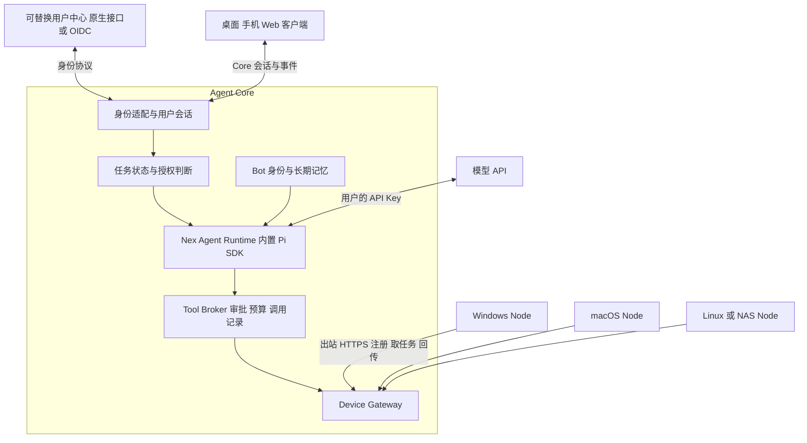

# 个人 AI OS 固定运行时与跨设备技术方案

创建：2026-10-07。更新：2026-10-08。状态：技术设计，待实现。

本方案面向 nex_bot 后续开发，确定固定 Agent 运行时、API Key 配置、应用内登录、统一身份、跨设备执行和第一阶段交付范围。目标体验是：用户打开应用，配置模型服务商的 API Key，同一个个人助手在常驻 Agent Core 上工作，并在明确授权后调用用户绑定的设备。

产品固定使用 Pi 的嵌入式 SDK，由 Nex Agent Runtime 封装。用户不选择 harness，不安装或登录外部 Agent CLI；模型供应商与模型仍可选择。身份提供两种接入：自有或兼容用户中心采用应用内原生登录，第三方身份提供方采用 OIDC。纯本地部署无需外部账号服务。

文中的接口、目录和默认参数均为目标设计；“当前基础”一节描述已有实现。新运行时、通用身份和设备协议属于开源核心，不依赖 `enterprise/`、某个运营方的生产域名或私有账号数据库。

领域与数据库的实施契约见[模块化单体领域与数据设计](2026-10-07-personal-ai-os-domain-model.md)，包括聚合、状态机、事务边界，以及 Core 和 Node 的完整 DDL。Core 内部不拆微服务；对话 `Conversation` 与业务目标 `Task` 明确区分。涉及数据归属和表约束时以该设计为准。

## 核心决策

| 决策 | 约束 |
| --- | --- |
| 固定一种运行时 | 嵌入 `@earendil-works/pi-coding-agent` SDK；产品移除多 harness 选择和外部 CLI 安装流程 |
| 模型仍可替换 | Pi 模型层适配供应商；用户只选择服务商并填 Key，默认使用推荐模型 |
| 复用当前技术栈 | Core 使用 Node.js 和 TypeScript，保留 React、Vite、Electron、Bot 界面和事件协议 |
| 一个 Core 管理个人工作空间 | 首版不做多 Core 自动选主、状态同步和 Bot 热迁移 |
| 应用内登录优先 | 兼容用户中心使用 Native Identity API v1；其他身份提供方使用 OIDC；保留本地模式 |
| 身份与权限分开 | 用户中心确认用户身份；Core 管理 Bot、设备归属和业务授权；Node 执行本地授权 |
| 用户与设备使用不同凭据 | 用户会话不能充当 Node 凭据，Node 凭据不能登录管理界面 |
| 网关先内嵌 Core | 沿用出站 HTTPS 长轮询；WebSocket 和独立网关按后续需求引入 |
| 统一工具入口 | 所有模型工具经 Core Tool Broker 审批和授权；MCP 与设备调用都由它封装 |
| 会话与任务分别持久化 | Pi 会话保存模型上下文；Core 和 Node 的调用日志记录真实执行结果 |
| 开放协议逐步接入 | MCP 接工具；内部 Bot 协作使用 Core 调度；外部 A2A 后续实现 |

## 用户体验与首版边界

首次使用流程为：选择本地 Core 或连接已有 Core，按部署方式在应用内登录，选择模型服务商并填写 API Key，创建 Assistant Bot，最后绑定 Windows Node 和选择允许访问的目录。服务商预设自带端点及推荐模型；自定义 Base URL、模型 ID、预算属于高级设置。

应用设置中不出现 Claude CLI、Codex CLI、Pi CLI、ACP 驱动或 harness 选择。API Key 保存一次，当前用户的多个 Bot 可引用同一个连接，也可选不同模型；同一套权限和设备规则始终适用。一个模型 Key 只提供模型调用能力，邮件、第三方应用和设备权限仍通过各自授权配置。

首版交付一个用户、一台 Core、一个 Assistant Bot 和一台 Windows Node。保留现有多 Bot 数据模型，但不把复杂多 Agent 编排作为首次交付前提。不做多 Core 同步、手机常驻执行、任意宿主机 shell 默认开放或自动迁移旧 CLI 登录凭据。

## 当前基础与需要补齐的部分

| 已有实现 | 可复用内容 | 本次设计要求 |
| --- | --- | --- |
| [Pi CLI 驱动](../../server/drivers/pi.ts) | Pi 概念映射、事件兼容和已有测试案例 | 替换外部 RPC 进程接入，使用应用内置的 SDK worker |
| [API 工具循环](../../server/drivers/openai-chat.ts) | 工具授权、错误处理、输出限额和事件案例 | 作为迁移对照，不作为产品的第二套可选运行时 |
| [会话注册表](../../server/sessions.ts) | 配对、会话撤销、令牌摘要、流访问票据 | 新增稳定 principal，区分用户会话与 Node 凭据 |
| [请求鉴权](../../server/request-auth.ts) | 会话校验、浏览器同源检查、权限范围 | 接入原生登录与 OIDC，设备路由不继承隐式 loopback 管理权限 |
| [身份映射](../../server/index.ts) 中的 `personKey` | 以邮箱或配对 session 计算人员标识 | 改为 Core 内部 `user_id`，旧身份迁移需显式关联 |
| [共享电脑服务](../../server/shared-computers.ts) | 注册、能力范围、长轮询、任务结果 | 持久设备身份、独立 Node、持久任务状态 |
| [桌面连接器](../../electron/computer-sharing.mjs) | 主动连接、保存授权、领取任务 | 提取可后台运行的 `agent-node` |
| [本地执行边界](../../electron/shared-computer-access.mjs) | 文件约束、终端调用、取消 | 独立审查权限升级路径，新增受控 PDF 提取 |
| [现有记忆](../memory.md) | Bot 笔记、检索、维护和变更记录 | 保留数据格式，补稳定所有者及共享范围 |

通用电脑共享在 [配置代码](../../server/config.ts) 中默认关闭，注释记录了只读授权可能升级为 shell 的待解决问题。现有文件读取限制为 256 KiB，命令执行限制为 30 秒。现有实现不能仅通过打开开关就视为本方案交付完成。

## 模块与部署关系



客户端是用户入口，Core 负责 Agent 生命周期，Node 提供设备能力。同一台机器可以同时承担多个角色；每个角色单独启动、认证和撤销。安装 Node 不要求安装模型、Agent CLI 或聊天界面。

首版 Core 可部署在 Mac mini 或服务器；移动端先作为用户入口。独立 Node 首先支持 Windows 文件与受控终端，再扩展 macOS、Linux。手机传感器及后台执行按平台能力另行设计。

## 固定运行时

### 选型与职责

使用 `@earendil-works/pi-coding-agent` 的程序化 SDK，由它组合 Agent 循环和模型层；需要直接使用底层类型时才显式依赖 `@earendil-works/pi-agent-core` 与 `@earendil-works/pi-ai`。不启动 `pi --mode rpc`，也不让用户安装 Pi。SDK 支持会话、压缩和自定义资源边界，具体接口以锁定版本的类型与 [官方 SDK 文档](https://github.com/earendil-works/pi/blob/main/packages/coding-agent/docs/sdk.md) 为准。

SDK 随发行包精确锁定版本，经过兼容性 fixture 后才升级；不在用户启动时下载安装最新版或执行自更新。Nex 只保留一个薄运行时适配层用于升级和测试，业务模块不导入 Pi 的内部源码。

| 所属层 | 负责 | 权限边界 |
| --- | --- | --- |
| Pi SDK | 模型调用循环、模型上下文、会话压缩、流式事件 | 只能使用 Nex 明确注入的工具和资源 |
| Nex Core | Bot 身份、长期记忆、用户会话、任务状态、审批、预算、审计 | 所有工具调用的业务授权与持久记录 |
| Device Node | 文件、PDF 提取和受控进程执行 | 本机授权上限、操作系统限制和调用日志 |
| 模型供应商 | 根据上下文生成回答或工具请求 | 不接收身份服务凭据或未授权设备资源 |

首版在受 Core 管理的 Node.js worker 进程中嵌入 SDK。worker 用于崩溃隔离，Core 通过内部 IPC 控制它；它不是另一种可选 harness。每个活动会话只有一个 writer，Bot 可以拥有多个独立 thread，线程间不能共享可变会话对象。进程分离不等同于操作系统沙箱。

### 初始化与工具约束

运行时必须显式提供模型连接、系统提示词、会话路径、配置、资源加载器和工具列表，不能直接使用 SDK 工厂的默认配置启动产品会话。

- 系统提示词围绕个人助手任务、设备选择和授权；不默认假设当前目录是需要修改的代码仓库。
- 默认工具全部关闭，只注册 Tool Broker 代理工具；没有绕过 Broker 的 SDK 原生文件、shell 或网络执行入口。
- ResourceLoader 只读取当前 Bot 获准的资源；不自动扫描用户主目录、全局 Pi 配置或项目中的可执行扩展。
- Skills 的说明内容可作为上下文；安装代码扩展和启动 MCP 进程属于独立管理权限。来自文件或网页的文本不能创建新工具或扩大授权。
- API Key 通过供应商连接解析器按需提供，不读取用户现有 CLI 登录文件，不把完整 Core 环境变量传入 worker。

业务侧只依赖 Nex 定义的接口，以下是目标契约而非 Pi SDK 原生 API：

```ts
interface NexAgentRuntime {
  open(binding: SessionBinding): Promise<void>;
  run(input: AuthorizedTurn): AsyncIterable<RuntimeEvent>;
  steer(input: AuthorizedMessage): Promise<void>;
  cancel(taskId: string): Promise<void>;
  close(): Promise<void>;
}
```

`SessionBinding` 绑定 Core、用户、Bot、thread、模型连接和 Pi session；`AuthorizedTurn` 由 Core 构造，含可信发起人、预算和执行授权。模型输出中的用户 ID、设备 ID 不能替代这个可信上下文。

### 会话与任务的唯一事实来源

Pi SessionManager 保存模型上下文及压缩后的会话分支；Core 的聊天显示与搜索索引是它的投影，不能另存一份可独立修改的模型历史。导入或恢复通过 SessionManager 的受支持接口完成，不直接覆写 `agent.state.messages`。依据 [Pi 会话说明](https://github.com/earendil-works/pi/blob/main/packages/coding-agent/docs/sdk.md#session-storage)。

Core SQLite 记录用户任务、审批、工具调用和设备执行结果。一个 `task_id` 可以对应多次模型 turn，`tool_call_id` 映射到 Core 的 `call_id`。界面增量事件不作为执行成功证明；完成事件写入持久存储后才显示最终状态。

重启时先核对未完成的工具记录，再恢复模型会话。若 Node 已返回结果而 Pi 会话尚未记录，补入已确认结果；若执行结果未知，暂停该任务并核对，不能把原提示重新发送一遍。SDK 的自动恢复和重试不得重新触发有副作用的工具。

### 事件与预算

适配器将 SDK 事件转成现有 RuntimeEvent，统一文本流、工具请求、审批、压缩、用量、失败和取消。SDK 的一次 `agent_end` 不一定代表全部排队工作结束；任务完成需要 SDK 稳定结束、所有调用结果已确认、Core 已持久化三个条件，具体结束事件由锁定版本适配器处理。

每个任务设置模型轮次、工具次数、时间和 token 预算。达到上限后保存进度并暂停，不能无上限自动续跑。取消同时停止 SDK 请求、撤销工具授权并通知 Node；未确认终止的操作显示 `unknown` 或取消处理中。审批等待可在内存中挂起，但审批与参数摘要必须持久化，重启后不能重新执行已批准且已完成的动作。

## 模型连接与 API Key

模型连接与 Agent 运行时分开。用户界面保留供应商、模型、推理强度及预算；不保留 engine 或 CLI 路径。供应商预设提供经过验证的 API 协议和模型目录，自定义兼容端点放在高级设置。Pi 提供多供应商模型层，但每种协议仍需用产品工具场景验收，不能把“兼容 OpenAI”当作全部能力相同。[模型层说明](https://github.com/earendil-works/pi/blob/main/packages/ai/README.md)

| 数据 | 保存方式 |
| --- | --- |
| 连接名称、供应商、模型和允许端点 | Core 数据库，按用户归属 |
| API Key | Core 凭据库加密保存，密钥由操作系统安全存储或部署 secret 提供 |
| Bot 模型配置 | 引用 `connection_id` 和模型 ID，不复制 Key |
| worker 所需凭据 | 按连接按需提供，仅当前 provider 可用 |
| 前端展示 | 仅配置状态与可选掩码，不提供读取完整 Key 的 API |

模型调用发生在 Core，因此 Key 保存在 Core，Node 不接收它。Key 不进入提示词、会话文件、日志、URL、错误详情或工作空间导出。修改 Base URL 不能把旧 Key 自动发送到新站点；需要重新确认绑定。Key 失效时暂停并提示用户更新，不偷偷切换到其他付费连接。

至少用两种不同供应商协议验证流式输出、工具参数、图像输入、取消、压缩和限额处理。首版模型必须支持可靠的工具调用；不支持的模型不能进入设备任务的默认推荐列表。模型选择与授权无关，切换模型不会扩大 Bot 权限。

## 通用用户中心协议

### 登录方式与统一身份

身份提供三种方式，完成后都签发 Core 自己的会话：

| 方式 | 用户体验 | 适用部署 |
| --- | --- | --- |
| `local` | 本地初始化或配对后直接使用 | 独立开源自托管，无云端账号前提 |
| `native-v1` | 应用内输入账号、密码或验证码，按挑战继续验证 | 部署方明确控制或信任的第一方用户中心 |
| `oidc` | 从应用发起，通过系统认证窗口或浏览器登录后返回 | 任意满足协议要求的第三方身份提供方 |

原生界面只展示服务端声明支持的方法。推荐提供邮箱验证码；只有现有用户中心支持且部署方明确启用时才展示密码、TOTP 等方式，不假定现有服务已经具备这些接口。注册和找回密码可以作为可选 capability，未实现时使用提供方公开页面。

Native Identity API v1 是本项目定义的公开应用协议，不是 OIDC 或 OAuth 的 password grant。原生密码方式限于明确受信的第一方登录体系，不能用它代收任意第三方账户密码；第三方身份接入使用 OIDC。OAuth 的资源所有者密码模式不作为兼容回退。[OAuth 安全依据](https://www.rfc-editor.org/rfc/rfc9700.html)

原生表单经已确认的 HTTPS Core 转交配置的身份提供方，Core 因此会短暂处理表单凭据。Core 不保存密码、验证码或完整请求体；部署者必须明确这个信任边界，不得将它描述为密码仅到达用户中心。身份接口排除请求体日志、分析埋点和错误回显。

### Native Identity API v1

身份适配器通过管理员配置的 `api_base` 调用用户中心。生产使用 HTTPS；Core 到用户中心使用每部署独立、范围受限的客户端凭据，不把共享密钥编入开源客户端。匿名用户不能自报用户中心 URL，元数据或事务响应不能提供任意脚本、HTML 或需要 Core 访问的任意 URL。

以下为身份提供方需要实现的端点，路径相对于 `api_base`：

| 方法与路径 | 请求要点 | 结果与约束 |
| --- | --- | --- |
| `GET /metadata` | Core 客户端认证 | `protocol_version`、`issuer`、登录方法、后续挑战类型、撤销能力 |
| `POST /transactions` | `client_id`、`nonce`、方法、账号标识、目的 `login` | `transaction_id`、`next_step`、有效期，默认最多 5 分钟 |
| `POST /transactions/{id}/respond` | 本步骤 ID 与密码或验证码等答案 | `challenge`、`authenticated` 或 `denied`，不能提前返回可信身份 |
| `POST /sessions/status` | 上游不透明 `session_handle` | `active`、绑定的 `client_id`、身份、到期时间；不得只凭客户端上传的 user ID 判定 |
| `POST /sessions/revoke` | 上游 `session_handle` | 撤销当前登录会话，重复请求幂等 |

用户中心验证密码或验证码、MFA、账号状态和客户端权限。challenge 采用固定枚举，如 `password`、`email_otp`、`totp`；携带一步有效的 `step_id`，由应用渲染受控表单。未知挑战必须报不支持或切换到独立的 OIDC 登录事务，不能跳过该步骤。

成功响应必须包含以下字段，且只通过受认证的 Core 后端通道返回：

```json
{
  "status": "authenticated",
  "transaction_id": "txn_example",
  "client_id": "core_client_example",
  "nonce": "login_nonce_example",
  "identity": {
    "issuer": "https://identity.example.org/native",
    "subject": "subject_example",
    "display_name": "Example User"
  },
  "session_handle": "opaque_upstream_session_example",
  "expires_at": "2026-10-07T16:00:00Z"
}
```

Core 核对配置的 issuer、事务、client ID、nonce、有效期及受认证响应来源，再一次性消费本地登录事务并签发 Core 会话。浏览器不能提交这份 JSON 来自行宣称已登录。`session_handle` 只交给身份适配器加密保存，用于状态检查和退出；不能作为 Core 或 Node 的 bearer。

用户中心按账号和来源限速，验证码绑定本事务、目的及接收对象，限制尝试次数，成功后失效。错误不暴露账号是否存在。Core 对事务与步骤重复提交去重；响应丢失时终止事务并重新登录，不重复发送验证码或反复校验旧密码。支持账号停用时，`sessions/status` 必须使相关会话失效，作为验收条件。

Native 与 OIDC 都通过同一个 `IdentityAdapter` 返回经过验证的身份；业务模块不感知现有用户中心的私有字段。v1 原生接口尚需由现有用户中心实现或通过服务端适配层补齐，管理 MCP 不能替代上述登录协议。

### OIDC 最小接入要求

用户中心作为 OpenID Provider，Core 作为 OIDC Relying Party。每个部署注册自己的客户端和回调地址，不在开源发行包中内置共用客户端密钥。

| 接口或能力 | v1 要求 | 用途 |
| --- | --- | --- |
| Discovery | 必须 | 从配置的 issuer 获取 `/.well-known/openid-configuration` |
| `authorization_endpoint` | 必须 | 在用户中心完成交互登录，`response_type=code` |
| `token_endpoint` | 必须 | Core 服务端用 code 和 PKCE verifier 换取身份结果 |
| `jwks_uri` | 必须 | 获取签名公钥，支持密钥轮换 |
| PKCE S256 | 必须 | 登录事务绑定，禁止降级到 `plain` |
| `openid` scope | 必须 | 请求身份认证 |
| `profile` 和 `email` scope | 可选 | 展示资料；邮箱不是业务身份主键 |
| `userinfo_endpoint` | 可选 | 补充资料，返回 `sub` 必须与 ID Token 一致 |
| Back Channel Logout | 增强能力 | 接收用户中心的会话退出通知 |
| Token Introspection | 严格撤销模式需要 | 验证上游访问令牌是否仍有效 |
| Token Revocation | 使用上游 refresh token 时需要 | 退出或解绑时主动撤销上游凭据 |

除标准 Discovery 路径外，不规定用户中心的 URL 命名；端点地址从可信元数据读取。元数据 `issuer` 必须与管理员配置精确匹配。Core 不提供让匿名请求任意指定 issuer 的入口；元数据端点、跳转和私网地址按部署允许列表检查，防止服务器被借用来访问任意地址。

标准依据：[OIDC Discovery](https://openid.net/specs/openid-connect-discovery-1_0.html)、[PKCE](https://www.rfc-editor.org/rfc/rfc7636.html) 和 [OAuth 安全最佳实践](https://www.rfc-editor.org/rfc/rfc9700.html)。以上“必须”包含本项目为互操作选择的约束，不表示所有条目都是 OIDC 基础标准的强制要求。

### 身份主键与 OIDC 校验

Core 以 `(protocol, issuer, subject)` 唯一定位外部身份，`protocol` 为 `native-v1` 或 `oidc`。OIDC 的后两个字段对应 ID Token 的 `iss` 和 `sub`；原生协议对应受认证响应的身份字段。按协议原值精确比较，不把 subject 当邮箱处理，也不假定两种协议返回的相同字符串就是同一人。Core 将外部身份映射到自己生成的不可变 `user_id`；改邮箱、改昵称不改变资源归属。跨协议关联必须证明两侧身份。

ID Token 校验必须包含签名、允许的算法、`iss`、`aud`、`exp`、`iat` 和本次事务的 `nonce`，并按使用的扩展处理 `azp`。本项目拒绝 `none`；存在 `azp` 时要求与客户端 ID 一致。ID Token 只用于完成登录，不直接作为 Core API 或 Node API 的 bearer token。校验规则基于 [OIDC Core](https://openid.net/specs/openid-connect-core-1_0.html)。

| 字段 | 用法 |
| --- | --- |
| `iss` 与 `sub` | OIDC 内的唯一身份键，不允许用邮箱替代 |
| `name`、`preferred_username`、`picture` | 可选展示资料，不影响权限 |
| `email`、`email_verified` | 可选联系资料，即使已验证也不能自动合并账号 |
| `sid` | 可选上游会话标识，用于精确处理退出通知 |
| 上游角色或群组 | 默认不授予 Core 管理权限；未来仅通过显式映射启用 |

Web、Electron 和手机首版都经同一个 Core 身份适配器完成登录。选择 OIDC 时，它们使用同一注册 client，避免不同 client 的 pairwise subject 被误认为同一标识。未来增加独立原生 OIDC client 时，需另行设计账号关联，不比较邮箱推断同一用户。

### OIDC 登录流程

1. 客户端选择已配置的 provider，Core 创建有效期 10 分钟的一次性登录事务，保存 provider、`state`、`nonce`、PKCE verifier 和允许的登录后相对路径。
2. Core 将浏览器重定向至用户中心。密码、验证码、MFA、注册和找回密码均由用户中心处理。
3. 用户中心回调 Core；Core 校验事务归属、`state` 和有效期，再从 token endpoint 兑换 code。失败事务不得重用。
4. Core 验证身份结果，按 `("oidc", iss, sub)` 找到或创建身份映射，再检查本地准入策略。首次登录不能自动成为管理员。
5. Core 签发自己的用户会话。浏览器使用 `HttpOnly`、`Secure`、`SameSite=Lax` cookie；有副作用的 API 同时校验 Origin 和 CSRF 防护。
6. 客户端通过 `/api/v1/me` 获取本地用户与权限。登录完成页立即清除回调参数，不向页面脚本暴露上游令牌。

生产 OIDC 模式使用 HTTPS。开发环境的 HTTP 例外只允许显式配置的 loopback fixture。回调地址精确注册；登录后跳转仅接受同源允许路径。回调查询参数、cookie、code、verifier、token 不进入访问日志或事件流。

以上跳转仅适用于 OIDC，原生协议直接使用应用内表单。Electron 和手机选择 OIDC 时使用系统认证窗口或外部浏览器，不在普通嵌入式 WebView 中收集第三方密码，遵循 [原生应用 OAuth 规范](https://www.rfc-editor.org/rfc/rfc8252.html)。需要原生 bearer 会话时，使用 Core 配对交换或另行实现的设备授权流程，不把长期 token 放入 URL 或自定义 scheme。后续 CLI 用户登录可采用 [RFC 8628](https://www.rfc-editor.org/rfc/rfc8628.html)，该流程与“将一台电脑绑定为执行 Node”分别建模。

### 用户中心停用和退出

登录成功不自动意味着 Core 能实时获知账号停用。所有 Core 用户会话绝对有效期默认 8 小时，不能超过对应上游会话有效期，续期须重新认证。接入方必须选择并公开以下撤销级别，界面和部署文档不得把它们描述成同一保障。

| 模式 | 行为与边界 |
| --- | --- |
| `native_status` | 原生协议必需。用上游 handle 调用 `/sessions/status`，核对 client、身份和期限，状态缓存最长 60 秒；停用相关账号必须使 handle 失效 |
| `session_expiry` | OIDC 最小兼容模式。上游停用可能直到 Core 会话到期才生效；到期重新进行上游认证 |
| `introspection` | OIDC 严格模式。Core 持有加密保存的上游访问凭据，通过 RFC 7662 检查；状态缓存最长 60 秒 |

两个在线检查模式都约束新任务和运行任务的执行租约；提供方不可用且缓存过期时停止发放租约。`active=false` 撤销对应 Core 会话和派生执行授权，不能据此把整个本地用户永久标记为停用。原生协议 v1 不定义 refresh，handle 到期后重新登录；Core 退出先撤销本地会话，再调用上游 revoke，网络失败进入有界重试队列，不恢复本地会话。

OIDC 严格模式要求用户中心在停用账号时使该账号所有相关 access token 无效并拒绝 refresh；此行为必须通过接入测试，不能仅因提供 introspection endpoint 就认定满足。检查响应必须确认令牌主体和预期接收方。依据 [RFC 7662](https://www.rfc-editor.org/rfc/rfc7662.html)。

Core v1 的 OIDC 最小模式不请求 `offline_access`，不保留上游 refresh token。OIDC 严格模式如果需要持续刷新，必须明确请求相应 scope、加密存储并支持 refresh rotation；刷新失败暂停授权。刷新上游令牌不能延长 Core 会话的绝对有效期。主动撤销遵循 [RFC 7009](https://www.rfc-editor.org/rfc/rfc7009.html)。

Back Channel Logout 可在两种 OIDC 模式中加速退出：验证签名、issuer、audience、事件类型、时间和 `jti` 防重放，拒绝携带 `nonce` 的 Logout Token；在 OIDC 身份命名空间内按 `(iss, sid)` 或 `(iss, sub)` 撤销对应 Core 会话，不能把一次会话退出误作删除用户。它本身不保证账号停用事件一定送达，严格模式仍保留轮询检查。依据 [OIDC Back Channel Logout](https://openid.net/specs/openid-connect-backchannel-1_0.html)。

Core 主动退出、管理员停用本地用户、设备撤销均立即更新本地授权状态。Node 的执行租约最长 30 秒，在线时接收取消；断网或续租失败后到期停止新步骤并尽力终止子进程。在线检查模式的 60 秒状态缓存与 30 秒租约形成约 90 秒的授权收敛上限；网络请求另有超时，计时采用单调时钟，休眠恢复重新校验，不允许超时后沿用过期缓存。该上限不承诺任意进程已经停止，也不承诺撤回已发生的文件写入或外部副作用。

首版不允许已退出的用户会话继续派生设备任务，也不开放脱离用户会话的长期例行任务。后续无人值守任务需独立的、可撤销的用户委托记录及账号状态检查，不能把旧浏览器会话永久续期。

### 现有用户中心的适配方式

现有用户中心可承担账号、凭据校验和账号状态管理。先按上述接口逐项检查已有能力，不能仅因存在登录接口就认定已经满足设备身份、任务授权或完整协议。

- 第一方部署优先增加 Native Identity API v1 适配层，将现有登录、MFA、会话和停用能力映射为公开契约。适配层负责稳定且不复用的 subject、每个 Core 的客户端认证和会话状态检查；不要求重建账号数据库。
- 已支持 OIDC 的服务可直接配置接入。第三方系统若需补 OIDC，可在身份侧使用成熟协议组件作为 façade，实现 PKCE、签名密钥轮换及撤销。
- 用户中心负责“这个人是谁”；设备配对、Bot 授权、Tool Broker、Node 和任务恢复仍由本项目实现。身份登录不能替代这些模块。

私有账号系统的字段和迁移逻辑留在适配层；Core 不读取其数据库，不使用管理 MCP 的用户列表来替代登录验证。更换用户中心时先显式关联新旧外部身份，再停用旧 provider。账号关联需要验证两侧身份或走受审计的所有者恢复流程，不能按相同邮箱自动合并。

## 本地部署与准入

`auth.mode=local` 是默认自托管选项：首次初始化生成一个本地 owner 和 Core ID，通过操作员在本机运行的一次性初始化流程取得会话。无需邮件、外部账号服务或网络即可管理自己的 Core。

连接用户中心使用 `auth.mode=connected`，其中 provider 的 `type` 为 `native-v1` 或 `oidc`，可同时配置。三种登录入口生成同一种内部 `user_id`。切换时，已认证的 owner 可以在再次验证后把外部身份关联到该用户，因此已有 Bot、记忆和设备无需改属。关联失败保持原状态，不生成第二套看似相同的 owner。

connected 模式首版使用 `admission=owner_only`。管理员通过初始化工具明确设置 owner，并显式关联其外部身份；其他账号不能因为登录用户中心成功就进入该 Core。来自上游的 `admin` 字段、第一位登录者或 loopback 请求均不能自行获得所有者权限。成员关系保留为归属模型，团队邀请后续实现。远程访问本地模式也必须配对并使用安全传输。身份配置错误或用户中心不可用时，不得自动退回本地模式或匿名访问。

首版定位个人 Core。SDK worker、MCP 进程和任意宿主机 shell 若共用系统账号，不能据此宣称实现了敌对多租户隔离。未来面向互不信任的用户托管时，必须另有进程、文件系统和密钥的隔离边界。

## 内部身份和数据模型

身份、Bot、对话、任务、授权与设备元数据统一使用一个 `core.db` 事务持久化。Pi 上下文、Markdown 记忆正文和文件产物保留在独立文件存储；旧 Bot JSON 迁移后不再作为可写事实来源，历史聊天保留只读。暂不引入 Redis、PostgreSQL 和向量数据库作为部署前提。

| 实体 | 关键字段与不变量 |
| --- | --- |
| `users` | `user_id`、状态、展示资料；ID 由 Core 生成并永久保留 |
| `external_identities` | `protocol`、`issuer`、`subject`、`user_id`；唯一约束 `(protocol, issuer, subject)` |
| `workspaces` / `memberships` | 工作空间固定 owner 与成员关系；API 角色从 owner 身份推导，避免重复保存互相矛盾的 owner 标记 |
| `bots` / `conversations` | 助手与持久对话；旧 `WireTask` 对应 Conversation，不直接迁入业务 Task |
| `user_sessions` | 本地 session ID、token hash、`user_id`、身份关联、协议、到期和撤销时间；上游 handle 或令牌另行加密保存 |
| `model_connections` | `connection_id`、owner、provider、端点、模型策略、加密凭据引用；普通查询不返回 Key |
| `runtime_sessions` | 用户、Bot、thread、Pi session 位置与格式版本；每个会话单 writer |
| `tasks` | 发起会话、用户、Bot、thread、状态、预算和恢复位置；不能由模型修改发起人 |
| `task_runs` / `model_invocations` | 每次恢复执行及实际模型请求；共享 Task 的预算与审计 |
| `tool_calls` | 工具调用 ID、任务、参数摘要、审批、授权版本、状态和结果；设备调用关联 `device_calls` |
| `devices` | `device_id`、`core_id`、`owner_user_id`、平台、协议版本、绑定状态、最近在线时间 |
| `device_credentials` | 凭据摘要、设备、凭据族、到期和撤销时间；不能携带用户管理权限 |
| `device_grants` | Core 的 `grant_id`、引用的 `local_grant_id`、用户、Bot、设备、操作、资源范围、有效期、策略版本 |
| `device_calls` | 设备类 ToolCall 的一对一执行记录，共用调用 ID；参数只从不可变 ToolCall 取得，投递重试不创建第二次业务调用 |

本表仅为模块概览，完整字段、外键、审批与配对记录、记忆、产物和恢复表以[领域设计及配套 SQL](2026-10-07-personal-ai-os-domain-model.md)为准。

一名用户可有多个外部身份和会话；一台设备首版只绑定一个 Core 和一个 owner。设备的显示名称、网络地址、session ID 均不能作为设备主键。删除账号保留必要的撤销记录，禁止相同外部标识被重新分配给另一用户后继承旧资源。

内部鉴权统一返回以下判别联合类型，业务代码不能从请求体中的 `user_id`、`bot_id` 推断发起人：

```ts
type Principal =
  | { kind: "user"; userId: string; sessionId: string; workspaceId: string }
  | { kind: "device"; deviceId: string; coreId: string }
  | { kind: "bot"; botId: string; taskId: string; actingUserId: string;
      authorizationId: string; expiresAt: string };

type VerifiedIdentity = {
  protocol: "native-v1" | "oidc";
  issuer: string;
  subject: string;
  upstreamSessionId?: string;
  displayName?: string;
  email?: string;
  emailVerified?: boolean;
};
```

`VerifiedIdentity` 只能由完成协议校验的身份适配器构造；HTTP JSON 不能直接反序列化为可信身份。Bot 的 `actingUserId` 和 `authorizationId` 由 Core 从任务创建记录产生，Bot 委派给其他 Bot 时必须继续传播约束，不能扩大权限。

## Core 身份 API v1

新增 API 使用 `/api/v1` 命名空间，不改变旧 `/api/auth/*` 的含义。上文 Native Identity 与 OIDC 端点属于用户中心，以下端点属于 Core。时间使用 UTC RFC 3339，ID 为不透明字符串。

| 方法与路径 | 调用方 | 请求与结果 |
| --- | --- | --- |
| `GET /api/v1/auth/providers` | 匿名 | 返回 `id`、`type`、`display_name`、支持的方法；不返回密钥 |
| `POST /api/v1/auth/native/{provider}/transactions` | 登录界面 | 账号标识与方法；返回 Core 事务 ID、受控挑战和期限 |
| `POST /api/v1/auth/native/{provider}/transactions/{id}/respond` | 原登录客户端 | 步骤 ID 与答案；返回后续挑战或创建 Core 会话 |
| `GET /api/v1/auth/oidc/{provider}/start` | 浏览器 | 可选允许的相对 `return_to`；建立事务并 302 跳转 |
| `GET /api/v1/auth/oidc/{provider}/callback` | 用户中心经浏览器 | 消费 `code` 与 `state`；建立 Core cookie 后跳转 |
| `POST /api/v1/auth/oidc/{provider}/backchannel-logout` | 用户中心 | 可选能力，接收标准 `logout_token`，独立验证 |
| `GET /api/v1/me` | 用户会话 | 当前 `user_id`、资料、工作空间角色和会话到期时间 |
| `POST /api/v1/auth/logout` | 用户会话 | 撤销当前 Core 会话，清 cookie，重复退出返回 204 |
| `GET /api/v1/auth/sessions` | 用户会话 | 当前用户的会话元数据，不返回令牌或摘要 |
| `DELETE /api/v1/auth/sessions/{id}` | 本人或 owner | 撤销指定会话，禁止越权枚举 |
| `GET /api/v1/devices` | 用户会话 | 仅返回调用者可见设备及能力摘要 |
| `DELETE /api/v1/devices/{id}` | 设备 owner | 撤销该设备全部凭据和授权，取消未执行调用 |

原生登录事务绑定浏览器的 HttpOnly 临时 cookie，或原生客户端持有的随机登录意图凭据。仅知道事务 ID 不得完成或接管登录；事务、步骤、nonce 和客户端绑定均由 Core 维护。浏览器的事务创建和步骤提交在匿名阶段也执行 Origin 与登录 CSRF 校验。成功后沿用 OIDC 流程中的 Core cookie 与 CSRF 规则；上游 handle 不发给前端。原生客户端的 bearer 交付需绑定该登录意图，登录请求不得携带或采用调用者指定的 session ID。

最小 `/me` 响应示例：

```json
{
  "user": { "id": "usr_example", "display_name": "Example User" },
  "workspace": { "id": "ws_example", "role": "owner" },
  "session": { "id": "ses_example", "expires_at": "2026-10-07T16:00:00Z" }
}
```

非 OAuth API 的失败统一返回以下结构；OAuth/OIDC 端点仍遵循各自标准错误格式：

```json
{
  "error": {
    "code": "DEVICE_ACCESS_DENIED",
    "message": "The requested capability is not granted.",
    "request_id": "req_example",
    "retryable": false
  }
}
```

稳定错误码至少包括 `AUTH_REQUIRED`（401）、`IDENTITY_UNAVAILABLE`（503）、`USER_DISABLED`（403）、`DEVICE_ACCESS_DENIED`（403）、`DEVICE_OFFLINE`（409）、`DEVICE_BUSY`（409）、`PROTOCOL_UNSUPPORTED`（400）、`RATE_LIMITED`（429）。未授权设备 ID 使用统一的 404，避免暴露其他用户的设备是否存在。执行结果未知以调用状态 `unknown` 表达，不能转换为可以自动重试的普通错误。

## 模型配置 API v1

以下 API 只接受有效用户会话，并校验连接归属；Bot 工具没有创建或读取凭据的权限。

| 方法与路径 | 约束 |
| --- | --- |
| `GET /api/v1/model-providers` | 返回已验收协议、服务商预设与推荐模型 |
| `POST /api/v1/model-connections` | 接收 provider、端点和 Key，加密保存后只返回连接 ID 与配置状态 |
| `GET /api/v1/model-connections` | 返回调用者自己的连接元数据，不返回 Key 或可逆凭据 |
| `PATCH /api/v1/model-connections/{id}` | 更换 Key 或配置；变更端点必须显式重新绑定凭据 |
| `DELETE /api/v1/model-connections/{id}` | 撤销并删除凭据，暂停引用它的新任务和后续模型调用 |
| `POST /api/v1/model-connections/{id}/verify` | 以固定、最小请求验证连接；限制频率并展示可能产生的用量 |

Bot 设置仅引用自己有权使用的 `connection_id`、模型与预算。Key 和上游原始错误不进入事件流。连接撤销时通知活动 worker 清除缓存并取消后续请求；已经发送给模型服务的请求不能保证撤回。

## 设备绑定与凭据协议 v1

设备绑定使用 Core 的独立配对协议。它授权一台设备提供能力，不是用户中心登录协议，也不宣称实现 RFC 8628。Node 主动连接管理员提供的 HTTPS Core 地址，并保存首次确认的 Core ID；地址背后的 Core ID 改变时必须重新确认绑定。

1. Node 在本地产生 32 字节随机 `poll_secret`，只把 SHA-256 摘要发送给 `POST /api/v1/device-enrollments`，附带显示名称、平台和支持的协议版本。Core 返回 `enrollment_id`、人工核对码、确认页面地址、300 秒有效期和至少 5 秒轮询间隔。
2. 用户在已登录的 Core 页面输入核对码，核对 Node 名称、平台和两端显示的配对指纹，然后批准 `POST /api/v1/device-enrollments/{id}/approve`。`owner_user_id` 来自用户会话，接口不接受任意 owner ID。绑定本身不授予文件或终端访问。
3. Node 用 `poll_secret` 调用 `POST /api/v1/device-enrollments/{id}/exchange`。未批准返回 `pending`；批准后通过事务一次性消费配对记录，并签发 `device_id`、15 分钟 access token 和最长 30 天闲置、180 天绝对有效期的 refresh token。
4. Node 将凭据存入操作系统安全存储；headless 环境使用仅服务账号可读的目录与权限。Core 只保留随机凭据的摘要。签发结果丢失时重新配对，废弃此前未完成的设备记录，不盲目重复签发。
5. Node 首次使用 access token 完成确认后设备才进入 `bound`。未确认记录在 5 分钟内自动撤销。后续由 `POST /api/v1/device-auth/refresh` 轮换令牌，旧 refresh token 重用撤销该凭据族；丢失轮换响应需要重新配对。

所有配对和兑换接口限速。人工码至少为 12 位无歧义 Base32，有效期 5 分钟，只能使用一次；轮询凭据不进入确认 URL。两端指纹由 enrollment ID 和摘要计算，UI 不根据可由 Node 自报的设备名称授予信任。过期、拒绝和已消费状态不得恢复为待批准。

配对指纹帮助核对本次安装实例，不是硬件证明。移动硬盘复制 Node 的凭据文件仍属于凭据泄露；支持按设备撤销，并明确禁止把 token 写进仓库或共享安装镜像。

Node access token 只允许注册能力、领取本设备任务、续租和回传本设备结果。用户身份过期不一定删除设备绑定，但没有有效发起人授权时不能派发执行任务。新能力安装后默认未授权，需要用户重新选择。

### Node 出站 API

以下路径只接受 Node access token；设备身份从凭据中取得，不能由请求体改为其他设备。请求均为 HTTPS JSON，凭据放在 Authorization header 中。

| 方法与路径 | 请求 | 响应与约束 |
| --- | --- | --- |
| `POST /api/v1/node/hello` | 支持版本、平台、能力与本地授权摘要 | 确认绑定、返回 Core ID 和选定版本；不相容时拒绝 |
| `POST /api/v1/node/poll` | 已接收调用的游标 | 最长等待 20 秒，返回一个调用或空值；首版每个 Node 同时执行一个调用 |
| `POST /api/v1/node/calls/{id}/lease` | 当前执行状态 | 重检授权并返回最长 30 秒租约，或要求停止 |
| `PUT /api/v1/node/calls/{id}/result` | 状态、结果摘要、有界输出或产物引用 | 相同结果重复提交幂等；不同结果冲突，不能覆盖已确认结果 |
| `GET /api/v1/node/calls/{id}` | 无 | 返回本设备调用的已知状态，用于断线后核对 |

hello 只上报 Node 已在本地允许的资源范围；Core 必须与用户的业务授权取交集，不能把注册能力自动授权给全部 Bot。单次 JSON 请求或结果正文最多 256 KiB；超出时分页或使用有独立授权的产物通道。过期租约和休眠前租约不可继续使用，恢复执行前必须重新核验。

## 权限与设备调用

有效授权为用户授权、Bot 策略、Node 本地授权和操作系统权限的交集。用户中心的登录结果不能直接变成 `terminal.execute` 或 `file.write` 的许可。

Core 按 `user_id + bot_id + device_id + capability + resource + expiry` 判断授权。Node 依据本机保存的授权再次检查；Core 发出的请求不能修改 Node 本地授权上限。MCP 工具参数中的身份字段仅作资源选择，可信主体必须从内部调用凭据取得。

Pi 的全部工具入口只代理到 Tool Broker。Broker 从 Core 任务绑定中取得主体、校验工具参数、匹配授权与审批、记录调用，再交给 MCP 适配器或 Device Gateway；模型不能直接建立 Node 连接。发往本机的能力也必须遵守相同规则。审批绑定完整参数摘要和策略版本，模型改变参数后必须重新判断，不能沿用旧批准。

授权建立分两步：用户先在 Node 本地界面或 CLI 选择资源和操作，生成 `local_grant_id` 与单调递增的策略版本；再在 Core 中把这份授权的子集分配给具体 Bot，生成 Core 的 `grant_id`。Node 本地缩小或撤销授权立即生效，Core 中扩大配置不能覆盖它。Node 对同一 ID 不接受回退的策略版本；重新绑定后旧授权全部失效。

首版能力明确区分：

| 能力 | 权限边界 |
| --- | --- |
| `file.list`、`file.read` | 用户选择的目录 ID 和相对路径；拒绝越界与链接绕过 |
| `document.extract_text` | 固定 PDF 解析器，只读指定文件，按页返回有界结果 |
| `terminal.run_program` | 固定程序、受验证的参数、工作目录、时限和输出限额；执行策略需审查程序本身是否允许任意代码 |
| `terminal.execute` | 任意 shell 执行，明确作为整台设备用户权限级授权，默认关闭 |

仅限制 `cwd` 或程序名不能构成沙箱。Research Bot 默认没有通用终端权限；Coding Bot 如需整机终端权限，界面必须明确其可以读写授权文件夹以外的资源。严格只读需求须通过受控工具或操作系统沙箱实现。

目标调用消息示例，所有主体和授权字段由 Core 填入，JSON 本身不是凭据：

```json
{
  "protocol_version": "1.0",
  "call_id": "call_example",
  "task_id": "task_example",
  "core_id": "core_example",
  "device_id": "dev_example",
  "acting_user_id": "usr_example",
  "bot_id": "bot_example",
  "grant_id": "grant_example",
  "local_grant_id": "local_grant_example",
  "policy_version": 3,
  "capability": "document.extract_text",
  "arguments": { "root_id": "root_papers", "path": "paper.pdf", "pages": [1, 2] },
  "digest_version": 1,
  "argument_hash": "05386d09c0bbe3ba830018a7bab80d49f193c5172b78c7c47c52397038023767",
  "canonical_envelope": "{\"v\":1,\"tool_name\":\"document.extract_text\",\"tool_version\":\"1\",\"target_kind\":\"device\",\"target_id\":\"dev_example\",\"arguments\":{\"root_id\":\"root_papers\",\"path\":\"paper.pdf\",\"pages\":[1,2]}}",
  "deadline": "2026-10-07T08:05:00Z",
  "lease_expires_at": "2026-10-07T08:00:30Z"
}
```

Node 只接受绑定 Core 的认证 HTTPS 通道，且核对 `local_grant_id`、资源范围、策略版本、截止时间和调用 ID；Core 的 `grant_id` 用于关联业务授权和审计。先校验 canonical_envelope 原始 UTF-8 字节的摘要，再检查信封内工具、设备和参数与外层字段一致；实际执行只使用信封中经过校验的内容。摘要用于参数一致性，不替代通道认证或权限校验。物理根目录保留在 Node；Core 使用不透明目录 ID。任务进度返回状态和产物引用，大文件或整份 PDF 不通过模型上下文传递 Base64。

## 任务状态与恢复

Core 持久保存用户任务与调用，Node 持久保存已接收调用的 ID、参数摘要、状态和结果。相同调用 ID、相同参数只能返回已知状态；相同 ID 配不同参数必须拒绝。

设备调用状态包括 `queued`、`running`、`succeeded`、`failed`、`cancelled` 和 `unknown`；只有确认未执行或已终止才能标记 `cancelled`。批准请求作为独立状态记录，批准后才入执行队列。Core 任务另有 `awaiting_approval`、`paused` 和 `needs_reconciliation` 等等待状态，分别表示等待用户、达到预算或暂时不可继续、执行结果需要核对，不能把它们伪装成成功完成。

Node 必须先持久记录接收，再执行；但进程启动和日志提交无法组成一个跨操作系统事务，因此不承诺任意 shell 的 exactly-once。崩溃、断线或超时后先查询结果；不能确认副作用时进入 `unknown`，展示核对操作，禁止自动重放。

每次派发、续租和恢复都重新检查主体、设备与授权是否仍有效。撤销后丢弃待执行操作，并尽力取消正在执行的进程树。设备重连只恢复状态同步，不能恢复已撤销授权。文件摘要、页码、解析器版本和产物引用随结果保存，供论文总结追溯来源。

调用结果与模型会话使用不同存储，无法依靠一次数据库事务同时提交。适配器为结果回填记录单独的确认标记，通过稳定调用 ID 去重。未知调用未核对前不继续该任务的模型循环；同一动作被模型改写为新 ID 也不能绕过暂停。恢复后的只读重试须先确认操作确实无副作用，写入与进程执行默认不自动重试。

## Bot、记忆与后续协作

Bot 是 Core 中的持久实体，包含稳定 ID、owner、角色说明、模型连接、工具策略和记忆范围；切换客户端或执行设备不创建另一个 Bot。Pi session 对应某个 Bot 的某条会话，不充当 Bot 身份或所有记忆的容器。

| 层次 | 内容与首版存储 | 使用规则 |
| --- | --- | --- |
| 任务状态 | Core SQLite 中的进度、审批、调用与产物引用 | 恢复任务先读执行记录，不依靠聊天摘要猜测已完成步骤 |
| 对话上下文 | Pi SessionManager 的消息、分支与压缩 | 由运行时维护，压缩不改变授权或调用事实 |
| 长期记忆 | 延续现有 Bot Markdown 笔记与索引 | 带 owner、Bot 范围、来源和更新时间；修改经过 Broker 并可追溯 |
| 工作空间记忆 | 项目说明、获准的文档与可重建索引 | 以 workspace ID 授权；设备路径使用 device/root 引用，不能默认全盘索引 |

读取记忆先按用户和范围过滤，再做检索。个人记忆默认不跨 Bot 共享；明确标记为工作空间共享的内容才可由获准 Bot 使用。API Key、用户密码和设备凭据不得写入记忆。持久笔记及检索内容是参考资料，不能覆盖系统授权。首版不要求 Redis 或向量数据库；后续检索质量、数据量需要时再引入。

多 Bot 首先复用同一个 Pi 运行时封装，各自拥有独立会话与记忆。后续内部委派由 Core 创建子任务，记录父任务、发起人、授权子集和共享预算；子 Bot 只能获得父任务授权与自身策略的交集。设置委派深度、并发和循环限制，防止相互唤醒无限运行。外部 A2A 作为独立协议适配层接入，不能凭对方声称的角色获得设备权限。

MCP 继续承载工具描述与调用；本方案设备协议补充设备绑定、本地授权、出站连接、租约和恢复。Device Gateway 可将能力映射为 MCP 工具供 Broker 使用，无需在模型层另造一套工具调用语义。首版先冻结必要的设备接口，不把完整 A2A 或自定义协议生态作为交付前提。

## 配置与部署示例

以下是目标配置结构，尚非当前 `config.json` 可直接接受的字段；值均为公开示例。

```json
{
  "auth": {
    "mode": "connected",
    "admission": "owner_only",
    "session_max_age_seconds": 28800,
    "default_provider": "personal",
    "providers": [
      {
        "id": "personal",
        "type": "native-v1",
        "display_name": "Personal Account",
        "api_base": "https://identity.example.org/native/v1",
        "issuer": "https://identity.example.org/native",
        "client_id": "core_client_example",
        "client_secret_env": "AIOS_NATIVE_CLIENT_SECRET",
        "client_auth_method": "client_secret_basic",
        "methods": ["email_otp"],
        "revocation_mode": "native_status"
      },
      {
        "id": "external",
        "type": "oidc",
        "display_name": "My Identity Provider",
        "issuer": "https://id.example.org",
        "client_id": "personal-ai-core",
        "client_secret_env": "AIOS_OIDC_CLIENT_SECRET",
        "token_endpoint_auth_method": "client_secret_basic",
        "scopes": ["openid", "profile"],
        "revocation_mode": "session_expiry"
      }
    ]
  },
  "public_origin": "https://core.example.org"
}
```

两个 provider 按部署需求选择，不要求同时配置。原生协议 v1 的后端客户端认证使用 TLS 上的 HTTP Basic，用户名为注册的 client ID，密码为该 Core 的独立 secret；请求体的 client ID 必须与认证结果一致。它只认证 Core，不替代用户挑战。示例启用邮箱验证码，提供方未声明支持时启动校验报错，不能静默改为密码。

OIDC 客户端认证方式须与 provider 注册信息一致，v1 至少支持 `client_secret_basic`；扩展方法需明确协商。所有身份客户端密钥仅 Core 的身份模块使用，不传给 SDK worker、MCP 进程、Node 或前端。OIDC 签名公钥可缓存，未知 key ID 受控刷新；不能因用户中心不可用而跳过签名校验。

模型连接由应用设置创建，存储形态如下；不是要求用户手写的配置文件。`credential_ref` 是服务端凭据库引用，绝不填真实 Key。

```json
{
  "connection_id": "conn_example",
  "owner_user_id": "usr_example",
  "provider_id": "provider_preset_example",
  "endpoint": "https://model-api.example.org/v1",
  "credential_ref": "vault:model/conn_example",
  "default_model": "validated-model-id",
  "enabled": true
}
```

Pi 的运行时选择固化在代码和发行包中，不提供用户可修改的 `harness` 配置项。不同发行版本的 SDK 版本记录在构建清单与诊断信息中，方便排查，不作为日常设置。

本地模式使用 `{"auth":{"mode":"local"}}`，启动流程生成本地 owner。切换模式、替换 issuer 和修改准入策略均是操作员管理动作，普通 Bot 不得通过配置工具执行。生产域名、服务器地址、真实账号、部署目录和凭据在部署环境维护，公开仓库仅保留示例。

## 代码落点与迁移

以下为目标模块入口，内部按 domain、application、infrastructure 划分，跨模块只能导入 public 接口；完整职责以领域设计为准：

```text
server/modules/identity/    用户 身份 会话 工作空间
server/modules/assistants/  Bot 与 Conversation
server/modules/execution/   Task Run ToolCall 与产物
server/modules/access/      策略 授权 审批
server/modules/devices/     设备绑定 Gateway 与执行记录
server/modules/models/      模型连接与凭据引用
server/modules/memory/      记忆作用域与版本
server/runtime/pi/          SDK worker 与会话适配
server/workflows/           单体内跨模块事务协调
shared/protocol/            JSON Schema 类型及稳定错误码
node/                      独立 CLI 本地授权 执行器 调用日志
```

先用 fixture 确认 Pi SDK 可完全控制工具、资源和凭据加载，再接入现有 UI 事件协议。界面移除 harness 下拉框、CLI 安装检测、CLI 登录提示与路径设置，统一为模型连接设置。旧驱动可短期留在迁移分支供对照测试，正式发行只包含固定运行时，不以旧 CLI 作为隐式失败回退。

同时对 `server/sessions.ts`、`server/request-auth.ts` 增加适配接口，再收敛 `server/index.ts` 的人员标识和设备路由。旧客户端会话协议只作为有期限的迁移兼容层；不让 v1 的 Node bearer 命中旧管理路由，也不让旧接口绕过新权限。现有 `SessionRecord.userId` 可能承载特定接入的含义，迁移前须分类，不直接全量重解释为新 `user_id`。

迁移采用以下顺序：

1. 停止旧执行任务，备份并在隔离副本演练；生成 schema version、新内部 user ID 和旧主体到新主体的映射表，未匹配资源保持旧访问边界。
2. 本机 owner 通过可信初始化流程认领本地资源；旧邮箱或配对会话通过显式账号关联认领。相同邮箱不自动合并，不把所有 session 归为 owner。
3. 将 Bot、任务发起人、记忆范围、模型连接及设备所有权纳入新主体查询；保留历史审计中的原始主体和迁移关系。用户通过新设置录入 Key，不自动提取旧 CLI 凭据。
4. 历史聊天保留只读记录。不同 CLI 的 resume ID、工具状态和压缩格式不能直接当作 Pi 会话使用；继续历史话题时，在确认未完成工具状态后建立新的 Pi session，带来源说明导入摘要。已是可支持格式的 Pi 会话也须通过版本迁移验证。
5. 旧设备 grant、Node secret 和活动执行授权不自动扩大为 v1 权限；重新配对并确认资源范围。旧用户会话通过兼容层验证后才能逐步迁移。
6. 完成迁移后写入最低可读取 schema 版本，拒绝旧程序直接使用新目录。回退必须先撤销新凭据、停止新任务并恢复完整备份；禁止让旧程序忽略新授权表继续执行。

## 实施阶段与验收

| 阶段 | 交付内容 | 验收条件 |
| --- | --- | --- |
| P0 运行时与权限验证 | 锁定 Pi SDK；验证两种模型协议、工具覆盖、上下文压缩与恢复；复现现有共享权限问题 | SDK 不扫描外部 CLI 配置、默认工具不可绕过 Broker；只读升级 shell 的缺陷有可重复证据及修复方案 |
| P1 固定助手运行时 | SDK worker、模型连接、凭据库、Tool Broker、任务记录及 UI 收敛 | 未安装任何 Agent CLI 也能用 Key 完成聊天与获准工具调用；重启可恢复上下文，迁移不丢历史 |
| P2 身份内核 | local、原生登录、OIDC、身份映射、会话撤销与接入文档 | 同账号在不同客户端映射到同一内部用户；第一方应用内登录通过契约测试；更换合规 provider 无需改业务代码 |
| P3 跨设备闭环 | Windows 后台 Node、配对、本地授权、持久调用、只读文件与 PDF 提取 | Mac Core 的一个 Bot 读取 Windows 授权 PDF，返回带页码依据的总结；只读升级问题关闭后再启用 |
| P4 执行与发布验收 | 受控终端、取消、重连、撤销、迁移和开源安装文档 | 返回真实退出码；断线不重复执行；未知结果明确可见；未授权 Bot 无法调用；干净环境安装通过 |
| 后续阶段 | macOS 和 Linux Node、移动入口、无人值守委托、外部 A2A | 分平台测试与明确授权后逐项启用 |

协议冻结前必须形成 OpenAPI 或 JSON Schema、客户端类型及兼容性 fixture。v1 允许增加可选字段；未知 capability 不执行，未知授权操作拒绝；破坏性字段修改升级主版本。能力发现不能代替权限判断。

开源发行包包含固定 SDK 及必要运行依赖、许可证与版本清单、公开协议和本地部署示例。发布前核对上游及依赖的分发要求；私有部署适配和凭据通过外部配置接入，不将真实账号、生产地址、私有日志或用户数据纳入示例和安装包。

验证遵循 [仓库验证规范](../verification/README.md)，使用临时数据目录、假模型、本地模拟 IdP 和合成 PDF。不能用真实聊天、论文、用户账号或当前运行的桌面来验证变更。真实模型协议冒烟测试另用测试账户、显式测试预算和合成输入，不能借用用户运行中的会话。端到端验证至少覆盖：

- 运行时：无 CLI 环境启动、忽略主目录 Pi 凭据与扩展、无原生 shell/文件工具绕过、worker 崩溃、压缩后恢复、流结束与任务完成一致、取消和预算生效。
- 模型：两种协议的流式工具请求、错误与限流、图像、压缩用量计入预算；无效 Key 可解释，端点变更不泄露旧 Key，日志及导出无凭据。
- 原生身份：伪造成功 JSON、事务窃取、未知挑战、OTP 重放、MFA 绕过、响应丢失、限速、主体不一致、账号停用和用户中心不可用。
- OIDC：错误 issuer、audience、签名、过期、nonce、state、code 重放、PKCE 降级、密钥轮换以及 Discovery 地址滥用。
- 账号：同邮箱不同 issuer 或协议不合并；改邮箱保留资源；首个远程登录不成为 owner；上游 `admin` 不越权；旧会话迁移不吞并别人的资源。
- 撤销：Core 退出与会话撤销、Back Channel Logout 重放、严格模式停用及 IdP 不可用、刷新凭据重用、已有任务租约到期。
- 设备：未批准和过期配对、伪造 owner ID、兑换响应丢失、设备凭据访问用户 API、跨设备结果伪造、Core ID 改变和撤销后重连。
- 权限：路径穿越、符号链接及 Windows junction、只读文件升级 shell、参数注入、Bot 委派扩大权限、localhost 绕过和运行时密钥泄露。
- 故障：执行完成但结果未到达、Core 重启、Node 重启、重复调用 ID、重复 refresh、离线取消；结果回填 Pi 会话不重复；SDK 重试不能再次执行有副作用的调用。
- 可替换性：原生模拟实现与现有用户中心适配方通过相同契约测试；至少两种独立 OIDC 实现通过 OIDC 配置测试；未通过前不声明已兼容某个产品。

首版交付标准是：一个用户配置模型 Key 后，无需选择或安装 harness，即可通过一台 Core、一个 Bot、一台 Windows Node 完成获准的跨设备任务；第一方支持应用内登录，身份提供方可替换，设备可单独撤销，失败状态可解释，开源部署不依赖任何私有账号服务。
