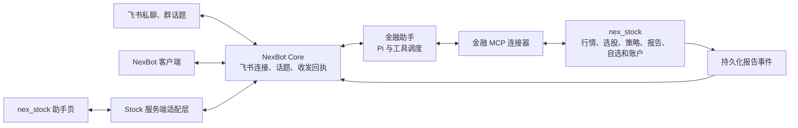

# NexBot 金融助手、飞书话题与 nex_stock 接入方案

## 实施与合并依赖（2026-11-11）

NexBot 的实现基线为 `f84e03ec`。Stock 的用户系统已合入 `origin/main` 的 `c7e4c30a`，包含 P1（`054c1ded`）、P2（`d69e664b`）、P3（`1f2bcdb5`）和多用户隔离修复（`626f43f7`）。金融助手已在这个正式基线上验证 Stock 私域数据隔离及 Stock、NexBot 两端的真实接口。

金融助手的候选分支为 NexBot 的 `codex/finance-assistant` 和 Stock 的 `codex/finance-assistant-p3`。两仓生产构建均使用各自已发布到远端的 `main` 提交。首次升级旧版 Stock 时，在启动新代码前将 `PRIMARY_USER_ID` 设置为历史数据主人的用户中心 ID；持仓、笔记和原有会话在首次迁移时即确定归属。

| 依赖 | 金融助手的接入点 | 合并时需要保持的契约 |
| --- | --- | --- |
| P1 身份与迁移 | Stock 浏览器保留现有 Cookie、Origin、CSRF 与角色校验。Core 校验服务配对和一次性交换码，按同一用户中心的 issuer、subject 定位个人工作区。 | 用户名、邮箱、群号、请求中的 user_id 均不可充当主体。旧主人的工作区和已迁移个人数据需要继续归属同一身份。 |
| P2a 个人业务 | 真实业务入口通过 `get_current_user` 读取委托对应的用户。Stock 原生入口、助手全页、侧栏和 MCP 共用这些服务。 | 自选、持仓、笔记、计划以及新旧会话的读取、修改和流式事件均按所有者判断。 |
| P2b-1 个人配置 | 触发 Stock 模型、搜索等付费业务动作时沿用发起人的设置。NexBot 推理模型与推理强度属于本人金融助手。 | 缺失的个人配置返回可诊断的结果。不要借用部署主人的私钥或凭据。 |
| P2b-2 报告与派生数据 | 工具记录按实际 HTTP 方法、路径和返回视图判定私密性。盘后归档校验市场复盘原文，回测聚合从可共享的实际源记录计算。 | 一次工具调用里读到持仓即影响报告的可见性。自定义路径和缺少来源的混合内容按私人材料处理。 |
| P3 私人调度 | Stock 按用户设置运行定时计划，使用本人的模型配置与推送渠道。NexBot 分别消费私人计划和已授权的公开群订阅。 | 普通用户缺少模型配置时，规则计划只在本人网页展示。NexBot 消费私人产物时继续验证本人委托。已获授权的公开群订阅有独立公共事件流。 |

**接线与切换。** Stock 通过 `FINANCE_CORE_URL` 启用 Web 接入，服务端配置 `FINANCE_SERVICE_TOKEN`、`FINANCE_INSTANCE_ID`、`FINANCE_CORE_ID`。Core 对应使用 `NEX_CORE_STOCK_URL`、`NEX_CORE_STOCK_TOKEN`、`NEX_CORE_STOCK_INSTANCE`、`NEX_CORE_STOCK_CORE_ID`。生产连接使用 HTTPS，私密值由部署注入。Stock 浏览器点连接后，两个端的登录都指向同一金融助手。授权支持撤销；本人仍有有效用户中心会话时，Core 可为已接受的长任务续租。

**飞书交接。** 先在 NexBot 配置原应用并确认它挂在目标金融助手。Stock 的 `FINANCE_FEISHU_MANAGED`、`FINANCE_FEISHU_APP_ID`、`FINANCE_FEISHU_TENANT_ID` 与 Core 的 `NEX_CORE_STOCK_FEISHU_APP_ID` 应指向同一个已核实的应用。由拥有该应用的工作区主人读取 `GET /api/finance/channel`，向同一路径 POST 当前 `expectedVersion`、`appId` 和新 `owner`。先将 stock 转为 paused，待旧接收器退出，再按新版本将 paused 转为 core。回切时按 core → paused → stock 执行。每次都使用最新读取的版本。保留绑定、订阅、收发回执和游标，首次绑定从当前报告水位开始。处理平台返回值未知的旧发送应先核对回执。

**投递规则。** 用户在私聊用自然语言修改，或在飞书设置中编辑。目的地、Stock 实例、报告类型、适用场景、受众、启用状态和版本作为订阅数据保存。两个群可以选择不同的报告，同一群之后可以增加类型或取消。“仅复盘”只是其中一组设置。

Stock 的“运行和推送 → 飞书”读取当前应用的持久归属。暂停和 NexBot 承接状态下，页面提供 NexBot 管理入口。管理员可用 `FINANCE_CORE_SETTINGS_URL` 指定浏览器可访问的公开地址并附上 `?settings=feishu`。未配置公开地址时，页面显示 NexBot 内的导航路径。浏览器使用的链接与服务间配对地址独立配置。

金融飞书应用所属工作区的“账号与投递”提供当前收发方、暂停、转交给 NexBot 和回切 nex_stock 的控制。NexBot Web 的 `?settings=feishu` 深链在登录后直接打开“设置 → 连接器”里的飞书卡。保持暂停时可重启承载旧 SDK 的 Stock 进程，释放它持有的真实接收租约。多账号接入前须核实 Stock 的 `PRIMARY_USER_ID` 归属。用户中心最低登录角色默认是 `admin`，需要开放普通用户的部署配置为 `USER_CENTER_REQUIRED_ROLE=user`。结果未知的飞书消息按持久回执与当前订阅核对后处理，详见[投递对账与恢复](../verification/feishu-outbox.md)。

**复验入口。** NexBot 的 `server/personal-os/stock-finance.test.ts`、`stock-history.test.ts`、`finance-topics.test.ts`、`feishu/delivery.test.ts` 和 `feishu/workspace-router.test.ts` 分别覆盖身份、历史、并发和投递。在已合并用户系统的 Stock 工作区，设置 `NEXBOT_TEST_CHECKOUT` 为 NexBot 检出目录后运行 `python -m pytest tests/test_finance_cross_service.py`，可启动两个真实本地服务并用虚构账号、模型、行情与飞书重放跨端用例。详情见各自的 `docs/verification/finance-topics.md` 和 `docs/finance-gateway.md`。

设计提案 · 2026-11-09，2026-11-10 对齐 Stock 用户系统开发分支 · 涉及 NexBot Core、各端会话界面、nex_stock Web / Desktop、金融 API 与 MCP 服务。

**一个个人工作区默认有一位金融助手。飞书连接 NexBot，nex_stock 的助手页也进入这位助手。每次“新对话”在助手名下创建一个能独立续聊的子会话。** 模型可以自行选股、跨标的查证、组合策略、发起长任务和执行主人交办的操作。nex_stock 负责提供金融事实、策略计算和业务写入，NexBot 负责会话、身份、执行和消息投递。助手身份用 `botId` 表示，子会话用 `conversationId` 表示，一次运行用 `taskId` 表示。开十个话题仍是同一位金融助手。

## 1. 两个项目已经做到哪一步

本节和第 3 节记录初版设计时的行为。当时 Stock 主线在 `2086f8c2`，用户系统分支已提交 P1，P2a、P2b-1、P2b-2 还在开发；NexBot 核对过 `7a26cdae` 和包含账号工作区的 `f84e03ec`。实际集成使用文首所列的正式合并版本。

| 位置 | 已核实的行为 | 设计决定 |
| --- | --- | --- |
| Stock 飞书通道 | 私聊普通消息各开一个话题，回复已知消息可找回原会话。先发“正在分析…”卡，完成后更新首段，长答案分卡，卡更新失败可回复新卡。推送消息也记录回链。 | 将这里的行为和测试用例移植到 NexBot 的 TypeScript 通道。继续复用 NexBot 自己的扫码、凭据保管、长连接和重连。 |
| Stock 助手页 | `/assistant` 有新对话、历史、模型与推理强度选择。股票后端还已有 `read_api_doc` 和 `call_api`，可发现和调用 Web 业务接口；对外 MCP 主要提供分析、复盘、报告和服务管理。 | 保留助手页的入口和操作习惯。扩展对外金融工具，优先复用已有接口、数据提供方和策略。 |
| NexBot 会话 | `agents.send` 按 `botId` 查找活动任务或绑定的连续对话。`newTopic` 在已有对话标记下一段 episode，有任务时还会拒绝。`assistant_topics` 整理的是长期记忆。 | 用已有 `conversations` 承载独立对话。助手收件箱展示子会话；一个主题内仍可做记忆分段。 |
| NexBot 飞书出站 | 已能把后台任务报告送回发起聊天，引用报告可直接追问该任务。普通回答按助手挑最新发布消息，长回答只有首段按来源消息回复。两话题同时完成时存在漏投或错投风险。 | 发布事件携带确切消息、话题和发件目的地。保留后台任务的直接追问，所有分段都回到同一根消息。 |
| NexBot 运行时 | Pi 已接入。主线使用 `config.reasoning ?? "off"`，之前看到的固定 `"off"` 属于较旧工作树。Core 已有 `full` 权限模式；连接器仍按显式授予的工具名检查。旧任务表里的模型与工具次数列已成为兼容字段。 | 复用模型设置、完全权限、工具搜索和取消能力。补齐金融连接器整组授权、话题范围和数据契约。无需另建 Pi 内核。 |

**切换前要先修的接收问题。** 用项目锁定的 `@larksuiteoapi/node-sdk@1.76.0`，将两份合成的 v2 事件送入真实 `EventDispatcher.invoke`。消息回调顶层有 `sender/message`，卡片回调顶层有 `operator/action`，两者都没有嵌套 `event`。NexBot 的真实传输直接转交回调，业务层却读取 `raw.event`，现有假传输又恰好提供嵌套形态。按这条路径，消息会在缺少 ID 时返回，卡片动作也会失去操作者。应在传输边界统一规范化，并让真实 SDK 分发器参加回归。这个结果来自离线回放，生产实例尚需核对部署版本。

## 2. 用户看到的会话

进入“金融助手”首先看到话题列表。每张卡对应一段独立会话，显示首问或报告标题、发言人、时间、来源、最近一至两条可见回复和“回复话题”。回复数按逻辑消息计算，分段卡、占位和流式文字共用原消息的计数。点击卡片展开全文，输入框显示正在回复哪个话题，以及回复会出现在哪里。

```text
金融助手                                           ＋ 新对话
今天的收盘复盘                  飞书 · 复盘群          3 条回复
  金融助手   收盘复盘已生成
  我         今天尾盘的变化是从什么时候开始的？

寒潮相关股票                    来自 nex_stock         2 条回复
  我         把候选的量价变化放在一起比较
```

| 用户动作 | 会话和回复归属 |
| --- | --- |
| 在 nex_stock 或 NexBot 点“新对话” | 打开私人草稿，首条消息提交成功才出现在列表。两端返回同一个 `conversationId`。从个股、持仓、板块或报告进入时带来源对象和时点。之后模型可以继续研究别的标的。 |
| 在飞书单聊主界面重新发一条消息 | 以这条消息为根创建子会话，在其话题内回复。连续发送两条不同的新问题会得到两张独立卡，上一题可以继续运行。 |
| 在飞书已有话题追问或引用机器人答案 | 续用原子会话。引用占位卡、任一分段或推送报告，效果相同。新问题不会接到恰好正在运行的另一项任务上。 |
| 群内新发一条顶层 @ 金融助手 | 建议每个新的顶层 @ 开一个子会话，后续在原话题回复。这是对 Stock 旧版“同群普通 @ 共用一个会话”的有意调整。已绑定旧根消息的回复继续走原会话。 |
| 在 NexBot / Stock 打开一个飞书群话题 | 同一账号在两端看到归入自己工作区且可见的那份记录。输入框标明“回复到〈群名〉的此话题”，助手答案按绑定返回同一话题。需要私下分析时从该条消息开本人的私人话题，仅引用允许复制的公开资料。 |
| 本地新建私人话题或定时产出报告 | 私人话题默认只在本人客户端出现。显式指定飞书目的地后，才建立投递绑定。每个交易日的新复盘使用独立根卡，追问绑定到当天那一版报告。 |

**默认身份。** 在个人工作区用稳定角色键 `finance_assistant` 绑定现有 `botId`，按工作区和主人唯一。新工作区创建一次；升级时优先使用现有、已明确绑定的金融助手。显示名可改，重复启动、更新目录或重新登录均复用同一身份。同名旧助手保留，已有的其他机器人绑定原样保留，切换只针对选定的金融应用。

> 🧠 **From Hindsight memory (Core concepts)** — Stock 已把从板块、个股或持仓带着当前对象唤起助手定义为产品入口；主线 `docs/design/core-product-spec.md` 可核对这项约定。迁移时应保留对象引用与用户看到的日期。

## 3. 数据流与职责



NexBot 写入助手消息、话题和飞书投递偏好。Stock 写入金融数据、自选、持仓和报告。用户中心模式下，一个 Stock 服务可以接多个用户，每个用户从 Stock、NexBot 或已绑定的飞书私聊进入自己的金融助手。单人桌面和旧部署继续支持 `AUTH_MODE=local`。这两种部署使用不同的账号绑定方式。

### 与 Stock 用户系统的兼容契约

| 层 | 已有契约 | 接入方式 |
| --- | --- | --- |
| 账号 | Stock 的 `get_current_user()` 将已验证 `user_session` 中的 `userId` 放入 `CurrentUser.user_id`。NexBot 的 `NexUserProvider` 将同一字段读为 `subject`。 | Stock 从服务端配置的用户中心地址确定 `issuer`，再用 `(issuer, subject)` 与 NexBot 对接。`AUTH_MODE=user_center` 对普通账号开放时，Stock 的 `USER_CENTER_REQUIRED_ROLE` 按用户系统方案设为 `user`，管理接口继续由 `require_admin` 判定。 |
| 工作区与金融数据 | NexBot 以 `--account-workspaces` 启动时，在同一服务下按 `(issuer, subject)` 选取独立 Core 数据库。各库内部的 `workspace_id` 和 `owner_user_id` 可以同为 `personal` 和 `local-owner`。Stock 按 `user_id` 分区。 | Stock 实例标识加 `(issuer, subject)` 定位 Stock 用户，NexBot 通过已有账号工作区路由定位助手。私人请求、缓存、回执和历史别名带账号范围，市场公共缓存继续共享。内部 `owner_user_id`、可见昵称、邮箱及飞书 `open_id` 不能充当 Stock 用户主键。 |
| 单人兼容 | `AUTH_MODE=local` 由 Stock 解析为 `PRIMARY_USER_ID`（默认 `local`）。用户中心的 admin 角色与部署配置的主用户各有独立含义。 | 单人实例显式配给一个已核实的 NexBot 工作区。共享实例必须走用户中心身份。一个已连接应用、一条未绑定的飞书消息或一项缺失的凭据，都不能触发主用户回退。 |
| 个人数据 | P2 工作树中的 `WatchlistService` 为主用户读写 `.env` 的 `STOCK_LIST`，为其他人读写 `user_watchlist`。持仓、计划、提醒、笔记和旧聊天均有用户归属。 | 两种自选存储由同一服务处理。金融工具走带身份的业务入口，后台任务、上下文压缩、记忆、消息流和附件沿用同一主体。公开行情和板块缓存继续共享，包含自选、账户、会话或个人检索结果的缓存按账号及受众分开。 |

**Stock Web → NexBot。** 拟在 Stock 已登录的后端增加一次性会话交换。Stock 按原有 Cookie、角色和写请求 Origin/CSRF 规则取 `CurrentUser`，为已配对的 Core 签发短时、单次、限目的服务的凭证。Core 通过已认证的服务端通道向 Stock 核销，核对 `issuer`，按 `subject` 路由，签发仅供该后端使用的短会话。只允许已验证身份触发工作区初始化。这个入口需接入账号工作区路由，不能伪造 `UpstreamSession` 或使用服务器默认 owner 的令牌。浏览器仍用现有 Stock 登录。跨端继续对话用同一 `conversationId`，所有读写仍在解析后的工作区执行。

**NexBot / 飞书 → Stock。** 拟由 Stock 在真实登录用户绑定金融连接器时登记可撤销的委托，绑定金融实例、用户中心主体和指定 Core。连接器以自己的服务凭据加短时用户凭证调用 Stock。Stock 校验目标实例、主体、委托状态和有效期，从可信结果构造 `CurrentUser`，再执行与 Web 相同的角色校验、服务和仓库查询。工具参数、URL、消息正文和普通 `X-User-Id` 请求头不能指定执行人。实例 Bearer 单独出现只证明服务身份。`401/403` 或撤销必须原样体现在本次任务中，重试不切换身份。

**飞书常驻和离线任务。** 本人打开 Stock 页面发起的工作可直接复核现有 `/v1/session`。跨浏览器会话仍需运行的私人订阅和长任务使用独立的用户委托，任务只保存委托引用。启动、恢复、执行私人工具和实际投递前，校验委托及目的地的当前版本。账号停用、角色变更需从用户中心取得可验证的新状态，`app_user` 是登录快照。已核对的用户中心会话接口需要有效 Cookie。首期可在上游会话有效时复核，失效后保留私人步骤进度并在本人入口恢复。有独立的离线账号状态查询或撤销通知并通过失效测试后，才支持脱离登录会话的私人操作。公开复盘的生成和已具备独立授权的公开分发可先行。

### 会话、任务与消息的标识

以下为**拟议增量**。沿用现有表和标识，使用同一个 `conversationId` 贯穿三个入口。

| 对象 | 改动及索引 |
| --- | --- |
| 金融助手及子会话 | `agent_inboxes` 对应助手主页。每个用户话题对应一行 `conversations`，补首问、来源、可见范围、最后活动和归档信息；现有工作区 / 主人 / 助手外键继续约束所有引用。后台任务的内部对话保留类型和发起话题引用。 |
| 输入、消息与未读 | `agent_input_receipts` 关联目标对话；幂等摘要涵盖话题或建题意图、文本、附件、来源上下文。同一请求 ID 重试返回原话题和任务，改内容或改目标返回冲突。`agent_messages` 增加可索引的展示话题 ID；保留助手全局 `seq` 做增量同步，另设每话题已读游标，按过滤后的消息计数。 |
| 运行状态 | 复用 `runtime_sessions` 和“每个 conversation 同时最多一个开放任务”的现有索引。`active`、steer、取消、重试、流式草稿和工作笔记改按对话寻址。普通追问在本话题按接收次序运行；明确补充正在执行的任务可走 steer。不同话题可并行，关闭一张卡不会取消别的卡。 |
| 飞书侧映射 | 扩展现有 `personal_feishu_messages/outbound`。使用连接器、应用/租户、chat 和外部 ID 组成唯一键。分别记根消息 ID、话题 ID、父消息 ID、所有分段 ID、方向、内部话题/消息 ID，以及可选 `reportId/jobId`。Feishu `thread_id` 和内部 `conversationId` 各自独立。 |
| 历史与删除 | `(Stock 实例, 已验证用户归属, 旧 session_id)` 唯一映射到新对话，旧消息在该映射内按原始 ID 去重。已有 NexBot 连续对话可显示为“原有对话”。归档话题收到有效回复可恢复。用户删除后保留最小去重标记，迟到事件不能复活已删正文。 |

排队输入也要有可查询的回执。现有 `agent_input_receipts.task_id` 必填，实施时需迁移为可区分“已接收待运行”和“已建任务”的记录，保存稳定消息 ID、话题内顺序及等待期间的输入引用；历史回执回填为已建任务。消费队首时在同一事务内接受任务并关联其 ID。兼容入口仍立即返回原有任务 ID。

**上下文按话题恢复。** 同一题继续使用自己的 Pi 历史、附件、工具结果、任务及压缩摘要。主人偏好、已选模型和已授权工具可共享。其他私人话题在本人明确引用或主动检索时作为带出处的资料读取。现有按 `botId` 生成的工作笔记、最近报告、记忆搜索、消息预览和附件下载都要带上话题与受众；私人对话的全文和摘要都不能成为群回复的输入。后台工作、定时任务及委托任务继承发起话题和可见范围，保留其独立执行记录。

### 客户端契约

- 复用 `POST /api/conversations` 的建会话能力。为金融助手增加幂等的“新话题首条输入”，由 Core 在一个事务内建题、落首条消息、创建任务并返回 `conversationId/messageId/taskId`。已有话题在 `POST /api/agents/input` 增加 `conversationId`。兼容旧客户端省略此字段的连续对话行为。
- 增加按助手分页的话题列表；`GET /api/agents/messages`、已读、检索、取消和编辑重试均可定向到话题。复用 `/api/events`、同步游标、断线补读和隐私重置机制。加载迟到或切换标签时，旧题结果只更新旧题的卡片与未读数。
- Stock 助手页将“新对话、继续、历史、停止、模型/推理设置”接到当前账号的 Core。旧 API 保留 `session_id` 别名、流式事件与该接口原有的不可见语义。例如读取他人旧会话与读取不存在的会话都返回 200 空结果，续聊他人会话保留 `session_not_found`。对新建话题由 Core 生成内部 ID，客户端传来的 `feishu:` 前缀不能认领旧机器人会话。助手的推理设置由该工作区反馈实际生效值。
- Web、Windows、Android、macOS 和 iOS 共用话题/未读/目标受众契约。覆盖共享 Web 和原生界面；Stock 的 Electron 壳同时验证。可从一条飞书回复打开对应 NexBot 话题，深链仍需校验当前用户是否能看这段对话。

**首个跨仓契约测试。** 下面两种请求共用 `POST /api/agents/input`。新增的可选字段由新客户端发送；认证会话在服务端决定主人身份。

| 输入情形 | 请求关键字段 | 可断言的响应 |
| --- | --- | --- |
| 从 Stock 的板块详情发起新题 | `botId, clientId, newConversation=true, text, sourceContext`；来源引用携带对象类型、稳定 ID 和所见数据版本 | 首次返回 202 和 `conversationId, messageId, taskId`。原请求重放返回相同标识；同键修改对象或正文返回 409。 |
| 从另一客户端追问同题 | `botId, conversationId, clientId, text` | 服务端校验主体与话题归属。首问仍执行时返回已入队的消息标识与状态，启动后通过同步事件补全其任务 ID；空闲时直接返回任务 ID。 |

旧客户端没有指定建题意图时沿用原接口语义。同时传入新建意图和已有话题 ID 属于无效请求。卡片读取和异步状态使用同一内部话题 ID，避免客户端按助手最近任务猜测。

## 4. 飞书接收、路由和回复

**输入时即确定目标话题。** SDK 回调先规范化消息事件和卡片事件，用经过验证的应用连接识别租户和发言人。回调中只做快速持久化；输入入账成功后才确认接收，耗时的模型和数据查询在后台执行。去重记录至少能区分待处理、已路由、已忽略及失败可恢复。进程在“已记消息、尚未建任务”之间退出时由恢复任务续办。

路由在同一已核验的应用和 chat 内依次查找：

1. 先处理显式引用。按 `parent_id`、`root_id` 查入站消息、占位卡、答案各段和报告。引用仍可交互的后台任务报告，沿用 NexBot 的直接追问 job 规则，并把回执展示在原话题。
2. 再用已绑定的 `thread_id` 或根消息别名查找子会话。新私聊根消息及新顶层群 @ 以自己的 `message_id` 建题。事务内完成别名占用和任务接受，重推或另一端同时首次回复只能命中一个话题。
3. 遇到子消息先于根消息到达，先按可信根或外部话题 ID 建临时绑定，根抵达后补齐。已经存在的两个绑定相互矛盾时做同群定向核对；核对期间暂存该事件。转发到另一群、换应用或引用无权查看的消息，按照新目的地新建上下文。
4. 新的群请求以 @ 或明确指向本机器人的可见回复触发。对已绑定话题，收到并能验证归属的追问沿用该话题。普通群的无 @ 回复是否能到达应用，取决于现有订阅和群设置；验收覆盖“能收到”和“只能通过 @ 续聊”两种情况。若需补查，使用具体话题的历史接口。[飞书话题说明](https://open.larksuite.com/document/uAjLw4CM/ukTMukTMukTM/reference/im-v1/message/thread-introduction) · [获取话题历史](https://open.feishu.cn/document/uAjLw4CM/ukTMukTMukTM/reference/im-v1/message/list)

**候场卡和答案都属于同一个话题。** 接收后尽快以 `reply_in_thread` 回复根消息，写下返回的消息 ID；默认显示“正在分析…”。完成后 PATCH 首卡，按飞书 Markdown 和 UTF-8 字节边界分段，其余分段继续回复原根。失败、取消、数据不足也要把占位卡更新到终态。卡片不能更新时以同话题回复补交已有答案；发送结果不明时先对账。每个分段收到的消息 ID 都登记回链，包括补发卡。私聊开话题以 Stock 的现有行为为基准，在目标租户、普通群和话题群分别验收。发送与回复使用应用机器人身份。[飞书消息接口](https://open.feishu.cn/document/uAjLw4CM/ukTMukTMukTM/reference/im-v1)

当前 Stock 机器人以主用户运行，NexBot 的 `personal_feishu_apps.owner_open_id` 也只绑定一位主人。迁移既有应用时，经原主人账号核实后保留这条关联。要让同一金融应用服务多个账号，凭据和长连接只在通道层持有一份。在已登录的个人工作区生成短期一次性绑定码，由本人在该应用私聊兑换，登记 `(应用, 租户, sender.open_id) → (issuer, subject)`。同一外部身份的重放、换绑、解绑按版本处理，解绑后旧卡片按钮和排队任务不能沿用旧授权。`/bind` 通知目的地与这个身份绑定各自记录。

接收器先定应用、租户和真实发言人，再按私聊绑定或群话题绑定投递到相应工作区。群根消息归入该群已配置的承接工作区，已有根只回原公开话题，一次事件只触发一次回答。两位已有账号的成员在同一群追问也沿用该公开上下文。调用记录同时保留发言人、承接话题和答复受众。未绑定成员能使用该群已开启的公开问答。涉及个人持仓、自选或设置的请求，在能够验证本人身份时转入其私人话题处理，回执也归本人。绑定了飞书的成员不会得到别人的工作区、模型密钥或持仓。

**消除“挑最后一条”带来的竞态。** Core 将已发布的 `messageId/conversationId/taskId` 和各目的地投递项在同一事务入账。投递键由目的地、逻辑消息、动作和分段组成，每段独立记录远端回执。发布顺序和网络完成顺序可以不同。遇到限流遵守服务端重试时间；遇到“服务器可能已发送但本地未记回执”，复用接口支持的幂等键或查询可核实的远端回执，无法判定的项标记为“待核实”。客户端保留完整答案与投递状态，重发从具体缺段开始。

**迁移范围还包括设置和命令。** NexBot 承接既有应用凭据或扫码注册、国内版/Lark 域名、主人绑定和群内 @ 识别。`/bind`、`/unbind` 和既有查询、复盘命令逐项对照旧行为，新版本直接修改 Core 订阅或调用金融工具；旧版 `/bind` 的“绑定通知目的地”与“绑定主人身份”必须分开。富文本、提及、长报告、图片与文件只在能力真实支持时显示为可读附件，不把“[图片]”当成已分析图片。Stock 设置页展示实际连接状态并链接 NexBot 管理页，避免重复扫码注册另一个应用。

## 5. 给模型的权限、工具和策略

在**当前用户的个人身份**下，首次初始化金融助手时写入现有 `agent_approval_settings.mode=full`。金融连接器按本账号在 Stock 可执行的全部金融业务发现和调用工具，目录随服务更新。后续尊重本人修改或撤销，连接目的地或账户变更时重建绑定。股票、题材、策略、工具组合和分析步数由模型决定。Stock 仍按真实用户执行普通业务和管理操作，NexBot 的 `full` 不会将普通账号提升为 Stock 管理员。

| 主人提出的任务 | 助手可以直接做什么 | 实现要求 |
| --- | --- | --- |
| 从某只股票转向题材，全市场寻找候选 | 搜索市场、题材、板块和公告，任意选择受数据源覆盖的标的，拉取 K 线并横向比较。 | 页面传来的股票作为证据引用。公开行情调用避开旧问股执行器和会话股票白名单，保留证券/指数身份、市场与交易所校验。 |
| 自选策略、多步查证或长时间分析 | 发现工具与策略，选择、组合或跳过策略，达到可解释的结果后回答。用户可在本题内补充、暂停或停止。 | 取消金融对话固定十轮截断。保留模型上下文容量管理、调用取消、按数据源重试/退避和可恢复长任务。连接器目录分页、数据分页和长任务续查均由实现明确返回下一步。 |
| 增删自选、维护持仓、修改订阅 | 主人明确交办后直接执行，逐项回读实际状态。普通金融操作无需重复审批或每个新标的单独授权。 | 区分自选列表与实际持仓。对修改自选的服务端读改写使用同一版本做比较更新，使两个话题同时编辑时不会丢掉另一项修改。 |
| 在群里看公开复盘、私下看账户细节 | 主人可在同一助手下完成两件事。群里已获准交流的成员可以在该群话题询问公开资料。 | 主人绑定、群发言人和回答受众分别校验。成员不会因为 @ 了金融助手就成为账户主人。需要个人资料的主人请求可在其私人话题继续；实现上群侧的模型输入、记忆、工具数据和最终投递都使用群可见范围。 |

**工具如何发现。** 保留 `broker`、`tool.search`、`connector.tools` 和 `connector.call`。系统提示简述当前金融实例、能力目录和可选策略入口，模型按需展开名称、参数、示例和返回值。用一小组稳定操作提供 OpenAPI 分层发现和业务调用，并给高频行情/选股提供批量或异步接口，避免把每个 HTTP 路由都展开成一个 MCP 顶层工具而撞上连接器目录容量。已支持的模型按真实模型能力传递推理强度，记录所选与实际生效设置，模型与网关走现有配置。金融工具和策略的中文名称、别名及适用输入要能从目录中找到。当前飞书写工具的静态说明写着“逐次批准”，应改为显示实际生效的权限，避免模型自行要求额外确认。遇到上游无法继续时，把已核实结果、待查项和可继续使用的任务引用交还用户。

**跨进程接入。** 主线 `320ad42b` 新增的 `call_api` 用 `api/internal_client.py` 绕过 HTTP 登录中间件，用户系统工作树尚无这两个文件。本次在临时源码副本叠加主线原版的这两个文件，调用实际工具处理器查询 `/api/v1/me`。用户中心模式下，普通用户从 Web 得到 200 和本人身份，同一配置经工具得到 401 `AUTH_REQUIRED`。切到 `local`，工具得到 200 和主用户 admin。另核对现有 MCP 的 Bearer 只认证管家，其出站 HTTP 客户端也没有传递用户身份。

合并时在 `nex_stock/mcp_server` 扩展业务能力，让旧 Agent 的通用调用和新远程连接器共用一条已验证主体的执行路径。复用 `read_api_doc` 的目录语义、已有金融函数及 FastAPI 业务服务。执行上下文逐请求构造，避免在缓存的应用上改全局 `dependency_overrides`。路由自带的 `require_admin`、`user_id` 过滤、用户配置和任务所有者检查继续执行。既有单人 MCP 管理工具保留原入口。多用户连接器只持有绑定用户的业务委托和工作区内的工具，部署侧密钥、服务器的 Stock 数据库路径及跨账号管理凭据留在服务端。

工具目录沿用 OpenAPI 的方法、路径、输入和错误契约。对通用 `call_api`，以实际匹配的服务端路由和返回视图附上数据归属与可见性。例如经通用工具读持仓与直接调持仓工具均产生私人证据。用这份证据标记报告、派生信号、附件和记忆，不能只检查调用日志里有没有 `get_portfolio_snapshot`。身份与受众由执行侧注入，模型只给业务参数。变更的幂等键按实例、主体、操作和 `operationId` 唯一。调用聊天避免递归，SSE 工具等待改走任务状态查询。

**模型和搜索费用归属。** Pi 聊天使用当前 NexBot 工作区本人配置的模型连接和推理档位。Stock 执行需要模型的分析时，使用 `get_user_config(user_id)` 和该用户的 Stock 用量记录。个人模型或搜索缺 Key 时遵循 Stock 已有契约，包括符合条件的共享报告复用、查看已有结果和无搜索 Key 时使用共享资讯。两端首版分别读取各自已有的凭据，只传凭据引用或能力状态；Stock 的个人设置接口返回脱敏值。首次无推理偏好且模型支持分档时可选其支持的高档，模型名称与可选档位取自本人连接。用模拟提供方核实实际参数。需线上采样时使用仓库指定测试分组。

| 金融能力 | 优先复用 | 交给助手的结果 |
| --- | --- | --- |
| 标的、行情和证据 | Stock 的行情、日线、分时、指数、板块信号、公告和新闻服务 | 证券标准身份、交易所、数值/单位、源、市场时区、交易日、数据源时间、抓取时间、粒度、覆盖状态和可引用的行标识。缺失、过期、部分覆盖都有确定表示。 |
| 策略与筛选 | `/api/v1/screening/strategies`、现有 YAML、筛选任务、回测 | 所有账号可发现策略、读取共享结果并用行情自行选股。用户系统工作树的 `POST /screening/screen` 和 `/screening/screen/tasks` 使用进程级模型与搜索凭据，仅管理员可执行。开放给普通账号的实施项是让策略运行显式接收本人配置、用量和任务归属，再开放该业务能力。回测等共享派生结果须先排除其他用户的私人报告。 |
| 自选与账户 | `/api/v1/stocks/watchlist` 及增删接口、持仓/计划服务 | 对象、操作、修改后的实际值、版本和操作回执。高频组合请求按项返回成功、失败或结果待核实，可单独恢复。 |
| 报告与长任务 | Stock 任务、状态/SSE、`HistoryService` 和收盘档案，沿用已有 MCP 工具的返回语义 | 传入请求人的 `viewer_user_id`，共享报告和本人私有报告均可读。其他人的私有 ID 按不可见处理。复用 `is_private`、`requester_user_id` 和任务所有者，详情、列表、状态、SSE 与恢复查询都作同样核对。超出等待窗口返回可续查的任务引用。 |

> 🧠 **From Hindsight memory (选股题材与交易板块联合筛选)** — 仓库曾明确将板块与题材过滤作为可配置的策略能力，并保留模型对自定义题材的匹配理由。当前 Stock 主线的 `docs/screening-engine.md` 也区分了策略过滤和候选的模型题材判断。本方案沿用这一区分。

**行情示例。** 如果 14:30 查询上证指数，拿到的行只有上一交易日的日线，工具应返回该交易日、`daily_bar` 和空的盘中时间。只有具备匹配的分时观测才能回答“14:30 跌了多少”；单个快照也不足以证实“下午翻绿”。提供来源和证据引用，并让模型决定是否再查。当前 Stock 工作树已做的部分指数时间改动，应对照接入基线确认后再纳入。

## 6. 按目的地配置投递偏好

本人用自然语言新建、查看、修改、暂停或取消订阅。NexBot 按用户中心主体、金融实例、飞书应用/租户和已绑定目的地保存配置，记录内容类型、适用场景、受众、状态和版本。每个用户只能管理自己有权投递的目的地。重启、重试和换绑时重新核对归属及当前版本。新群没有默认订阅。群可发送的公开视图与本人能读的 Stock 资料分别记录，系统内共享一份报告不等于可以向群公开发布。

“这个群只发复盘，持仓只给我看”是主人对具体目的地的一次设置示例。如果后来要求“这个群也发盘前简报”，助手更新同一群的内容类型并回读；其他群继续按各自的配置运行。只指定“每天推送复盘”时，订阅仅作用于主动推送，已有话题的普通问答仍可继续。群 ID、“仅复盘”和示例话术均不写成内核分支、默认提示词或初始化订阅。

1. **产生报告。** 保留 Stock 交易日调度和计算。报告落地后记录耐久的 `report.ready` 事件，带来源实例、报告 ID、交易日、版本、种类、所有者或共享标记、可投递视图和内容引用。对文件产物使用原子完成标记并可由归档补登记。Stock 按委托主体过滤事件及详情后，Core 才按对应账号的游标消费。共享复盘可以生成一次，个人计划须由明确的用户任务产生。当前 P2 非主用户提醒只记 `__no_channel__`，次日计划跳过个人推送。主动私人推送依赖后续按用户产出事件，可复用 P3 的用户级任务与渠道归属；Stock 对受管飞书目的地只产生事件，避免两端双发。
2. **选择与订阅匹配的内容。** Stock 主线新增的 `closing_analysis.py` 一次能返回 `market_review`、`daily_plan`、`stock_summary`。接入多用户时要把使用者带入计划查询，为共享市场复盘提供独立的公开视图。旧文件中无法证明可公开的混合内容保留在已核实所有者的私人入口。当群订阅公开复盘时，正文、图表、附件、链接预览、错误信息和后续追问都只使用经过核实的公开材料。
3. **投递并绑定话题。** Core 按报告、版本和目的地去重，临发送时重读当前订阅版本。取消或换群后尚未发送的旧投递重新评估。为每份匹配订阅的报告创建或复用该日期、报告及目标群的根卡，登记全部消息 ID、题目和报告版本；群内追问引用这份已发布的报告。补发是显式动作，绝不因重连重发整个归档。
4. **所有出口使用同一规则。** 同时接管 Stock 通知服务、次日计划的直接飞书发送、盘前/收盘调度、文件、Webhook 回退、手动测试发送和工具里的 `notify`。NexBot 日常回复、后台任务、定时任务以及通用 `feishu_write` 对该受管群的消息发送也经过同一目的地判断。群设为“仅复盘”时只出现公开复盘及允许的原话题解读；设置回执、私人分析和失败诊断进入主人的私人收件箱。凭据由连接器保管；独立于这条通道的旧凭据和发送进程须在切换前停用。
5. **一次指令包含多个动作。** 例如改复盘群、从自选删除一只股票、保留私人持仓投递。将群和允许内容作为一个版本化订阅变更；自选走 Stock 独立写入。两边使用同一请求的分项操作号。网络在写成功后中断，先回读或核对操作记录，再决定是否重试。最后逐项报告真实结果，部分成功可以从未完成项继续，无须人工重复授权。

受管模式同时作用于 Stock 服务端的启动、扫码注册、配置热重载、通用 API 和测试通知路径。桌面重启、计划任务重启或修改配置时都读取通道归属。报告订阅的内部消费游标仅在 Core 已耐久写入对应投递项后前进，重放同一事件命中原投递项；交易日无产物时展示“尚未生成”。

## 7. 迁移顺序与回滚

以这一个金融飞书应用为切换单位。同一 App 上新旧两套长连接同时开会造成事件由不同消费者领取；同一个报告同时保留旧推送和新订阅也会双发。预演使用独立测试应用，或把脱敏事件离线投给新旧两个处理器。正式应用始终只有一个接收者和一个实际发送方。

优先迁移现有飞书应用，通过服务端密钥保管机制交接凭据，核实原应用身份以及已发布的消息、回复和卡片更新权限。这样用户能继续在原机器人、原群和原话题提问。若重新扫码创建了另一个 App，旧用户标识和消息可见性需要重新核验；不能证明可回链的旧内容只作为私人历史导入。

**与用户系统并行的开发顺序。** A、B 以及公开数据契约可立刻用虚构账号开发。Stock 的账号、设置和迁移由原用户系统分支维护，金融助手复用其交付。先对齐 `get_current_user`、`WatchlistService`、用户配置、任务/报告所有者的合并版本，再接私人实数据。这样允许各模块独立验收，不必等整个 P3 才开始做话题。

| 阶段 | 交付与负责位置 | 进入下一阶段的条件 |
| --- | --- | --- |
| A · 通道基线 | 在 NexBot 修正 SDK 事件规范化，移植 Stock 的私聊开题、占位卡、原地更新、分段、引用和 FIFO 用例。建立假的行情、模型与飞书发送端；真实 SDK 保留在测试链中。 | 普通提问与卡片动作能通过实际分发器，收到、入账、回复和回链可逐条对照。 |
| B · 真子会话 | NexBot Core 增加话题身份、幂等首发、按题并发、精确发布事件和恢复投递。NexBot Web/桌面、Android 与 Apple 客户端接入话题卡、未读和定向回复。 | 同时开两个话题并反序完成、跨端切换、单题停止、原题追问均准确。旧客户端仍可用连续会话。 |
| C · 金融能力与身份贯通 | Stock 对齐 P1 + P2a 后接通双向身份交换、自选、持仓、笔记与会话。P2b-1 提供个人模型与搜索配置，P2b-2 确定任务、SSE、报告与复用的所有者。两者就绪后开放会产生私人任务和结果的付费筛选。补齐 `call_api`、收盘档案和回测派生视图的身份与可见性。 | 两位用户从相同入口研究同一证券、自选增删和查看报告，成功结果、费用、流式事件与操作回执均正确归属。公开行情可跨标的，私人接口缺少委托时返回身份错误。 |
| D · Stock 入口与历史 | Stock 助手页按当前账号对接 Core，旧会话和飞书映射按归属导入。飞书单一接收器接入账号绑定、群承接工作区与私人回复路由。 | 同一人跨端同题，两个用户相互隔离。旧会话、原根消息和已确认笔记回链。未具备按用户产出与离线授权时，非主用户仍可查自己的计划和主动发起研究。 |
| E · 切换正式应用 | 按 App/租户交接一个接收者和发送方，先切已验收的主人私聊、群话题与公开复盘。非主用户的私人定时推送在 P3 按人调度或等价的已验收事件源、可撤销离线授权和个人目的地都就绪后启用。对已有明确归属的绑定移交一次。 | 记录旧入口停发、排空、最后事件水位与新端启用水位。旧根追问、权限撤销、离线恢复、重复事件和更换订阅逐一冒烟，一份公开复盘只向同一目的地发布一次。 |

**历史导入。** Stock 首次跑用户迁移前核实 `PRIMARY_USER_ID`，保存其迁移前备份。如果已经按旧值回填，事后修改配置不会移动已有记录，需在副本上核对原主人并显式迁移归属。旧会话按 `conversation_session_states.user_id` 导入，有消息而没有状态行的旧会话按 Stock 的兼容规则归主用户。旧 `feishu:`、`feishu_` 等机器人会话同样先核实原主人；新用户绑定当天的飞书账号不能认领旧主人的记录。每个已归属的私人会话映射为一个子会话。群历史仅在报告、消息 ID 和回复链能证明归属时拆分。按账号分别核对会话、消息、笔记引用和投递数量，导入可重复，按水位追平增量。已确认的金融笔记保留 Stock 唯一主副本，旧凭据和旧授权不随内容迁移。

**回滚演练。** 新旧接收器按同一份通道归属和交接版本决定是否消费或发送。出现重复回复、归属冲突、跨受众内容或恢复投递失败时，暂停受影响的投递，保留出站账本，核对已发、未发和结果未知项。交接期间按能读取的飞书消息或话题历史补差。新话题、消息和已执行的自选、持仓操作保留。若要旧系统承接新话题，先导回其可见消息和飞书映射。监听和推送分别回切，恢复发送的一侧须能落实目的地当前的订阅与可见范围。旧库、增量日志和游标保留到回滚演练通过。

回滚也需保留用户系统版本和数据分区。旧 Stock 飞书监听以主用户运行。一个应用一旦接入其他用户，须先核实旧入口能在执行前识别并隔离其消息，才可以移交通道；做不到时保留可区分用户的接收器并暂存未处理项。Stock Web 可单独回切到已验证按人隔离的旧聊天入口。迁移前的数据库备份仅作灾难恢复，直接覆盖会丢掉切换后的业务写入。

## 8. 验收用例

表内列出开发回归和正式切换时的验收条件。开发基线曾复现内部请求返回 401 或以主用户执行。当前集成工作树的 `tests/test_finance_cross_service.py` 已启动独立的 Stock 和 Core 进程，用两个测试账号验证同题跨端续聊、飞书入站到金融工具再回复、两人的自选写入归属。私人付费筛选另用真实工作进程验证个人模型配置、用量、并发和撤销。行情、模型、用户中心和飞书外部服务使用合成响应。

正式切换仍需用测试租户验证原应用的权限、真实长连接交接和原消息回链，并在用户系统的最终合并版本上重跑回归。线上费率、实盘行情及截图中的历史分时涨跌幅需要相应来源的观测记录。回放和构建证据见 [金融助手验收记录](../verification/finance-topics.md) 及 [Stock 历史迁移验收记录](../verification/stock-history.md)。

| 场景 | 必须观察到的结果 |
| --- | --- |
| A 与 B 登录同一 Stock，各从 Stock 和 NexBot 打开助手并新建同名话题 | A 跨端看同一题，B 有自己的助手和话题。即使两个 Core 内部 owner 字符串相同，A 仍无法凭 B 的话题、任务、报告或附件 ID 读取 B 的内容。非主用户管理员读其他人的私人报告也按缺失处理。 |
| 已验证 A 的调用伪造 B 的 `user_id`、错 issuer 或错实例，或只带管家 Bearer | 业务字段无法改变执行人；伪造、失效和受众错误的凭证在写入前失败。A、B 同时调用相同工具不会串身份。非主用户缺 Key、退出会话或取消委托后，重试按该业务的状态处理，不消耗主用户的 Key。 |
| 独立调用持仓工具，或经 `call_api` 读同一持仓并生成报告 | 两条路径的报告、信号、附件和记忆都对本人可见。B 的列表、SSE、报告复用、回测及群公开视图均无法带出 A 的私有证据。 |
| 同一飞书 App 的两位已绑定用户在同群及各自私聊提问，中途一人解绑 | 群内每个输入只收到一份公开回复。各私聊使用本人的金融委托。解除绑定后旧按钮、已排队任务及私聊深链均不能再触发此人的私人操作，其他用户和群的公开订阅按各自状态继续工作。 |
| 主人从 Stock 新开两题，在飞书也新问两题 | 同一默认金融助手下有四张新卡。各入口重发相同请求、重复注册助手或同步重连，都不会多建助手、话题或任务。 |
| 第一题在研究、第二题已完成，此时回复第一题的第二段 | 输入落在第一题；两题各自的工具记录、流式内容、未读、答案和取消状态均正确。编辑重试也只作用于选定话题，并区分已经产生的业务效果。 |
| 同一根消息先到子回复、后到根，或两个 App 收到形似的外部 ID | 子回复与根最终归到一个正确话题；跨应用、跨群和跨主人均不串线。归档、删除、重启和跨设备之后继续遵守相同归属。 |
| 先聊大有能源，再问“寒潮行情有哪些候选” | 模型可读取多个标的，不触发旧股票范围错误；可从源数据说明候选理由。用超过十个模型往返的固定回放仍能总结，停止键可以随时结束本题。 |
| 14:30 查指数，分别给予当天分时、上个交易日日线、缺时点快照 | 仅第一种可据匹配的观测引用具体分钟；日线标实际交易日，缺时点说明未知。数值、市场、单位和时区在工具、聊天与报告间一致。 |
| 主人一次要求改群、删自选并仅发复盘 | 回读订阅与自选状态，保持持仓账本准确；注入第二项失败或响应丢失后，可单项恢复。哪项未完成在私人回执中可见。 |
| 主人将甲群设为仅公开复盘，将乙群设为仅盘前简报，随后给甲群增加简报、取消乙群订阅 | 初始按群分发。变更后甲群收到两类、乙群停止主动推送；排队中的旧投递按最新配置重算，重启后结果一致。仅配置主动推送时，普通问答仍可继续。 |
| 某群明确设为仅复盘、持仓仅本人可见，同时产生持仓计划和公开复盘 | 群只收到一份公开产物，正文、卡片摘要、附件和群内追问都不含私人数据。测试成员伪造主人、换 chat、通用飞书工具另发、旧 Webhook 回退和定时任务，均无法绕开该目的地规则。 |
| 两个话题同时完成；在建题、接受任务、飞书返回、卡片更新和第三段发送处分别模拟崩溃 | 恢复后有唯一目标话题；已知已发的段不重发，未发段可继续，结果未知的操作可核对。后台 job 报告、直接追问和审批/停止按钮仍属于原 job。 |
| 升级、回滚并重复导入 | 历史条数和抽样内容吻合；旧会话可读、已完成写操作不重放、群订阅不被回滚为更宽的内容范围。模拟接收/发送双开时能检测并阻止切换。 |

真实外部验收使用专用测试群、测试账号及合成持仓；涉及真实行情按仓库规则先查已有样本，每个必要接口最多一次最小采样。真实模型验证使用仓库指定的测试分组。记录从消息入库到首卡、工具完成到末段回执的耗时，以及重复、漏投、路由冲突和结果未知项；用同一套回放与 Stock 现有体验对比。日志仅保留关联号、动作、耗时和状态，截图使用脱敏测试数据并留在验收附件中。

## 9. 实施时的代码定位

文件名以仓库相对路径表示。切换前应使用当时的主线与实际部署记录核对，避免把旧开发分支当成运行版本。

| 仓库及版本 | 先看这些文件 |
| --- | --- |
| `nex_stock@2086f8c2` | `bot/platforms/feishu_stream.py`、`src/services/feishu_binding_service.py`、`src/services/feishu_assistant_service.py`、`src/repositories/feishu_binding_repo.py`、`tests/test_feishu_assistant.py`、`docs/bot/feishu-bot-config.md` |
| 同上，业务与客户端 | `apps/dsa-web/src/pages/plan/AssistantPage.tsx`、`src/agent/tools/api_tools.py`、`api/internal_client.py`、`api/v1/endpoints/stocks.py`、`api/v1/endpoints/closing_analysis.py`、`src/services/daily_plan_push.py`、`src/notification_sender/feishu_sender.py`、`mcp_server/tools.py` |
| `nex_bot@7a26cdae` | `server/personal-os/feishu/{transport,module,api}.ts`、`server/personal-os/feishu.test.ts`、`server/personal-os/agents.ts`、`server/personal-os/schema.sql`、`server/personal-os/agent-schema.sql`、`server/personal-os/continuity-schema.ts`、`server/personal-os/episodes.ts`、`server/personal-os/jobs.ts` |
| 同上，权限与客户端 | `server/personal-os/{worker,policy,connectors,tool-catalog,index,sync}.ts`、`src/personal/`、`apps/apple/`、`android/`、`docs/verification/README.md` |
| `nex_stock` 用户系统 `054c1ded` 及其工作树增量 | `docs/design/multi-user.md` 第 14–17 节、`api/deps.py`、`api/middlewares/auth.py`、`src/user_center_auth.py`、`src/storage_multi_user_migration.py`、`src/services/{watchlist_service,user_config_service,agent_chat_session_service,report_reuse_service}.py`、`src/agent/tools/registry.py`、`src/core/pipeline.py`、`api/v1/endpoints/{me,agent,screening,history}.py`、`mcp_server/api_client.py` |
| 对接时复用的离线证据 | Stock `tests/test_{multi_user_identity,watchlist_user_isolation,agent_tools_user_scope,agent_chat_user_isolation,multi_user_p2b2_privacy,multi_user_p2b_model_keys}.py`；NexBot `f84e03ec` 的 `server/personal-os/{identity-provider,identity,workspaces,workspaces.test,store}.ts` 和 `server/personal-os/feishu/{module,feishu-schema}.ts` |
