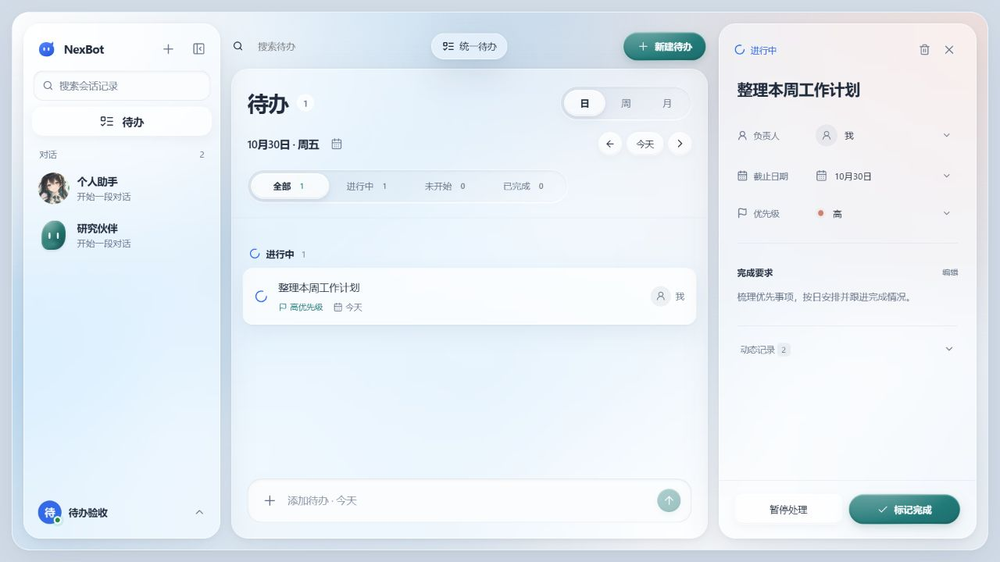

# 统一待办：全平台发布（2026-10-30）

版本：Windows 0.9.21；Android 0.2.20（220）；Mac / iOS 0.2.15（17）。
发布标签：`nexbot-v0.9.21-preview.1`。

## 范围

统一待办支持日、周、月视角，全部、进行中、未开始、已完成筛选；自定义输入框、选择器和日历保持现有玻璃风格。支持个人推进、AI 执行与停止、步骤、验收和再次打开。数据存于 Core SQLite，通过版本检查防止跨端覆盖，迁移 38 只新增待办表和触发器，保留主分支的定时任务迁移 36–37。

初始实现和隔离验证见[待办验证记录](todos.md)。

## 合并后验证

前后端类型检查、Core/Web 构建通过。待办、日历、账号传输及 app 回归 57 项通过、1 项跳过。定时任务兼容性、Web 和文档检查 41 项通过：旧迁移夹具改为只回退它负责的迁移 36–37，避免误删新增待办迁移收据；文档测试路径已补全。实际构建的隔离 Core 验证了待办重启持久化、409 冲突、AI 幂等执行和交付，以及定时子任务隔离、删除和历史结果。

## 发布进度

Core、Web 和全部安装包来自已推送 main 提交 `37a10eb0b30d8ae8a87133420a7e550306c8a9ff`。推送前重新 fetch 并合入定时任务发布记录；全项目 lint、前后端类型检查和十种语言目录校验通过。GitHub 预览版已发布，六个上传文件的大小和 SHA-256 与本地一致。OSS 已完成 dry-run、私有旧清单备份、四个安装包上传与摘要复核，发布清单已更新。四个平台均通过旧版本获得更新、当前版本无更新以及实际下载文件大小和 SHA-256 校验。浏览器读取官网渲染后的四张下载卡片，确认版本为 0.9.21 / 0.2.20 / 0.2.15 / 0.2.15，链接指向本次发布文件，与 README 一致。

## Core 与网页

- 已上线 `/data/nexbot/releases/main-37a10eb0-20261030`，使用最后排序的 33 个 z 前缀 drop-in。备份为 `/data/nexbot/backups/main-37a10eb0-20261030-pre`，保留数据、配置和 systemd；脚本配置自动回滚。
- 六个生产库以只读连接生成一致副本，仅对副本打开实际构建的 Store；迁移 37 → 38、完整性、外键和逐表行哈希通过。
- 部署前和停机后重复确认无活动任务；停机迁移后的原有行哈希一致，新增待办三表为空，既有迁移记录、其他数据文件和配置哈希不变。仅排除生成型同步游标及每次打开都会轮换的 desktop-owner 引导令牌/过期字段。
- 公网 health 200，未登录 Todo 和其他受保护 API 返回 401；首页及全部七个构建资源字节与发布包一致，动态 HTML 预览与同构建的隔离 Core 一致。
- 发布提交的浏览器隔离夹具再次验证了新建表单、自定义优先级、个人开始处理和刷新后恢复，日/周视角及详情显示正常。所有交互均使用合成账号；生产环境只做未登录读取。

## 安装包

| 文件 | 字节数 | SHA-256 |
| --- | ---: | --- |
| NexBot-0.2.15-ios-unsigned.ipa | 11296679 | `689da983cf44e79a1c979689b15533c45b917e19c400144165aa4fcaf93d10b7` |
| NexBot-0.2.15-mac-arm64.dmg | 76859287 | `fcb432caf3c7537621d6466243e22ea20f8e6691656c8cd749a7bd073d33cf29` |
| nexbot-0.2.20-debug.apk | 19965523 | `8f441ba00b139e37ad545f681a2737ace364ff091ca8cf94143f845a743c9e22` |
| NexBot-0.9.21-x64-Client-Portable.exe | 176218466 | `054a3a6e985475fc7ff916d69c17829e2a7288b9e365fa0ec6f87a6367527c80` |

- Windows：精确 EXE 的版本 0.9.21，20 项单账号登录与 24 项账号工作区检查通过。
- Android：82 项测试通过，APK 0.2.20 / 220；签名验证通过，与已发布旧版证书一致（`af012179efbcda655934c0a2400ad76a8ac32ac81598b4f4f3bd633b9073cb4b`）。首次构建因 Windows JDK Unix socket 临时路径报错，给该构建设置独立短路径后通过，未更改系统配置。
- Apple：Mac 上全新克隆已推送 main 提交，专用模拟器；180 项 NexClientKit 测试与 Mac/iOS 各 11 项渲染测试通过。Mac Release、iOS Simulator 和 iPhone Release 构建通过；DMG/IPA 版本 0.2.15 / 17、Mac 签名与包内容验证通过，传回文件哈希一致。专用模拟器及克隆目录已清理。
- 构建保留既有大 chunk 提示。Apple Todo 已通过编译和协议/日历测试，尚无专门的原生 Todo 全流程交互测试；未做真实设备覆盖安装或生产并发负载测试。

原始日志与校验文件保存在忽略目录 `release/deployment-todos/`、`release/ship-0.9.21/` 和 release 下的 Todo 验证日志。

## 安装限制

Windows 尚无发布者签名；Android 使用本机调试证书；Mac 临时签名、未公证；iOS IPA 未签名，需自行签名安装。验证仅使用临时数据与合成账号，不向生产会话发送测试任务。
